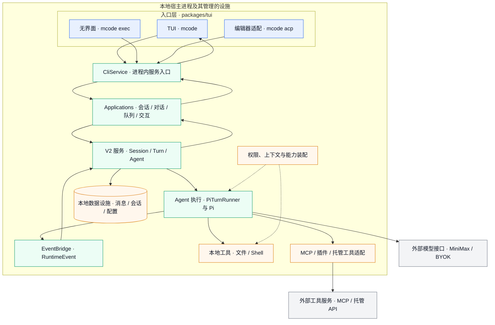
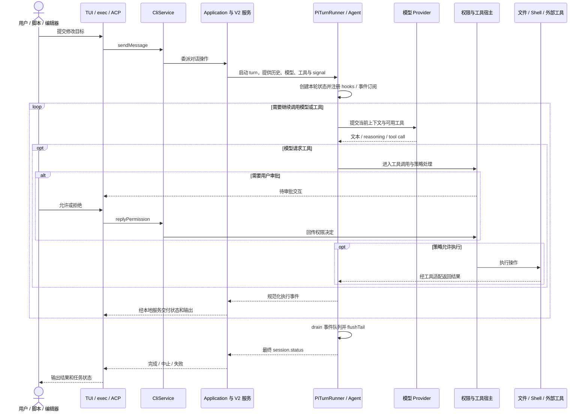
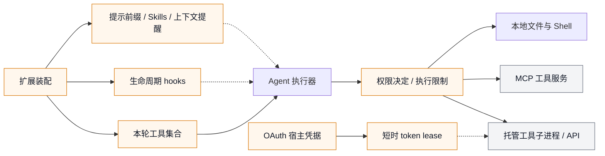

# minimax-code 项目架构介绍

minimax-code 的核心是一个**在本地进程中编排编码任务的 Agent 运行时**。TUI、无界面 CLI 和 ACP 共用应用服务；应用服务管理会话和任务，再由 Agent 执行器调用模型与工具。模型服务可以位于远端，但文件、Shell、权限和会话设施由本地宿主负责。

核查日期：2026-10-12。基于 [main 快照 cee0791](https://github.com/MiniMax-AI/minimax-code/tree/cee079138600224e9ad4d8b954c4a4ed549e15b6)，与[仓库总览](仓库总览.md)使用同一基线。本文阅读了架构文档、CliService、PiTurnRunner、扩展工厂及部分组合入口，未运行项目或调用在线服务。图为逻辑架构，不是完整函数调用图。

## 1. 总体架构：入口、编排、执行与外部依赖

**图例**：蓝色为用户入口，绿色为编排与执行，橙色为宿主设施，灰色为外部服务；实线表示主要逻辑调用或数据交付，虚线表示策略/能力参与。外部模型与工具节点省略响应箭头；事件路径合并了不同入口的适配，实际 exec 和 ACP 也有各自输出。

CliService 通过方法调用本地 Applications。源码明确说明这一入口没有 HTTP / RPC envelope，因此图中的层次不代表必须部署多套服务器。用户登录与远端服务认证仍然存在，但不是 CliService 的网络传输层。来源：[docs/architecture.md](https://github.com/MiniMax-AI/minimax-code/blob/cee079138600224e9ad4d8b954c4a4ed549e15b6/docs/architecture.md)、[packages/local-runtime-v2/src/local/cli-service.ts](https://github.com/MiniMax-AI/minimax-code/blob/cee079138600224e9ad4d8b954c4a4ed549e15b6/packages/local-runtime-v2/src/local/cli-service.ts)。

## 2. 各层分别解决什么问题

| 层次 | 核心职责 | 主要源码位置 |
| --- | --- | --- |
| 入口与展示 | 接收任务，展示输出、状态和交互；转换编辑器协议 | `packages/tui/src/tui/`、`headless/`、`acp/`、`cli/` |
| 本地服务门面 | 提供会话查询、发送消息、恢复、中止与审批等统一入口 | `packages/local-runtime-v2/src/local/cli-service.ts` |
| Application | 将用户操作组合成对话、会话、队列和交互流程 | `packages/local-runtime-v2/src/application/` |
| 领域服务 | 会话、Turn、Agent 等运行状态及相关持久化协作 | `packages/local-runtime-v2/src/service/` |
| Agent 执行 | 组装模型、历史、工具与 hooks，驱动一轮执行并输出事件 | `packages/agent-core/src/pi-turn-runner/` |
| 扩展与模块 | 注册工具、生命周期 hook、提示前缀、提醒与上下文能力 | `packages/agent-runtime/`、`agent-extension/`、`agent-modules/` |
| 宿主基础设施 | 文件、权限、存储、模型适配及其他复用设施 | `packages/local-runtime/` |
| 协议与配置 | 本地接口契约、RuntimeEvent、Agent 配置与共享类型 | `packages/protocol/`、`config/`、`shared/` |

`packages/agent-modules/` 中可见 context-manager、permission、mcp、skills、plugin-hooks、goal 和 background-task 等模块。**目录存在不等于每个入口都默认启用该能力**，需要继续查组合入口、配置与工具清单。

这里有两个容易混淆的边界：

- V2 的 Applications 和 services 负责当前本地产品流程；`local-runtime` 仍提供复用设施。不能仅凭旧目录名推断当前执行器。
- `agent-runtime` 负责扩展契约与装配辅助；`agent-core` 中的 PiTurnRunner 负责具体 turn 执行。两者不宜写成“两个独立 Agent 服务”。

来源：[docs/architecture.md](https://github.com/MiniMax-AI/minimax-code/blob/cee079138600224e9ad4d8b954c4a4ed549e15b6/docs/architecture.md)、[packages/agent-runtime/src/factories.ts](https://github.com/MiniMax-AI/minimax-code/blob/cee079138600224e9ad4d8b954c4a4ed549e15b6/packages/agent-runtime/src/factories.ts)及[模块树](https://github.com/MiniMax-AI/minimax-code/tree/cee079138600224e9ad4d8b954c4a4ed549e15b6/packages)。

## 3. 一次编码任务如何执行

下面以“修改代码并运行测试”为例。图中的权限检查和工具结果回传是概念流程；不同工具、权限模式、hooks 和 API 适配的具体顺序可能不同，不能将它作为所有路径逐函数执行顺序。

这里的 **Session** 是承载历史、配置与状态的会话；**turn** 是一次执行范围，可能包含多次模型请求和工具执行。工具调用并不意味着任务结束，结果还会进入后续模型上下文。

CliService 的 `sendMessage` 实际委派给 conversation application；`abortSession` 和 `resumeSession` 也由该层处理。`replyPermission` 将交互决定转换为 `allowOnce`、`allowAlways` 或 `deny` 并交给权限设施。来源：[packages/local-runtime-v2/src/local/cli-service.ts](https://github.com/MiniMax-AI/minimax-code/blob/cee079138600224e9ad4d8b954c4a4ed549e15b6/packages/local-runtime-v2/src/local/cli-service.ts)。

### PiTurnRunner 中已确认的关键行为

- 每次 `runTurn` 新建本轮 Agent、EventBridge、事件队列和历史 cursor；Runner 实例只持有进程级默认配置，避免将上一轮状态直接复用到下一轮。
- 工具 hooks 包装工具执行；LLM hooks 包装模型调用，并与历史 cursor 协作处理上下文变化。
- AgentEvent 经单个串行队列转换和交付 RuntimeEvent。工具调用可能并行完成，事件队列用于维持交付顺序。
- 执行前已取消时不启动 Agent；执行中取消通过 `agent.abort()` 转发。
- 正常停止后等待事件队列排空，再补刷历史尾部并发出最终状态；中止/错误具有单独的 termination reason。

这些步骤直接来自 [packages/agent-core/src/pi-turn-runner/pi-turn-runner.ts](https://github.com/MiniMax-AI/minimax-code/blob/cee079138600224e9ad4d8b954c4a4ed549e15b6/packages/agent-core/src/pi-turn-runner/pi-turn-runner.ts)。因此，排查“工具完成但 UI 仍显示运行”“取消后历史缺项”等问题时，不能只看终端渲染，还要检查事件收尾和历史同步。

## 4. 工具、权限与账号如何协作

**图例**：实线表示能力装配或调用的概念路径，虚线表示上下文、hook 或凭据供给。权限节点概括工具执行策略，不表示每一种工具都使用同一沙箱，也不表示 MCP 服务器或远端 API 的内部执行受本地沙箱约束。

扩展工厂支持工具注册、hook、系统/用户提示前缀和提醒 provider。这使能力可参与执行而不必全部写进 Runner。Skills 通常提供指令/资源；MCP 提供工具协议；插件可以组合多类能力，三者职责不同。源码入口：[packages/agent-runtime/src/factories.ts](https://github.com/MiniMax-AI/minimax-code/blob/cee079138600224e9ad4d8b954c4a4ed549e15b6/packages/agent-runtime/src/factories.ts)。

托管工具认证存在单独的宿主边界：OAuth Core 管理凭据与刷新，mcode-tools-host 通过本地 lease broker 为工具子进程提供短时 access token；架构文档说明 refresh token 由宿主持有。**模型 Provider 的 BYOK key 与托管工具所需的账号授权应分别理解**。来源：[docs/architecture.md](https://github.com/MiniMax-AI/minimax-code/blob/cee079138600224e9ad4d8b954c4a4ed549e15b6/docs/architecture.md)、[docs/open-source-status.md](https://github.com/MiniMax-AI/minimax-code/blob/cee079138600224e9ad4d8b954c4a4ed549e15b6/docs/open-source-status.md)。

## 5. 为什么要这样分层

以下是基于已读结构的解释，不是上游已发表的架构决策记录。

| 结构 | 带来的作用 | 理解与排查时的代价 |
| --- | --- | --- |
| 多入口共用本地 Application | TUI、exec 和 ACP 可复用会话与执行流程 | 仍需分别检查各入口的交互、输出与协议适配 |
| Session / turn 与展示分离 | 会话恢复、取消和消息队列不必依赖某个终端面板 | 一个状态错误可能跨越服务、事件和展示多个层次 |
| 扩展注册工具与 hooks | 上下文、权限、MCP 和 Skills 可在装配阶段参与 | 需要核对“能力存在”“已装配”“本轮可用”的区别 |
| 串行交付事件 | 并行工具产生的事件具有明确交付路径 | 正确收尾必须等待事件 drain 和历史 flush |
| 本地宿主接入远端能力 | 保持文件操作和产品流程本地化，支持不同模型服务 | 网络失败、凭据失效和额度限制仍会影响任务 |

## 6. 按问题定位源码

| 现象或变更 | 优先阅读位置 | 下一步核对 |
| --- | --- | --- |
| TUI、exec、ACP 行为不一致 | `packages/tui/src/` 对应入口 | CliService 输入、流式结果与退出状态 |
| 恢复/中止/排队后状态异常 | V2 `application/conversation/`、`application/session/` | Session / Turn 服务与持久化 |
| tool call 丢失、历史错配、流式重复 | `agent-core/src/pi-turn-runner/` | EventBridge、工具 hooks 与 history cursor |
| 权限决定或 Shell 行为变化 | `agent-modules/permission/`、宿主 permissions 和工具实现 | 实际权限模式、沙箱与执行入口 |
| MCP / 插件工具不可见 | agent-runtime 装配、agent-tools 与 MCP 模块 | 配置、启用状态、本轮 schema 与认证 |
| 模型兼容、超时或重试 | Runner 模型 hooks、model-provider 与 TUI provider | 最终请求格式、模型限额及终止状态 |
| 托管工具认证失败 | oauth-core、oauth-lease-protocol、mcode-tools-host | host 凭据与 lease 边界 |
| 源码版本与发布能力不一致 | package.json、release、构建脚本与 source-status | 合并提交、发布产物和文档日期 |

公开源码不包含完整桌面产品和云执行器。出现桌面专属故障时，本次阅读无法确认其内部调用链；不能把本地 CLI 架构图直接当作桌面端实现。

版本差异也需保留：该快照根包与 TUI 声明为 **0.6.5**，部分文档仍描述 **0.4.12**。本介绍依据所读源码说明职责，不宣称旧文档中的在线验收自动适用于当前版本。详见[总览的版本信息](仓库总览.md#当前版本信息与证据差异)。

## 7. 后续架构变更记录重点

每期优先回答：变更发生在哪一层，影响哪些入口，调用或事件契约是否变化，是否改变会话/工具执行状态，原配置是否需要调整。只在最终代码确实改变架构关系时更新上述图，不将新目录、Issue 或设计提案直接画成已落地能力。
