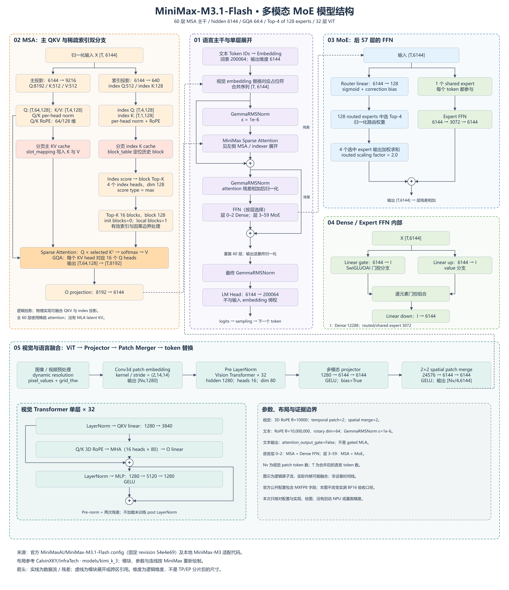

# MiniMax-M3.1-Flash：模型结构与 A5 开箱验证

整理日期：2026-11-03。测试记录主要来自 2026-10-26～29；此次归档不表示重跑模型。保留本目录原有的 [结构与前向张量形状分析](model_analyze.md)。

## 入口

- [详细架构图：完整层级、入参及张量流转](architecture/minimax-m31-detailed-architecture.png) · [可编辑 SVG](architecture/minimax-m31-detailed-architecture.svg) · [分区放大阅读](architecture/detailed/README.md)。同构层只展开一次，包含 MSA、Dense/MoE、ViT、视觉融合及 decode 缓存更新。
- [模型结构说明与完整参数表](architecture/README.md)：主干、MSA/indexer、残差、专家及视觉融合。
- [逐步张量 shape 与数值流转详解](model_analyze.md)：输入接口、QKV/indexer、MoE 分发回收、prefill/decode 算例、视觉 patch、KV 分页、TP/EP 与量化存储；附固定版本配置和官方权重 header 抽样。
- [高清模型图 4800×5560](architecture/minimax-m31-full-architecture.png) · [可编辑 SVG](architecture/minimax-m31-full-architecture.svg)。
- [全层测试：服务启动、测试命令、结果及边界](full/README.md)。
- [验证详单：逐轮比较、显存与失败诊断](full/VALIDATION_DETAILS.md)。
- [减层 RL：当前证据状态和补验清单](reduced/README.md)。
- [历史自动化命令（凭据已脱敏）](full/commands/historical-commands.txt)。
- [归档校验清单](SHA256SUMS) · [检查记录](validation.json)。

## 当前结果

| 范围 | 项目 | 结论 |
| --- | --- | --- |
| 全层 | AIME2026 三轮 | 28/30、29/30、28/30；均 30/30 请求完成，平均 94.44% |
| 全层 | 基线文本/图文、路由捕获、SP、双机 PP | 功能通过；路由训练端 replay 未验证 |
| 全层 | Sleep Level 2 / 同 checkpoint 恢复 | 关闭 prefix cache，三轮恢复前后 60/60 文本、token、logprob 精确一致；两项共用恢复证据 |
| 全层 | Sleep Level 1 | 失败：CPU pinned memory 分配 207001；尚未完成 wake |
| 全层 | NPU IPC 权重更新 | 失败：接收端 clone NPU OOM；更新未完成 |
| 全层 | HCCL 权重更新 | 阻塞：推理占用 16 卡，缺独立 producer NPU |
| 全层 | DCP / PCP | 当前 sparse backend 不支持 |
| 减层 | RL 功能验证 | **未找到可核验记录，不标为通过** |

全层权重为本地 MiniMax-M3.1-Flash-BF16，语言主干 60 层。公开 HF 配置用于结构补充，包含量化配置，不与本次 BF16 实测资产混同。图文首次/后续请求差异在任何 RL 操作之前已存在，不据此将 Level 2 恢复判为失败；不同权重切换、独立 awake 热更新仍未验收。

目录中的 Python/Bash 复现入口经过离线整理；没有在归档后的目录布局中重新执行 NPU 验证。压缩 JSON 保存原始结果内容；历史绝对路径是当时运行位置。原始设备 trace、权重和镜像未上传，位置及范围在全层报告记录。未上传密码、私钥或 API key。
