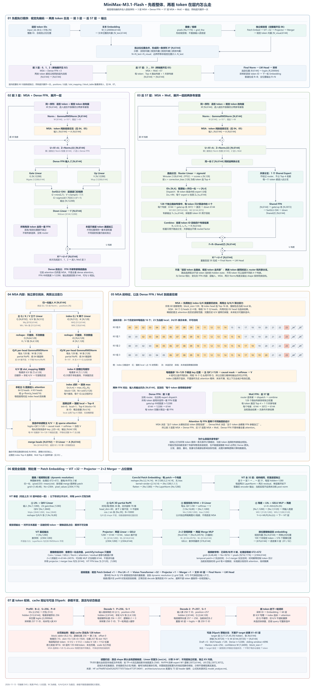
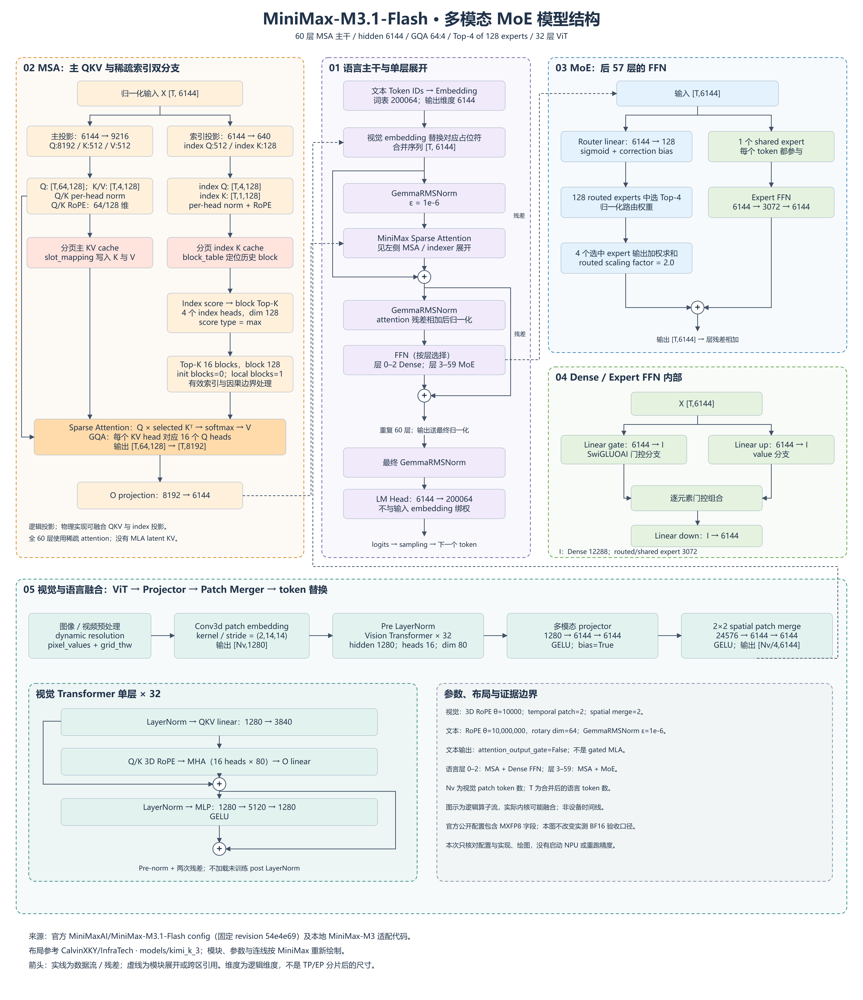

# MiniMax-M3.1-Flash 模型结构

MiniMax-M3.1-Flash 是包含视觉编码器的自回归 MoE 语言模型。文本主干共 60 层，所有层使用 MiniMax Sparse Attention（MSA）；前 3 层采用 Dense FFN，后 57 层采用 128 专家、每 token 选择 4 个路由专家及 1 个共享专家的 MoE。图示按官方模型配置和本工作区适配实现整理，不以硬件 profiling 反推模型结构。

## 详细版：全层级、入参、Shape 与内部流转

[完整高清 PNG（5400×11805）](minimax-m31-detailed-architecture.png) · [可编辑 SVG，可无限放大](minimax-m31-detailed-architecture.svg) · [七张分区图逐一阅读](detailed/README.md) · [详细版绘图源码](draw_detailed.py) · [整体与两类层布局](detailed_sections.py)

2026-11-13 版先讲整体执行顺序，再分别展开前 3 层、后 57 层、MSA 及独立视觉塔。同构层只展开一次，各层权重与缓存内容独立。语言与视觉向量合并后一起进入主干；MoE 图明确画出路由分支、共享分支及两次汇合。MSA 增加四组历史块的 Top-16 选取示意，并将“稀疏 attention”与“专家稀疏 FFN”区分。原始总览图保留如下。

## 整体架构

[高清 PNG](minimax-m31-full-architecture.png) · [可编辑 SVG](minimax-m31-full-architecture.svg) · [绘图源码](draw.py)

图从上向下阅读：中间为语言主干与单层残差结构，左侧展开主 QKV 和 index Q/K 两条分支，右侧展开路由专家、共享专家及 FFN；下方是视觉编码器、projector、patch merger 和多模态合并。实线表示数据流，虚线表示侧面展开或跨区域引用。

## 配合结构图阅读张量变化

[逐步 shape 与数值流转详解](../model_analyze.md)于 2026-11-12 补全，按官方固定版本配置、权重 header 及本工作区实现核对；包含以下内容：

| 图中区域 | 详解内容 |
| --- | --- |
| 01 语言主干 | 输入 ID、位置、mask 与 embedding；Gemma RMSNorm；两次残差；完整 prefill/decode 算例 |
| 02 MSA 双分支 | 主 Q/K/V 与 index Q/K 的 shape；partial RoPE 数值公式；按块 max、Top-K、GQA 与 softmax；KV cache 写入和分页寻址 |
| 03 MoE / 04 FFN | sigmoid 与 correction bias；路由权重；专家 dispatch/combine；SwiGLU-OAI 的准确截断和数值例子 |
| 05 视觉融合 | 像素、patch、3D RoPE、ViT、projector、2×2 merger、占位符替换；672×672 图像与视频例子 |
| 运行时与额外分支 | TP/EP 分片、MXFP8/NVFP4 的文件存储 shape、DSpark 草稿配置与来源边界 |

参数权重、激活张量和 KV cache 状态分别解释；所有教学数值均与实际模型激活区分。配置快照与官方 header 抽样在 [sources](sources/README.md)，原结构图仍保留其原始绘图版本记录。

## 主要参数

| 模块 | 参数 | 值 |
| --- | --- | --- |
| 语言 | Transformer 层 / hidden size | 60 / 6144 |
| 语言 | Dense FFN / MoE FFN 层 | 3 / 57，层号从 0 开始 |
| Attention | Q heads / KV heads / head dim | 64 / 4 / 128 |
| Attention | Q / K / V 投影逻辑宽度 | 8192 / 512 / 512 |
| Attention | QK normalization | per-head Gemma RMSNorm |
| Attention | RoPE θ / rotary dim | 10000000 / 64（head dim 的一半） |
| Indexer | index heads / index dim | 4 / 128 |
| Indexer | index Q / index K 投影宽度 | 512 / 128 |
| Indexer | block size / Top-K blocks | 128 / 16 |
| Indexer | score type / init blocks / local blocks | max / 0 / 1 |
| Dense FFN | intermediate size | 12288 |
| MoE | routed experts / Top-K / shared experts | 128 / 4 / 1 |
| MoE | routed / shared intermediate size | 3072 / 3072 |
| MoE | router / routed scaling factor | sigmoid、correction bias / 2.0 |
| FFN | 激活 | SwiGLUOAI，alpha=1.702，limit=7.0 |
| 文本 | vocab size / 最大位置 | 200064 / 1048576 |
| 文本 | 输入与输出 embedding 绑权 | False |
| 视觉 | 层 / hidden / MLP intermediate | 32 / 1280 / 5120 |
| 视觉 | heads / head dim | 16 / 80 |
| 视觉 | 空间 patch / 时间 patch | 14×14 / 2 |
| 视觉 | RoPE / θ | 3D / 10000 |
| 视觉 | 归一化 / 激活 | LayerNorm，epsilon=1e-5 / GELU |
| 融合 | projector | 1280 → 6144 → 6144，GELU |
| 融合 | spatial merge / merge MLP | 2×2 / 24576 → 6144 → 6144，GELU |

投影宽度由配置乘积推导，例如 Q=64×128=8192，K/V=4×128=512。它们是全模型逻辑宽度，不能直接当作单个 TP rank 的张量形状。

## 语言模块

### 单层前向与残差

每层先对输入做 GemmaRMSNorm，再执行 MSA，attention 输出与层输入残差相加。之后进行第二次 GemmaRMSNorm，进入 Dense FFN 或 MoE，输出再与 attention 后的隐藏状态残差相加。代码使用融合 residual/norm 接口保存残差，图中将其展开成等价逻辑关系；不存在 Kimi 的 AttnRes 或 latent MoE。

### 主 attention 与稀疏索引

主分支将隐藏状态投影为 Q、K、V，Q/K 做 per-head normalization 和部分维度 RoPE。K/V 按 slot mapping 写入分页缓存。GQA 的 64 个 Q head 共享 4 个 KV head，即每组 16 个 Q head 对应一个 KV head。

并行的 indexer 分支生成 4 个 index Q head 和 1 个 index K head，head dim 均为 128，独立执行 normalization 与 RoPE，并维护 index K cache。索引打分以 block 为单位产生候选，结合 Top-K、local block 和因果边界，输出供稀疏 attention 使用的索引。`sparse_disable_index_value` 在配置中全为 1；图只展示 index Q/K，不画独立的 index V 通路。

稀疏 attention 根据 Q、主 KV cache、block table 和所选索引计算输出，再经 O projection 将 8192 映射回 6144。Top-K=16 是配置参数，不能直接解释为所有请求都恰好访问 2048 个有效历史 token：实际有效范围还取决于序列长度、局部 block、掩码及索引处理。

### 专家 FFN

Router 将输入映射到 128 维 logits，以 sigmoid、correction bias 和 Top-4 路由选择专家。选中专家输出按权重聚合，routed scaling factor 为 2.0，再与共享专家分支组合。共享专家对每个 token 参与计算，不属于 Top-4 中的一个。

Dense FFN 与专家使用两路 gate/up 投影、SwiGLUOAI 门控组合和 down projection。Dense 的中间维度为 12288；路由及共享专家中间维度为 3072。SwiGLUOAI 的具体 clamp、偏移和融合细节以实现为准，图中没有用普通 SiLU 公式替代它。

## 视觉模块与多模态融合

处理器按 dynamic resolution 策略产生 pixel values 和 grid 信息。视觉 patch embedding 使用 Conv3d，空间 patch=14、时间 patch=2，嵌入宽度为 1280。官方 `image_size=672` 是配置值，不代表所有实际输入都固定为 672×672。

视觉塔先做 LayerNorm，然后执行 32 层 pre-norm Transformer：QKV 投影、Q/K 的 3D RoPE、16-head MHA、输出投影和残差，再经 LayerNorm、1280→5120→1280 的 GELU MLP 和残差。head dim=1280/16=80；3D RoPE 的具体维度分配以实现为准，不假设全 80 维都旋转。

本地实现的顺序是 **ViT → 两层 projector → 2×2 patch merger**：projector 将 1280 映射到 6144；merger 将相邻 4 个视觉 token 的文本宽度特征拼接为 24576，再通过两层 MLP 输出 6144。它不是先在 1280 维空间做 merge 后才投影。最终视觉 embedding 按图像/视频占位符合并到语言序列，不是另一路 cross attention。

本地视觉实现使用最后一层 encoder hidden state，不应用未随 checkpoint 提供权重的 post LayerNorm。此项依据实现注释；不应据此推断任意同名模型版本都没有 post norm。

## 配置、实现与实测范围

- 官方结构参数固定参考 [config revision 54e4e69dfc452b1e94a426c24a4fdeeaa8e3ad5e](https://huggingface.co/MiniMaxAI/MiniMax-M3.1-Flash/blob/54e4e69dfc452b1e94a426c24a4fdeeaa8e3ad5e/config.json)。该公开配置包含 MXFP8 量化字段；它与历史实测 BF16 权重不是已做逐文件校验的同一份资产。本文用它补充结构参数，不宣称本次跑过公开量化权重。
- 语言实现：工作区 `minimax-M3适配代码/vllm-ascend/vllm_ascend/models/minimax_m3/minimax_m3.py` 与 `msa_m3.py`；视觉实现：`minimax-M3适配代码/vllm/vllm/models/minimax_m3/common/vision_tower.py`。
- A3/A5 可以对相同模型语义选择不同的 index score 或 sparse attention 内核；算子融合、KV dtype 和图模式是部署实现细节，不改变本图的逻辑模块。
- `FULL_DECODE_ONLY` 表示仅对 decode 批次捕获整图，不代表替换模型的 attention 结构。
- 1048576 是配置位置上限，不代表所有百万 token 语义、精度及稳定性均已验收。
- 未将 DSpark/其他草稿模型画入本次关闭投机解码的主干；这不表示公开仓库不包含草稿相关资产。
- 本次绘图未启动模型或重跑精度。RL、精度及性能实测范围见[开箱交付说明](../README.md)。

## 相关资料与绘图

- [官方模型卡片](https://huggingface.co/MiniMaxAI/MiniMax-M3.1-Flash)
- [布局参考：InfraTech Kimi K3](https://github.com/CalvinXKY/InfraTech/tree/main/models/kimi_k_3)。仅借鉴主干/侧面展开布局，不复用 Kimi 的模型参数或架构模块。
- `python draw.py` 重建 SVG。高清 PNG 由浏览器按 SVG 2 倍像素导出，尺寸为 4800×5560；SVG 内文字保持文本，可直接编辑。
