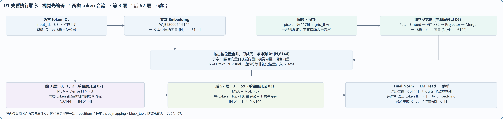
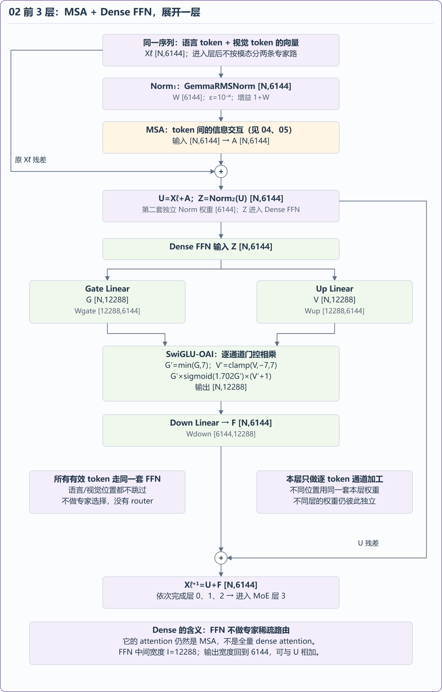
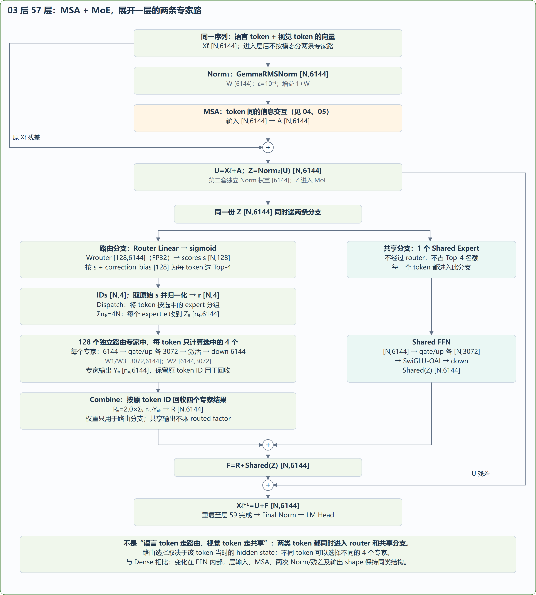
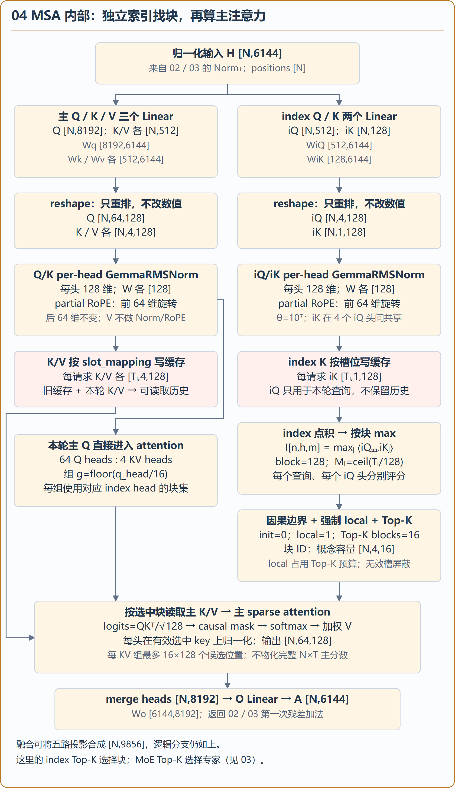
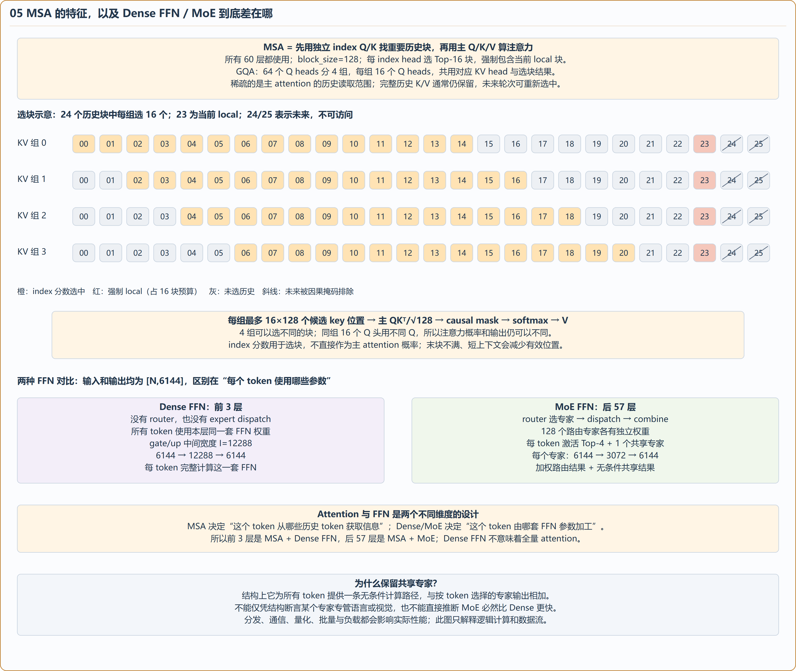
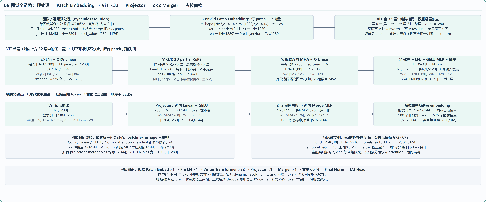

# MiniMax-M3.1-Flash：先看整体，再看 token 在层内怎么走

此页保留扩展分区资料。当前阅读入口为[单一主线 + 模块小图](../mainline/README.md)，完整主线图为 [5100×4890 PNG](../minimax-m31-detailed-architecture.png) / [SVG](../minimax-m31-detailed-architecture.svg)。公式、shape 与数值例子见[文字详解](../../model_analyze.md)。

## 01 整体顺序：视觉塔先编码，合流后进入 60 层

图像/视频先经过独立视觉塔，得到 6144 维视觉 token 向量；语言 token 查 Embedding 得到同宽向量。按占位位置合成一条序列，然后依次经过前 3 层 MSA + Dense FFN、后 57 层 MSA + MoE，最后 Final Norm、LM Head 和采样。视觉塔不计入 60 层语言主干。

[SVG](01-overview.svg)

## 02 前 3 层单独展开：Dense FFN

层 0、1、2 结构一致，只展开一层，各层权重独立。合并序列中的所有有效位置都经过 Norm、MSA、残差、第二次 Norm 和同一套本层 FFN。Dense FFN 不做专家选择，中间宽度 12288，输出恢复到 6144。这里的 Dense 描述 FFN；attention 仍为 MSA。

[SVG](02-dense-layer.svg)

## 03 后 57 层单独展开：路由与共享专家两条路

层 3–59 同构，展开一层。第二次 Norm 后，同一份 Z 同时进入两条分支：router 为每个 token 在 128 个专家中选择 4 个，dispatch 后逐专家计算，再按原 token ID 回收并加权；另一个共享专家无条件处理所有 token。两路相加得到 FFN 输出，再加上层内残差。

语言与视觉位置都走这两条分支。图不表示“语言 token 走路由、视觉 token 走共享”，也不把某个专家指定为某种模态专用。

[SVG](03-moe-layer.svg)

## 04 MSA 的算子与张量 shape

独立 index Q/K 为历史块评分并选块；主 Q/K/V 在选中的块内计算注意力。Q 不写缓存，K/V 与 index K 各自写缓存。图保留投影权重、reshape、Norm、partial RoPE、GQA、max、Top-K、softmax 和 O projection 的 shape。

[SVG](04-msa.svg)

## 05 MSA 特征与 Dense / MoE 区别

四行小块展示四个 KV 组可以选不同历史块：橙色为按 index 分数选中，红色为强制 local 块，二者合计占 Top-16 预算；灰色为未选历史，斜线为未来不可访问。每块 128 token。该图是教学示意，不是实测索引结果。

| 比较项 | Dense FFN | MoE FFN |
| --- | --- | --- |
| 在本模型中的层号 | 0–2 | 3–59 |
| 参数使用方式 | 每个 token 使用本层同一套 FFN | router 按 token 选择专家 |
| 本模型的激活分支 | 一套 FFN | 4 个路由专家 + 1 个共享专家 |
| 中间宽度 | 12288 | 每专家 3072 |
| 分发与回收 | 无专家 dispatch/combine | 按 expert 分发、按原 token 回收 |
| 输入输出 | [N,6144] → [N,6144] | [N,6144] → [N,6144] |
| 所在层的 attention | MSA | MSA |

MSA 决定一个 token 从哪些历史位置获取信息；Dense/MoE 决定一个 token 使用哪套 FFN 参数加工。二者作用不同，不能把 Dense FFN 与全量 attention 等同。

[SVG](05-msa-features-and-ffn.svg)

## 06 视觉塔单独展开

图像/视频预处理 → Conv3d patch embedding → ViT ×32 → projector → 2×2 merger → 视觉向量替换语言占位。ViT 中展示代表层的 QKV、3D RoPE、双向 MHA、MLP 和残差。672×672 为给定条件的教学例，实际 patch/token 数按处理器 grid 计算。

[SVG](06-vision.svg)

decode、分页缓存时序与可选 DSpark 保留在[文字详解](../../model_analyze.md)第 10、11、15 节，不纳入本图。

## 来源与重建

模型配置与 header 依据 [sources](../sources/README.md)。语言与 MSA 来自 ycl 的 Ascend 实现，视觉等共用模块来自上游 vLLM；具体提交、注册链与 M3.1 配置分支见[来源说明](../../model_analyze.md#162-本工作区实现)。静态结构分析未执行全量模型，图中的数值和选块示意不是实测激活。

此页扩展分区可在 `architecture` 目录运行 `python draw_detailed.py --png` 重建，组合图另存为 `minimax-m31-expanded-reference.svg/png`；当前主线图用 `python draw_mainline.py --png` 重建，二者不互相覆盖。PNG 导出依赖已安装的 Chrome/Edge 和 Pillow。
