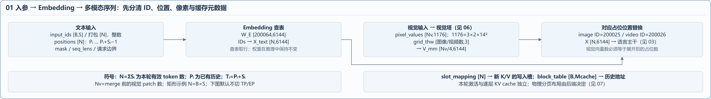
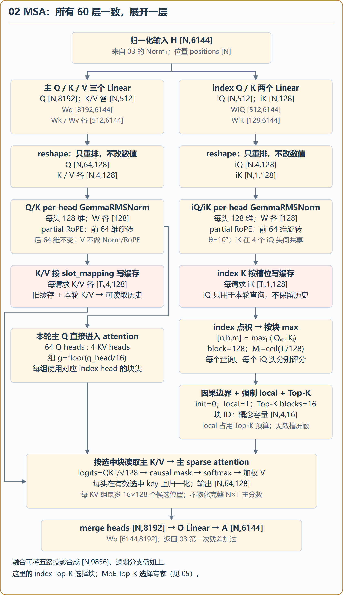
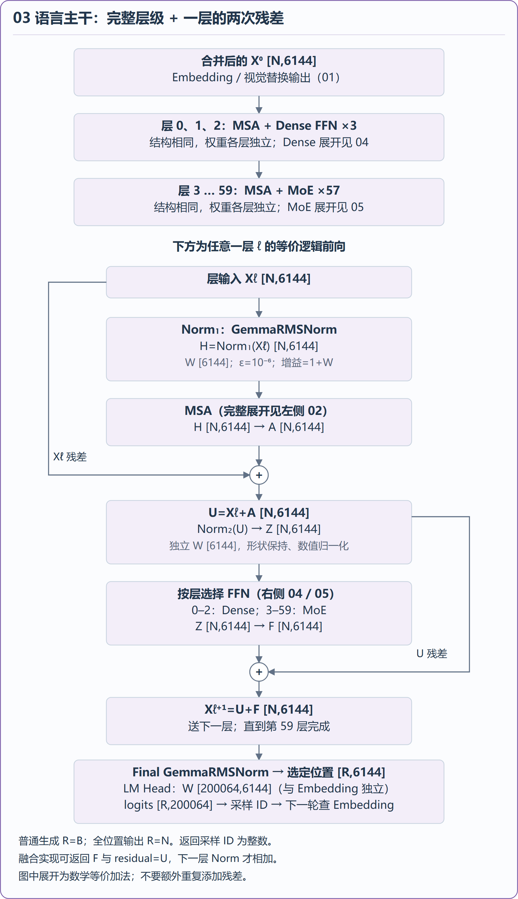
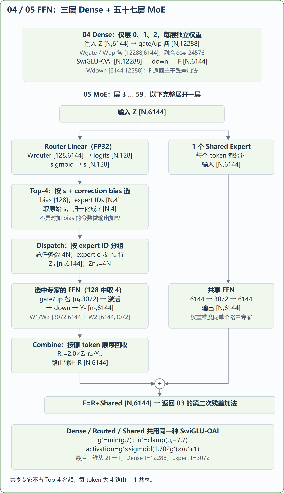
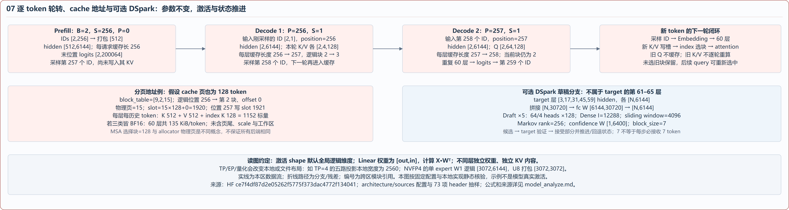

# MiniMax-M3.1-Flash：逐模块看 Shape 与内部流转

[完整高清图 5400×7890](../minimax-m31-detailed-architecture.png) · [完整可编辑 SVG](../minimax-m31-detailed-architecture.svg) · [逐步公式与数值示例](../../model_analyze.md) · [原始架构总览](../README.md)

详细版覆盖所有层级；相同结构只展开一层，并标明层号和重复次数。不同层不共享参数或 KV 内容。默认显示未切 TP/EP 的逻辑 shape；W 表示参数，X/H/Q/K/V 表示激活。推理时权重不随 token 改变，激活、位置、路由索引和缓存状态逐步推进。

## 01 入参和多模态合并

区分 `input_ids`、`positions`、`pixel_values`、grid、slot mapping 和 block table；展示文本查表与视觉向量如何合并成 [N,6144]。

[可编辑 SVG](01-inputs.svg)



## 02 MSA：所有 60 层都使用此结构

主 Q/K/V 和 index Q/K 使用独立权重。Q 绕过缓存参与本轮计算；新 K/V 写入缓存，indexer 选块后从主缓存读取对应 K/V。图中分别标出了 reshape、Norm、partial RoPE、分组、max、Top-K、softmax 和 O projection。

[可编辑 SVG](02-msa.svg)



## 03 完整文本层级与单层残差

文本层 0–2 为 MSA + Dense FFN，层 3–59 为 MSA + MoE；下方仅展开一个通用 decoder 层，并显示两次残差与最终输出。中间单层展开是说明，不是在 60 层后再额外追加一层。

[可编辑 SVG](03-decoder.svg)



## 04 / 05 Dense 与 MoE

Dense 展示 gate/up、激活和 down；MoE 展示 FP32 router、bias-corrected Top-4、原始 sigmoid 分数归一化、4N 条任务分发、逐专家矩阵和按原 token 顺序回收。共享专家独立参与，不占 Top-4 名额。

[可编辑 SVG](04-05-ffn.svg)



## 06 视觉编码与融合

从像素入参开始，展示 Conv3d、32 层 ViT 的代表层、3D RoPE、双向 MHA、MLP、projector、merger 与语言占位替换。672×672 是明确给定的教学例，实际分辨率以处理器输出 grid 为准。

[可编辑 SVG](06-vision.svg)


## 07 连续 decode、缓存与可选 DSpark

展示 prefill 之后两轮 decode 的输入、位置、cache 长度和采样时序；给出分页地址例，以及独立于 60 层 target 的 DSpark 草稿分支。DSpark 部分只表示已核对的结构和参数，不据此推断固定候选提交协议。

[可编辑 SVG](07-runtime.svg)



## 来源与重建

核验日期：2026-11-12。结构依据 [sources 配置与官方权重 header 抽样](../sources/README.md)及[当前工作区实现](../../model_analyze.md#162-本工作区实现)。本图为静态结构解释，不是 NPU trace；未执行完整模型，示例不是实测激活。

在 `architecture` 目录运行：

```powershell
python draw_detailed.py          # 完整及分区 SVG
python draw_detailed.py --png    # 同时渲染完整及分区 PNG
```

PNG 导出需要已安装 Chrome 或 Edge，以及 Pillow。渲染时检查节点文本宽度，完整 PNG 为 5400×7890；六张分区 PNG 从同一渲染结果导出。`layout.json` 记录分区坐标，`overview-preview.png` 为索引用缩略图。
