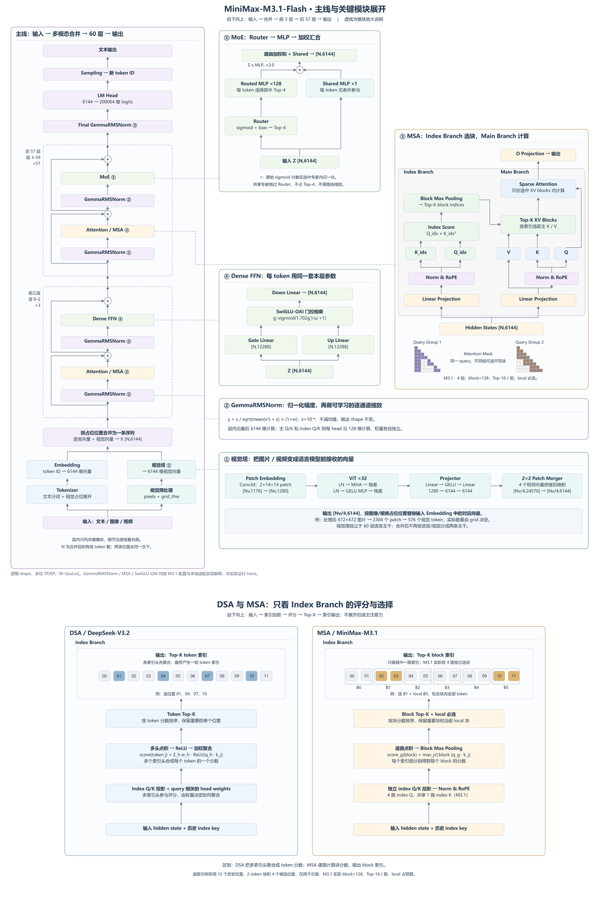

# MiniMax-M3.1-Flash：一条主线与关键模块展开

[完整高清 PNG 5100×7500](../minimax-m31-detailed-architecture.png) · [可编辑 SVG](../minimax-m31-detailed-architecture.svg) · [完整 shape / 数值流转详解](../../model_analyze.md)

左侧实线按参考图习惯**从下向上**阅读：底部输入 → 文本 Tokenizer / 视觉预处理 → Embedding / 视觉塔 → 按占位位置合并 → 前三层 → 后 57 层 → Final GemmaRMSNorm → LM Head → 采样 → 顶部文本输出。输入阶段两路在进入语言主干前合并，后续只有一条主线。右侧 Dense、MoE、MSA 小图中的纵向运算同样从下向上，视觉塔的横向小图从左向右。

前 3 层和后 57 层各用一个代表层框，并标记 ×3 / ×57；框内只列 GemmaRMSNorm、Attention、Dense FFN / MoE 及两次残差。两次残差旁路统一画在主线左侧，右侧只用虚线引出模块说明。结构相同不表示各层共享权重。

虚线与编号连接对应的小图，表示模块放大说明，不是额外执行分支：

| 编号 | 模块小图 | 展开内容 |
| --- | --- | --- |
| 主线 | [PNG](main-path.png) / [SVG](main-path.svg) | 输入到输出的完整路径 |
| ① | [视觉塔](01-vision.png) / [SVG](01-vision.svg) | Patch Embed、ViT ×32、projector、merger、返回视觉向量 |
| ② | [GemmaRMSNorm](02-gemma-rmsnorm.png) / [SVG](02-gemma-rmsnorm.svg) | RMS 归一化、1+w 增益、归一化轴和 shape |
| ③ | [Attention / MSA](03-attention-msa.png) / [SVG](03-attention-msa.svg) | 参考论文 Figure 1：Index Branch、Main Branch、Top-K KV Blocks、Sparse Attention 和按组 mask 示意 |
| ④ | [Dense FFN](04-dense-ffn.png) / [SVG](04-dense-ffn.svg) | gate/up、SwiGLU-OAI、down |
| ⑤ | [MoE](05-moe.png) / [SVG](05-moe.svg) | Router、128 个 Routed MLP 中选 4 个、共享 MLP、路由加权和与结果相加 |

MSA 小图改为参考 [MSA 论文 Figure 1](https://arxiv.org/html/2606.13392v2#S0.F1)重新绘制的可编辑结构图，保留其左右双分支和按组 mask 的表达：Index Branch 经 Linear Projection、Norm/RoPE、index Q/K、Index Score、Block Max Pooling 产生块索引；索引连接 Main Branch 的 Top-K KV Blocks，再由主 Q/K/V 执行 Sparse Attention。V 绕过 Norm/RoPE，主 Q 绕过 KV 选择直接进入 attention。

为接回本图的语言层，顶部补充 O Projection。底部标注本模型实际配置：4 个 GQA 组、block=128、Top-16 / 组及强制 local。mask 仅展示两个组如何产生不同选块的教学示意，不代表模型只有两组，也不是实测 attention mask。完整 shape 与缓存过程见[文字详解](../../model_analyze.md)。

以下补充对比中的 DSA 特指 DeepSeek-V3.2 的 DeepSeek Sparse Attention。大图底部附有[独立 Index Branch 对照图](../msa-vs-dsa.md)，仅比较索引分支，不展开后续主注意力。两者都有 Indexer；“先选再算”并非 MSA 独有，真正要区分的是按块选取与按 GQA 组独立选择：

| 项目 | DSA（DeepSeek-V3.2） | MSA（本图的 M3.1） |
| --- | --- | --- |
| 选择粒度 | 单个历史 token | 128-token block |
| 选取结果共享范围 | 同一 query 的所有 Q heads 共用一组 token 索引 | 每个 GQA 组独立选择块；组内 Q heads 共用 |
| 索引评分 | 多个索引头的 ReLU 点积，经 query 相关权重聚合为 token 分数 | 每组 index Q 与 index K 点积，再对块内位置取 max |
| 主注意力搭配 | V3.2 基于 MLA 的 MQA 模式 | GQA，64 个 Q heads 对应 4 个 KV heads |

依据：[MSA 论文第 6 节对 DSA 的直接比较](https://arxiv.org/html/2606.13392v2#S6)、[DeepSeek-V3.2 第 2.1 节及式 1](https://arxiv.org/html/2512.02556v1#S2.SS1)。本图的 Top-16、128 和 4 组取自固定 M3.1 配置。按块选取便于连续 KV 读取，但即使候选数量相同，也不等同于选出相同数量的最佳单个 token，不能仅凭示意图判断哪种实现更快。

MoE 小图沿用参考图的 Router → MLP → 加权汇合组织方式，去掉 dispatch/combine 等实现节点；参数按 M3.1 改为 128 个路由 MLP、每 token 选择 4 个，并额外保留每 token 都参与的 1 个共享 MLP。共享 MLP 绕过 Router，其输出不乘路由缩放系数。专家内部的 gate/up、激活、down 仍见文字详解。

图上 shape 为未分片的逻辑维度。N 是合并后的有效语言序列长度；Nv 是 merger 前视觉 patch 数。GemmaRMSNorm 的 w 为增益参数；Dense / Expert 的 SwiGLU-OAI 使用上界截断 g′=min(g,7)、u′=clamp(u,−7,7)。完整参数 shape 与实现依据放在文字详解中。

布局参考 [CalvinXKY/InfraTech MiniMax-M2.5 架构图](https://github.com/CalvinXKY/InfraTech/blob/main/models/minimax_m_2_5/minimax_m_2_5_architecture.jpg)，只参考主线与模块放大的组织方式。M3.1 的维度和模块来自[固定版本配置与 header](../sources/README.md)、ycl Ascend 适配及上游 vLLM 共用视觉实现；不是对 M2.5 参数进行替换后推测，也不是本次实际运行 trace。

重建：在 `architecture` 目录运行 `python -B draw_mainline.py --png`。SVG 保留文字和路径，可编辑；PNG 依赖已安装 Chrome/Edge 与 Pillow。绘图原语由 `diagram_primitives.py` 提供。
