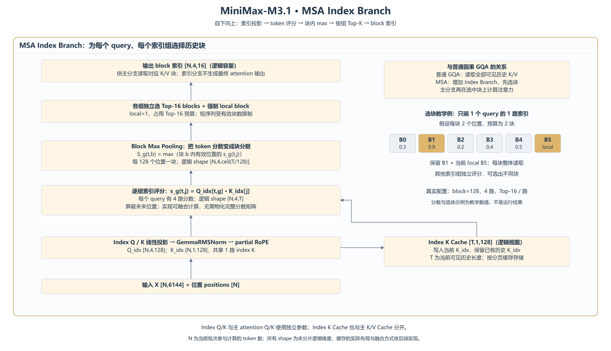

# MSA Index Branch：如何选择历史块

[高清 PNG](msa-index-branch.png) · [可编辑 SVG](msa-index-branch.svg) · [绘图源码](draw_msa_index.py)

本图已放到[完整架构图](minimax-m31-detailed-architecture.png)最下方。普通因果 GQA 在所有可见历史位置上做注意力；MSA 增加独立的索引分支，先挑选历史块，再让主分支在选中块上计算注意力。GQA 描述 Q/KV 头的共享关系，MSA 的稀疏选块可以与该共享关系同时存在。

1. 当前输入 `X [N,6144]` 经独立索引投影，生成 `Q_idx [N,4,128]` 与 `K_idx [N,1,128]`。沿每个 head 的 128 维做 GemmaRMSNorm，再做 partial RoPE。
2. 当前 index K 写入独立的 Index K Cache；逻辑历史视图为 `[T,1,128]`。它与主 attention 的 K/V Cache 分开。
3. 每个 query 的 4 路 index Q 分别与历史 index K 点积，得到逻辑分数 `[N,4,T]`。未来位置不可参与候选。
4. 每 128 个历史位置组成一块，块内取有效位置分数的最大值，得到逻辑块分数 `[N,4,ceil(T/128)]`。
5. 各索引组独立选 Top-16 blocks，并强制保留 1 个 local block。local 占用选择预算；短序列和边界块仍受有效位置约束。
6. 输出逻辑容量 `[N,4,16]` 的块索引，供主 attention 读取对应 K/V。索引分支只负责选块，不生成主 attention 输出。

N 是当前批次参与计算的 token 数（decode 时可对应多个请求），T 是相应序列的可见历史长度；批处理时各序列的 T 可不同。以上是未切 TP 的逻辑 shape，融合内核可能直接计算块分数而不物化完整 token 分数矩阵，索引输出的物理排列也可能不同。

选块例子只画一个 query 的一路索引：6 个块、每块 2 个位置、预算 2 块，选 B1 与当前 local B5。教学参数和分数不代表实际运行结果。

实现入口：ycl `vllm-ascend-private` 的 `vllm_ascend/models/minimax_m3/minimax_m3.py` 中 `_sparse_prepare` 完成投影及 Norm/RoPE，`_insert_kv` 写缓存，`_run_sparse_attention` 调用 indexer 后把索引传给主分支；`msa_m3.py` 的 `AscendMiniMaxM3IndexerImpl.forward` 调度索引评分及 Top-K 内核。

依据：[固定配置](sources/config.json)、[实现与来源](sources/README.md)及[张量流转详解](../model_analyze.md)。图为逻辑结构示意，不是运行 trace。

重建：在 architecture 目录运行 `python -B draw_msa_index.py --png`；重建完整大图使用 `python -B draw_mainline.py --png`。需要 Chrome/Edge 和 Pillow。
