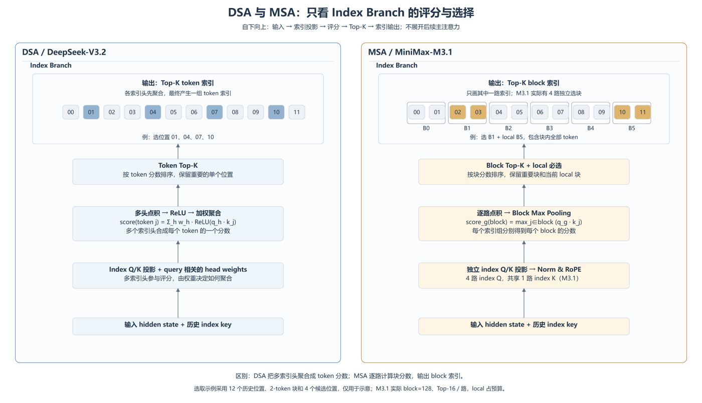

# MSA 与 DSA：只看 Index Branch

[高清 PNG 4200×2415](msa-vs-dsa.png) · [可编辑 SVG](msa-vs-dsa.svg) · [绘图源码](draw_attention_comparison.py)

本图也已收录在[完整架构图](minimax-m31-detailed-architecture.png)最下方。

本图仅比较独立索引分支，自下向上展示：输入 → 索引投影 → 评分 → Top-K → 索引输出。不展开后续主注意力的结构。

| 阶段 | DSA（DeepSeek-V3.2） | MSA（MiniMax-M3.1） |
| --- | --- | --- |
| 投影 | 多头 index Q/K，并生成 query 相关的聚合权重 | 独立 index Q/K，4 路 index Q 共享 1 路 index K |
| 评分 | 各索引头点积经 ReLU 后加权聚合，得到每 token 的一个分数 | 每路索引做点积，再在 block 内取 max，得到每路每块的分数 |
| 选择 | Token Top-K | 每路 Block Top-K，强制保留 local 块 |
| 输出 | 一组离散的 token 索引 | 多路整块索引 |

图上的 00–11 是历史位置编号，不是词表 ID。为了直观比较，示意中 DSA 选择 4 个 token，MSA 选择 2 个块、每块 2 个 token，候选位置数量相同；MSA 示例选中 B1 和当前 local B5。示例只展示其中一路索引，不是实际选择结果。M3.1 的真实配置为 block=128、每路 Top-16，local 占用选择预算。

代码入口：ycl `vllm-ascend-private` 的 `vllm_ascend/models/minimax_m3/minimax_m3.py` 中 `MiniMaxM3SparseAttention` 与 `_run_sparse_attention`；索引分支调度在 `msa_m3.py` 的 `AscendMiniMaxM3IndexerImpl`。完整上下文见[前向详解](../model_analyze.md#162-本工作区实现)。

资料来源：[MSA 索引分支定义](https://arxiv.org/html/2606.13392v2#S3.SS1)、[DSA 索引分数式 1](https://arxiv.org/html/2512.02556v1#S2.SS1)、[固定 M3.1 配置](sources/config.json)。图为独立解释，不是运行 trace。

重建：在 `architecture` 目录运行 `python -B draw_attention_comparison.py --png`，需要 Chrome/Edge 和 Pillow。
