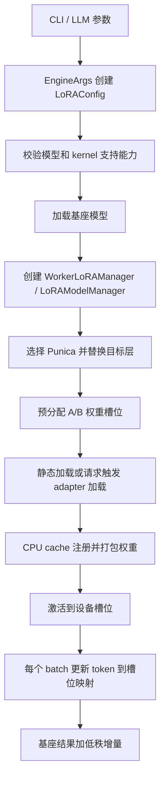

# vLLM LoRA 代码链路

本文基于 vLLM Ascend 当前配套的 vLLM **固定提交**，解释如何使能 LoRA、使能后初始化什么，以及 adapter 如何进入推理。阅读日期：2026-11-21。

| 项目 | 固定版本与范围 |
| --- | --- |
| vLLM | [`c410543d9ffff03f5f6c4a8c0ae1d3ad082c4a15`](https://github.com/vllm-project/vllm/tree/c410543d9ffff03f5f6c4a8c0ae1d3ad082c4a15) |
| 配套依据 | vLLM Ascend [`7a7ed073c481d5e3a2fc2194c5b879efb2d373c0` 的 `.github/vllm-main-verified.commit`](https://github.com/vllm-project/vllm-ascend/blob/7a7ed073c481d5e3a2fc2194c5b879efb2d373c0/.github/vllm-main-verified.commit) |
| 主链 | V1 / `v1/worker/gpu/model_runner.py` 的 Runner V2；Ascend 的 `worker/v2/model_runner.py` 继承该 Runner |
| 说明 | 源码静态分析；不代表已经完成模型或硬件实测。不混入本地尚未提交的 MiniMax LoRA 适配代码，也不外推到后续 main |

目录：

- 本文：开关、启动初始化、加载、请求路由、计算与排查。
- [源码索引](code-map.md)：按阅读顺序列出固定 commit 的源码链接与关键函数。
- [Ascend 接入与 MiniMax 边界](ascend-and-minimax.md)：NPU wrapper、算子选择及当前适配缺口。
- [M3.1 BF16 LoRA 测试方案与实测](validation/2026-11-21/README.md)：四层真实 BF16、双 adapter、TP/DP/EP；BI服务隔离通过，merged token硬指标未通过。

## 1. 先区分三个阶段

**`enable_lora=True` 创建 LoRA 执行能力；adapter 的路径决定加载什么；请求携带的 adapter ID 决定哪些 token 使用它。** 三者缺一都不能说明目标 adapter 已参与计算。



这里的“设备槽位”在上游注释中常叫 GPU slot；在 Ascend 上实际承载在 NPU。

## 2. 如何使能

### 2.1 在线服务

以下为**已经支持 LoRA 的模型**的通用配置示例，不是 MiniMax-M3.1-Flash 的可运行承诺：

```bash
vllm serve /models/base \
  --enable-lora \
  --max-loras 1 \
  --max-cpu-loras 4 \
  --max-lora-rank 16 \
  --lora-dtype bfloat16 \
  --lora-target-modules q_proj k_proj v_proj o_proj \
  --lora-modules task_adapter=/models/adapters/task_adapter
```

- `--enable-lora` 对应 `EngineArgs.enable_lora`；`create_engine_config()` 仅在其为真时构造 `LoRAConfig`，否则配置为 `None`。
- `--lora-modules` 属于服务层的 adapter 注册参数，不是 `LoRAConfig` 中的权重路径字段。
- 启动后，服务层 `init_static_loras()` 遍历这些 adapter，调用 `load_lora_adapter()`，再通过 `engine_client.add_lora()` 预加载。
- OpenAI 兼容请求用 `"model": "task_adapter"` 选择已注册的 adapter；使用基座服务名则走基座请求。仅注册 adapter 并不把所有请求自动切到它。

### 2.2 离线推理

```python
from vllm import LLM, SamplingParams
from vllm.lora.request import LoRARequest

llm = LLM(
    model="/models/base",
    enable_lora=True,
    max_loras=1,
    max_lora_rank=16,
    lora_dtype="bfloat16",
    lora_target_modules=["q_proj", "k_proj", "v_proj", "o_proj"],
)
outputs = llm.generate(
    ["Explain LoRA briefly."],
    SamplingParams(temperature=0, max_tokens=32),
    lora_request=LoRARequest("task_adapter", 1, "/models/adapters/task_adapter"),
)
```

`LoRARequest` 将 adapter 名称、正整数 ID 和路径带进引擎。设备槽位编号由 manager 分配，不等同于这里的 ID。

### 2.3 运行时加载与卸载

该提交的 `/v1/load_lora_adapter`、`/v1/unload_lora_adapter` 路由由已有环境开关 `VLLM_ALLOW_RUNTIME_LORA_UPDATING` 控制，入口是 `entrypoints/serve/lora/api_router.py`。

这与 `--enable-lora` 的职责不同：前者开放在线管理接口，后者在引擎启动时创建 LoRA 执行能力。静态 `--lora-modules` 不需要靠运行时接口开关才可初始化。该版本的多 API server 配置还会检查与运行时更新开关的兼容性。

## 3. 关键配置决定什么

以下默认值直接来自该提交的 `vllm/config/lora.py`。

| 配置 | 默认值 | 影响 |
| --- | --- | --- |
| `enable_lora` | `False`，位于 EngineArgs | 是否创建 `LoRAConfig`、包装层和管理器 |
| `max_loras` | `1` | 单 batch 不同 adapter 数上限，同时决定设备槽位数；不等于并发请求数 |
| `max_cpu_loras` | `None`，校验时补成 `max_loras` | worker 的已注册 adapter 缓存容量；必须不少于 `max_loras` |
| `max_lora_rank` | `16` | 各层预分配的最大 rank；加载的实际 rank 可更小 |
| `lora_dtype` | `auto` | 校验时解析成基座 dtype；可显式指定 `bfloat16` / `float16` |
| `target_modules` | `None` | 部署时目标后缀过滤；CLI 名为 `--lora-target-modules` |
| `fully_sharded_loras` | `False` | 选择不同的 A/B 分片方式和通信路径 |
| `enable_tower_connector_lora` | `False` | 额外开启多模态 tower/connector 路径，还要求模型支持 |
| `specialize_active_lora` | `False` | 配合 compilation 的 LoRA 图专门化设置影响捕获组合 |

`target_modules=None` 表示不增加部署时过滤，仍受模型和 wrapper 支持能力约束。它不是“任意线性层必定成功支持”的意思。

`LoRAConfig` 与 adapter 的 `adapter_config.json` 是两份配置：前者决定**服务容量和执行方式**；后者描述**已经训练出的 rank、alpha、目标模块及训练变体**。不能用服务端 `max_lora_rank` 替代 adapter 的真实 rank。

## 4. 使能后，启动时初始化什么

### 4.1 先校验模型支持，随后解析 dtype

`EngineArgs.create_engine_config()` 创建 `LoRAConfig`，随后 `VllmConfig` 调用：

```text
LoRAConfig.verify_with_kernel_config(kernel_config)
LoRAConfig.verify_with_model_config(model_config)
```

- 模型能力来自 `ModelConfig.is_lora_supported` 和模型注册信息；非 draft 模型若不支持，直接报错。
- `SupportsLoRA` 提供 `supports_lora=True` 及默认的 mapping/embedding 等属性。
- kernel 校验拒绝该版本不支持 LoRA 的 MegaMoE backend。
- `auto` dtype 在这一步解析；这不会把量化 checkpoint 自动变成 BF16 checkpoint。
- Runner 真正装载 LoRA 时还会通过 `supports_lora(model)` 再检查模型实例。

因此，只有 `packed_modules_mapping` 不足以证明模型支持 LoRA；只补 `SupportsLoRA` 也不足以证明每个自定义层都有可替换的 wrapper。

### 4.2 基座加载完成后创建 worker manager

主调用链：

```text
GPUModelRunner.load_model()
  -> model_loader.load_model(...)
  -> if self.lora_config:
       LoRAModelRunnerMixin.load_lora_model(model, config, device)
         -> LRUCacheWorkerLoRAManager(...)
         -> WorkerLoRAManager.create_lora_manager(...)
         -> create_lora_manager(..., LRUCacheLoRAModelManager, ...)
```

Runner 保存 `self.lora_manager`。它是 worker 层的 manager，负责读取 adapter、缓存与激活；不是网络 API 层的 adapter 名称注册表。

### 4.3 Model manager 的构造内容

`LoRAModelManager.__init__()` 初始化：

1. 根据基座模块发现 `supported_lora_modules`。
2. `_registered_adapters`：已注册 adapter 的 LRU 缓存，容量对应 `max_cpu_loras`。
3. `_active_adapters`：设备侧激活的 adapter 缓存，容量对应 `max_loras`。
4. `lora_index_to_id = [None] * max_loras`：设备槽位到逻辑 adapter ID 的映射。
5. `modules`、`packed_modules` 和模型的 `packed_modules_mapping`：记录被替换层及打包关系。
6. Punica wrapper：负责 token 映射元数据和低秩计算的设备实现。
7. `_create_lora_modules()`：替换目标层并分配 adapter 权重槽位。
8. MoE/EP 加载描述等附加状态，并将 manager 挂到 `model.lora_manager`。

多模态模型可根据 `get_mm_mapping()` 为 language model、tower、connector 创建相应 Punica wrapper；并非所有模型共享同一个 wrapper 的假设都成立。

### 4.4 层如何被替换

```text
LoRAModelManager._create_lora_modules()
  -> 遍历 named_modules，过滤目标、处理别名与 PP missing layer
  -> 找到模块对应的 packed_modules_list
  -> vllm.lora.utils.from_layer(...)
       -> 按 _all_lora_classes 顺序执行 can_replace_layer(...)
       -> wrapper(base_layer)
       -> wrapper.create_lora_weights(...)
  -> replace_submodule(...)
  -> register_module(...) / 绑定对应 Punica
```

`from_layer()` 找不到匹配 wrapper 时会返回原层，并不对每种情况都立即抛错。manager 对未包装目标另有记录和检查。因此调试时需要检查**实际模块类型和 wrapper 是否替换成功**，不能只看启动无异常。

packed mapping 例如 `qkv_proj -> [q_proj, k_proj, v_proj]`，连接训练 checkpoint 的分离名称与推理模型中的融合层。部署目标过滤也会结合该 mapping 处理成员后缀。

### 4.5 预分配 A/B，不等于读取 adapter

普通单 slice 线性层的槽位形状可概括为：

```text
A: [max_loras, 1, max_rank 或其分片, input_dim 或其分片]
B: [max_loras, 1, output_dim 或其分片, max_rank]
```

Merged/QKV wrapper 使用多个 slice 的 A/B tuple，各 slice 的 B 输出大小可能不同。初始化为零；激活时再把实际 adapter 权重复制到某个槽位，较小 rank 的未使用区域保持为零。Ascend 还可能初始化 packed A/B 等额外布局。

所以开启 LoRA 即使没有加载业务 adapter，也会带来包装层、设备槽位和元数据开销。普通 adapter 推理沿用基座权重，通过低秩分支加增量，不会复制一整份基座模型，也不在这个路径上把增量永久合入基座。

### 4.6 预热和图捕获

`maybe_setup_dummy_loras()` 为 profile / warmup 创建 dummy adapter；`maybe_select_dummy_loras()` 设置其 batch 映射。图捕获组合通过 `gpu/lora_utils.py` 的 `get_lora_capture_cases()`、`create_lora_capture_hook()` 等辅助函数组织。

dummy adapter 路径只是占位符，使用内部生成的权重，不读取业务 adapter 文件。退出时可清理 dummy adapters。看到启动日志中的 warmup adapter，不能据此判定业务 adapter 已加载或精度已验证。图的捕获和选择还受 compilation 配置及平台能力影响。

## 5. 指定 adapter 后，初始化与加载什么

### 5.1 在线预加载经过哪些进程层

```text
OpenAIServingModels.init_static_loras() / load_lora_adapter()
  -> AsyncLLM.add_lora()
  -> engine_core.add_lora_async()           # CoreClient / IPC
  -> EngineCore.add_lora()
  -> Executor.add_lora()
  -> collective_rpc("add_lora", ...)
  -> worker.add_lora()
  -> runner.add_lora()
  -> LRUCacheWorkerLoRAManager.add_adapter()
```

具体 executor 决定 RPC 实现；adapter 注册要送达参与执行的 workers，不能把 API 进程的注册表当作设备已加载状态。

### 5.2 读取配置与 checkpoint

`WorkerLoRAManager._load_adapter()` 的顺序：

1. 将 supported modules 和 packed mapping 展开成预期 checkpoint 模块集合。
2. `get_adapter_absolute_path()` 解析本地路径或下载后的目录。
3. `PEFTHelper.from_local_dir()` 读取 `adapter_config.json`。
4. `validate_legal()` 检查训练特性、rank 上限、bias 等；例如 rank 超过容量或 `bias != "none"` 会报错。
5. 使用模型的 `hf_to_vllm_mapper.get_rename_mapper()`，并获取模型声明的 `lora_skip_prefixes`。
6. `LoRAModel.from_local_checkpoint(..., device="cpu", dtype=lora_dtype)` 读取 adapter tensor。
7. 校验 MoE 布局、分类头等特殊分支。

checkpoint 支持 `adapter_model.safetensors`、`adapter_model.bin`、`adapter_model.pt`。safetensors 在加载前检查 key；EP 场景可跳过非本地专家。bin/pt 使用 `torch.load(..., weights_only=True)`，读取后再裁剪非本地专家。

`LoRAModel.from_lora_tensors()` 解析 PEFT 名称、执行模型名称映射，将 tensor 转为目标 dtype，按模块构建 `LoRALayerWeights`；满足平台条件时 CPU tensor 会使用 pinned memory。模型声明的 skip prefix、远端专家裁剪和部署目标过滤是不同机制，应分别核查。

### 5.3 scaling 和 packed 权重

`PEFTHelper` 根据模块的 rank/alpha pattern 计算 scaling：普通 LoRA 为 `alpha/r`，rsLoRA 为 `alpha/sqrt(r)`。`LoRALayerWeights.optimize()` 把 scaling 乘入 B，并置 `scaling=1`。

manager 的 `_create_merged_loras_inplace()` 按融合层顺序打包对应 adapter；`PackedLoRALayerWeights` 保留 slice 对应关系，未适配成员可用 `None` 占位。打包和普通权重准备路径会调用 optimize，不能再在 forward 中重复乘同一 alpha/r。

这里的“merged loras”指把多个 adapter slice 整理到融合层对应的数据结构，**不是把 BA 合并进基座 W**。

### 5.4 从 CPU cache 激活到设备槽位

```text
add_adapter(request)
  -> _load_adapter()                       # 未缓存或 load_inplace 时
  -> model_manager.add_adapter(LoRAModel)  # 校验、打包、注册
  -> model_manager.activate_adapter(id)
       -> 分配空闲槽位 index
       -> 遍历已经包装的层
       -> module.set_lora(index, A, B)
       -> 未适配层 module.reset_lora(index)
       -> lora_index_to_id[index] = id
```

`set_lora()` 负责 TP 分片、清零旧内容与复制权重；不能只在 Python 字典中保存 A/B 就认为已激活。LRU 子类可淘汰旧设备槽位或 CPU 缓存条目；缓存命中会更新使用顺序。

加载新 adapter 的路径先验证加载是否成功，再淘汰现有缓存，避免新文件非法却先破坏旧 adapter。`load_inplace` 可触发同一 ID 的重载。

## 6. 每个请求和每个 batch 做什么

### 6.1 调度限制的是不同 adapter 数

请求携带 `LoRARequest` 进入引擎，scheduler 统计当前 batch 的 `scheduled_loras`。当加入新请求会超过 `max_loras` 时，跳过该候选并留待后续调度。

`max_loras=1` 可以同时调度多个使用同一 adapter 的请求，也可包含不带 adapter 的基座请求；不是“服务只能有一个并发请求”。CPU cache 里还可保存更多 adapter，按 batch 切换。

### 6.2 请求 ID → 逻辑 adapter ID → 设备槽位

Runner 的 `LoraState` 保存每个请求的 adapter。`make_lora_inputs()` 按本轮 token/logits 数生成：

- `token_lora_mapping`：每个计划执行 token 对应的 adapter ID。
- `prompt_lora_mapping`：实际按 logits 行数展开，用于输出相关计算；不能简单假设始终每个请求只有一行。
- `active_lora_requests`：本轮需要的 adapter 集合。

例如两个请求分别使用 adapter 7 和基座，本轮执行 token 数为 3 和 1：

```text
逻辑 token 映射: [7, 7, 7, 0]
槽位表:         [7, None, ...]
内部 token 槽位: [0, 0, 0, -1]    # 示意，具体元数据由 convert_mapping 生成
```

逻辑 ID `0` 表示无 LoRA；内部槽位 `0` 可以是第一个有效 adapter，不能混淆。

### 6.3 forward 前激活并更新 Punica 元数据

```text
GPUModelRunner 的执行路径
  -> lora_state.make_lora_inputs(...)
  -> LoRAModelRunnerMixin._set_active_loras(...)
       -> LoRAMapping(token_mapping, prompt_mapping, is_prefill=True, type=...)
       -> worker_manager.set_active_adapters(requests, mapping)
            -> _apply_adapters(): 确保所需 adapter 已加载/激活
            -> model_manager.set_adapter_mapping(mapping)
                 -> Punica.update_metadata(mapping, lora_index_to_id, ...)
  -> 模型 forward
```

该 mixin 明确将 `is_prefill=True`，注释说明非 CUDA 平台由此使用 SGMV 路径；因此不能仅根据这个字段推断请求在做 prefill。实际内核仍取决于平台 wrapper 的实现。

mapping cache 同时考虑 slot layout，避免 adapter 换槽但 token ID 未变时继续沿用旧槽位映射。

## 7. 层内如何计算

普通线性 LoRA 的语义为：

```text
Y_base = X @ W.T + bias
Y      = Y_base + (X @ A.T) @ B_scaled.T
```

`BaseLinearLayerWithLoRA.apply()` / `_apply_sync()` 计算基座输出，再通过 `_apply_lora_to_output()` 调用 `Punica.add_lora_linear()`。有自定义 base forward、异步流或模型专用 wrapper 的层可能重写该路径，不能假设一律直接调用原层 `forward()`。

| 层类型 | 默认非 fully-sharded LoRA 的分片含义 |
| --- | --- |
| ColumnParallel | 输入/A 通常复制，B 按输出维分片；是否 gather 由层配置决定 |
| RowParallel | A 按输入维分片，B 复制；局部基座与 LoRA 增量一起按层配置 all-reduce |
| QKV | Q 按 head 分片；K/V 分片或复制由 KV head 数和 TP 决定 |
| MergedColumn | 多个目标共享一个融合投影，每个 slice 对应各自 A/B |
| fully-sharded | 使用专用 wrapper，A/B 的分片和中间结果通信不同 |

低秩计算通常拆为 shrink（`X @ A.T`）和 expand（乘 B 并加回输出）。Punica 依据 token 映射选择 slot；无 adapter 的 token 不应得到增量。Embedding、LM head、MoE、分类头有专用包装层和计算分支，不宜用普通 Linear 的全部细节直接套用。

## 8. 排查时按这个顺序核对

1. **配置**：`lora_config` 是否非空，模型能力检查是否通过，dtype/rank/backend 是否兼容。
2. **包装**：目标实际类型是否被 `can_replace_layer()` 接受；融合层名称与 mapping 是否对应。
3. **加载**：checkpoint key 经 mapper 后落到哪个模块；A/B shape、rank、scaling 是否正确。
4. **激活**：逻辑 adapter 是否在 registered/active cache 中；`lora_index_to_id` 是否指向正确槽位。
5. **请求**：请求是否确实指定 adapter；token mapping 是否含它，而不是全 0。
6. **计算**：真实 forward 是否经过 LoRA wrapper；融合/custom op 是否旁路了包装层。
7. **精度**：零增量 adapter 对齐基座，非零 adapter 对齐离线合并权重参考，检查混合请求和重载残留。

特别注意：该提交的 `activate_adapter()` 在 worker 上没有应用任何模块权重时会记录 debug 提示，并非一律抛错；PP/EP 的某些 worker 无本地目标可能是合法情况。必须结合具体 rank 和目标模块判断，不能把“加载接口返回成功”当作所有目标生效的证据。
