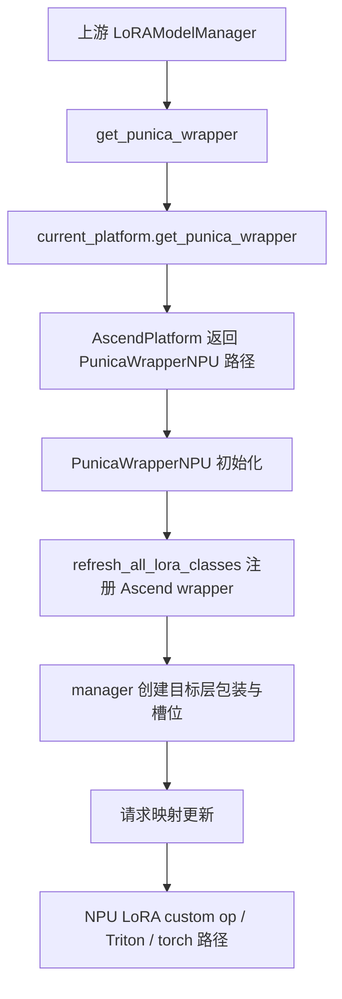

# Ascend 接入与 MiniMax-M3.1-Flash 的边界

本文承接 [LoRA 主链路](README.md)。vLLM 固定为 `c410543d9ffff03f5f6c4a8c0ae1d3ad082c4a15`，Ascend 固定为 `7a7ed073c481d5e3a2fc2194c5b879efb2d373c0`。本文只描述这些提交，不包含本地开发分支新增实现。

## 1. Ascend 复用上游哪些部分

[`NPUModelRunner`](https://github.com/vllm-project/vllm-ascend/blob/7a7ed073c481d5e3a2fc2194c5b879efb2d373c0/vllm_ascend/worker/v2/model_runner.py) 继承上游 `GPUModelRunner`。类名中的 GPU 不意味着 LoRA manager 只能在 CUDA 上运行。

主链中的 EngineArgs、LoRAConfig、worker/model manager、PEFT adapter 解析、槽位缓存与请求映射均来自配套 vLLM；平台差异主要接在 Punica、层 wrapper 与设备算子。



## 2. Punica 如何切换成 NPU

上游 [`punica_selector.py`](https://github.com/vllm-project/vllm/blob/c410543d9ffff03f5f6c4a8c0ae1d3ad082c4a15/vllm/lora/punica_wrapper/punica_selector.py) 读取 `current_platform.get_punica_wrapper()`，再动态解析类并实例化。

[`AscendPlatform.get_punica_wrapper()`](https://github.com/vllm-project/vllm-ascend/blob/7a7ed073c481d5e3a2fc2194c5b879efb2d373c0/vllm_ascend/platform.py) 返回：

```text
vllm_ascend.lora.punica_npu.PunicaWrapperNPU
```

[`PunicaWrapperNPU.__init__()`](https://github.com/vllm-project/vllm-ascend/blob/7a7ed073c481d5e3a2fc2194c5b879efb2d373c0/vllm_ascend/lora/punica_npu.py) 初始化的关键内容：

- 父类 token/prompt 映射与 prefill 元数据缓冲区。
- `refresh_all_lora_classes()`，在 manager 开始包装层之前准备 Ascend wrapper 注册顺序。
- shrink buffer cache、Triton workspace cache、全局 custom-op wrapper ID。
- 根据硬件能力及 rank，选择 Ascend custom ops 或上游 torch LoRA ops；不支持相关 custom ops，或 `max_lora_rank >= 128` 时进入 torch ops 导入分支。
- A2/A3 且 `max_loras == 1`、非 fully-sharded 时启用 `_single_lora_slot`；创建 BF16/FP16 等已解析 dtype 的 token mask。这里不是所有硬件都启用的统一快路径。

metadata 更新将逻辑 token adapter ID 转换为槽位相关信息，并更新单槽位 mask。`no_lora` 由本轮 mapping 中是否存在正 adapter ID 决定，不能把“manager 缓存不为空”当作本轮带 LoRA。

## 3. Ascend 层 wrapper 如何注册

[`vllm_ascend/lora/utils.py`](https://github.com/vllm-project/vllm-ascend/blob/7a7ed073c481d5e3a2fc2194c5b879efb2d373c0/vllm_ascend/lora/utils.py) 的 `refresh_all_lora_classes()` 在上游 `_all_lora_classes` 前插入：

- Ascend RowParallel / ColumnParallel wrapper。
- Ascend MergedColumn / MergedQKV wrapper。
- Ascend FusedMoE / FusedMoE3D wrapper。

上游 `from_layer()` 按顺序选择第一个 `can_replace_layer()` 成功的类。因此注册顺序、精确类型检查、packed 成员数量和配置检查共同决定实际选到哪个 wrapper。

已有 Ascend wrapper 维护 packed A/B 或转置后的 B，适配 NPU 的单 adapter 快路径和 expand 数据布局。部分 wrapper 会保留原层自定义 forward；不能假设替换后每条路径都保留原有通信语义。

## 4. NPU 计算如何分派

`PunicaWrapperNPU.add_lora_linear()` 在 `no_lora` 时直接返回；否则调用 [`lora_ops.py`](https://github.com/vllm-project/vllm-ascend/blob/7a7ed073c481d5e3a2fc2194c5b879efb2d373c0/vllm_ascend/lora/lora_ops.py) 的 `lora_linear` custom op。

该 op 检查：

1. 是否处于单 adapter slot 快路径。
2. 是否是单 slice，或者提供了 packed A/B。
3. 是否满足 Triton 快路径条件。

不满足单槽位/packed 条件时使用 `_lora_linear_kernel()`，通过 shrink/expand 执行；满足条件时先尝试 Triton，再回退到 `_lora_linear_matmul()`。所以“没有 packed A/B”不等于一定无法计算，但可能走不同路径；性能和图兼容性需按实际分支验证。

本次文档未执行 NPU 测试，不能据此给出硬件性能结论。

## 5. MiniMax：模型支持声明与层支持必须分别看

### 配套 vLLM 主仓

[`vllm/models/minimax_m3/nvidia/model.py`](https://github.com/vllm-project/vllm/blob/c410543d9ffff03f5f6c4a8c0ae1d3ad082c4a15/vllm/models/minimax_m3/nvidia/model.py) 中：

- `MiniMaxM3SparseForCausalLM` 没有声明 `SupportsLoRA` / `supports_lora=True`。
- `MiniMaxM3SparseForConditionalGeneration` 也没有该声明。
- 虽然有 `packed_modules_mapping`，但它不等于完整 LoRA 支持。
- 稀疏注意力使用自定义 `MinimaxM3QKVParallelLinearWithIndexer`，不能凭通用 QKV wrapper 推断兼容。

因此该固定提交不能直接认定为上游已经支持 MiniMax-M3.1-Flash 的 LoRA；使能时的模型能力检查就是一处门槛。

### 配套 Ascend 实现

Ascend 的 [`minimax_m3.py`](https://github.com/vllm-project/vllm-ascend/blob/7a7ed073c481d5e3a2fc2194c5b879efb2d373c0/vllm_ascend/models/minimax_m3/minimax_m3.py) 与 [`minimax_m3_vl.py`](https://github.com/vllm-project/vllm-ascend/blob/7a7ed073c481d5e3a2fc2194c5b879efb2d373c0/vllm_ascend/models/minimax_m3/minimax_m3_vl.py) 已有 `SupportsLoRA` 声明，但这只能说明模型级接入，不保证特殊投影已适配。

[`msa_m3.py`](https://github.com/vllm-project/vllm-ascend/blob/7a7ed073c481d5e3a2fc2194c5b879efb2d373c0/vllm_ascend/models/minimax_m3/msa_m3.py) 中的 `AscendMiniMaxM3QKVParallelLinearWithIndexer` 在 BF16 无量化路径仍使用五段输出：

```text
[Q, K, V, index_Q, index_K]
```

已有 Ascend MergedQKV wrapper 精确匹配普通 `AscendQKVParallelLinear`，不能直接覆盖这个自定义类。上游普通 MergedQKV wrapper 的 slice 数与 Q/K/V 三段语义也不能直接套到五段输出上。

这解释了为什么当前 BF16 适配重点是：

- 增加自定义五段层的精确 wrapper 匹配。
- 只对 Q/K/V 施加 adapter，保持后两段 indexer 输出布局。
- 正确处理 Q head 分片与 KV head 复制。
- 增量在 QK Norm / RoPE 前生效。
- 核查 O 投影与 SP/MMRS 自定义通信是否兼容。
- 用真实 manager 验证 adapter 名称映射、权重加载与请求路由，再做 NPU 数值测试。

这些是从固定提交得出的适配要求，不是已经通过端到端验收的功能声明。
