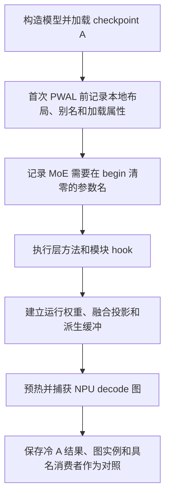
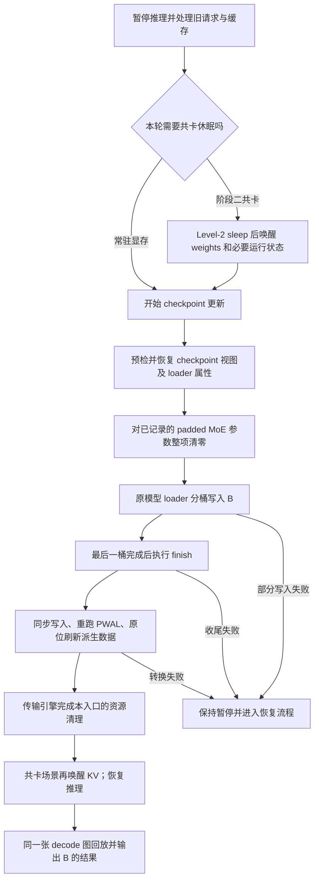
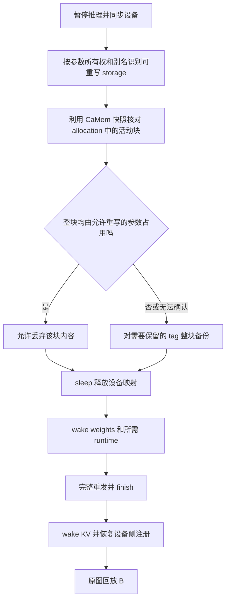

# 方案四：RFC #54477 在昇腾 A3、A5 上的权重重载适配设计

2026-11-18，适用于本文列出的 vLLM 与 vllm-ascend 固定版本。

## 1. 设计目标与实施顺序

训练侧把模型从权重 A 更新到 B 后，推理侧应继续使用同一个模型实例和已经捕获的 NPU decode 图。**第一轮用 B 推理时，原图就应读到与独立冷加载 B 一致的权重、派生张量和计算结果。** 这是第一阶段独立交付的功能。权重交换过程中释放显存、使用其他传输方式，以及适配量化权重，分别在后续阶段展开。

| 阶段 | 业务场景 | 阶段交付 | 完成标志 |
| --- | --- | --- | --- |
| 一 · BF16 原图直接重载 | A3、A5，非量化 BF16，显式开启 direct，权重常驻显存 | 从已有 checkpoint 或训练端全量更新 target 模型，重新执行加载后处理，在原图上恢复推理 | 两种硬件分别给出同一候选版本的 A→A→B→A、独立冷 A/B、原图回放及失败恢复证据 |
| 二 · BF16 权重交换与其他更新能力 | 同一硬件和精度，训练与推理共卡，或业务采用其他输入格式、传输入口及 reload 模式 | 优先完成 Level-2 sleep/wake 与真实权重传输的整轮交换；随后按入口交付其余适用能力 | 每个声明支持的组合都在目标机器上完成整轮更新和原图验证；共卡用例额外验证状态恢复和内存释放 |
| 三 · A5 MXFP 权重重载 | A5，MXFP 格式 W4A8 和 W8A8，同等优先级 | 两种格式分别覆盖 Linear、MoE 的 direct 原图更新，再覆盖阶段二适用的交换能力 | 用各自量化格式的冷加载结果作参考，核验真实量化内核读取的权重、scale、派生状态及输出 |
| 四 · 其他场景 | 其他量化、其他模型组合、MTP/推测解码 | 由实际模型和更新协议触发，每项单独界定参数归属、实现及验收 | 指定组合有独立证据即可交付；MTP 没有业务需求时可以一直不启动 |

首批图配置建议选用已有真机依据的 `FULL_DECODE_ONLY`。表中的“原图”具体指更新前已经捕获、更新后实际回放的同一张 decode 图。其他图模式、capture size、并行规模按实测范围登记。首批通道建议用已有测试基础的 **HCCL 非 packed**，同时把 **磁盘/inplace checkpoint** 作为独立入口验收。两项选择均为本方案的实施建议。

## 2. 系统设计：一次更新涉及哪些数据、由谁负责

### 2.1 为什么 BF16 也需要适配

checkpoint 是提供给 loader 的输入。经过分片、转置、专家拆分、投影融合或 NPU 格式转换后，内核读取的可能是另一块内存。以 SFA/KPool 为例，loader 更新投影参数，decode 图还要读取由它们生成的运行缓冲。重新给 Python 字段赋一个计算正确的新张量，已经捕获的图仍可能读取旧地址。反过来，地址正确但少执行一次派生计算，图也会在原地址读到 A。**因此一次交付需要同时保证源可加载、转换完整、运行数据原位更新、原图计算正确。**

| 对象 | 怎样处理 | 实现责任 |
| --- | --- | --- |
| checkpoint 参数、持久 buffer、别名 | 冷启动记录本 rank 的 shape、stride、dtype、offset、归属及 loader 分片属性；保留下一轮按原名加载的入口 | vLLM 公共 direct 生命周期；Ascend 审计会释放源参数或替换 Parameter 的分支 |
| 运行权重与派生数据 | 普通布局按契约原位写入；物理 NZ 使用布局匹配的持久运行缓冲；逐个更新图持有的 expert-list 元素、融合投影及派生 buffer | vllm-ascend 的 Linear、MoE、attention、indexer 及重载辅助函数 |
| 加载后处理 | `process_weights_after_loading`（下文简称 PWAL）先处理各层加载方法，包括未量化方法，再按子模块先于父模块的顺序执行模块 hook；同一共享模块在一次遍历中处理一次 | 公共 loader 调度；Ascend wrapper 负责未注册后端对象的必要委托 |
| 服务及传输状态 | 调用方暂停推理、处理旧请求及依赖旧权重的缓存，训练侧发齐本轮所需数据；worker 与 engine 管理更新会话、设备和目标 | 服务调用方、训练端、NPU worker、对应传输引擎 |
| sleep 后仍需存在的状态 | 区分可全量重写的纯参数分配与必须恢复的运行状态，按内存块和 tag 保存、映射与唤醒 | 阶段二的 NPU worker、CaMem allocator 和 sleep manager |

基线为 vLLM `ba15685ab7f4f5fbed8630bbb7441f8837e76fbe`、vllm-ascend `9005a22a862a95d52025b70fb2bff8eed8a5a5e3`。公共生命周期沿用固定 vLLM。NPU 专有处理放在 vllm-ascend 的插件、继承或既有 patch 入口。后续更换基线时，vLLM 侧如需改动，每个改动须对应明确的上游 vLLM PR。RFC 与源码分析（历史材料未附，原引用 `../single-pr/reference/RFC.md`）

### 2.2 冷启动：给后续更新留下可写入的源和可复用的图

冷启动记录的是模型本地可写入的分片布局。训练侧可以按 checkpoint 名称发送张量，TP 分片、融合 QKV 的子区间和 expert 映射仍由原模型 loader 处理。为验证 B，还需在相同硬件和配置上独立启动冷 B 引擎，避免让同一段热更新实现同时生成被测值和参考值。

### 2.3 运行时：从 A 到 B 的完整调用流程

HCCL 的外部入口是 `start_weight_update → update_weights（可多次）→ finish_weight_update`。磁盘/inplace 的 checkpoint 入口由 runner 经 `start_reload → model.load_weights → finish_reload` 驱动。两者共享模型转换语义，服务会话、传输和资源清理分别验收。恢复 checkpoint **视图**只恢复 loader 写入的形状和解释方式；需要重新转换的有效数据仍须重发。第一阶段选全量、同结构 A/B checkpoint，调用方在成功 finish 前保持模型暂停。direct 实现（历史材料未附，原引用 `../G2-BF16图模式代码审查-20261117/snapshot/vllm/vllm/model_executor/model_loader/reload/direct.py`） · inplace 入口（历史材料未附，原引用 `../G2-BF16图模式代码审查-20261117/snapshot/vllm/vllm/model_executor/model_loader/reload/inplace.py`）

## 3. 第一阶段：A3/A5 BF16 原图直接重载

**输入**为已冷加载并捕获图的 target 模型 A，以及同结构 BF16 checkpoint B。启动时显式设置 `VLLM_RELOAD_MODE=direct`，使用非量化权重和 KV、关闭推测解码，沿用已测入口的 `weight_nz_mode=0`。**输出**是在同一引擎、同一图实例中可以推理的 B，以及下一轮还能装回 A 的模型。算子内部强制使用的物理 NZ 仍在本阶段范围内。

### 3.1 按调用顺序实施

| 位置 | 需要接入或核对的行为 | 典型错误及判定 |
| --- | --- | --- |
| ① 冷加载与源保留 | 保住 checkpoint 参数对象、名称、必要别名及 loader 属性。检查冷启动时会 dispose 源投影的 SFA 分支，尤其是仅设 direct、未启用 RL 且未配 transfer 的磁盘更新 | 若 `kv_b_proj` 在首次 PWAL 后已释放，下一轮 loader 可能失去写入目标。用该入口单独复现，在 vllm-ascend 修正实际命中的保留条件，并回归普通冷启动 |
| ② begin 恢复加载视图 | 预检归属、共享参数、容量及 offset。参数迁入新 storage 时使用当前 offset。物理 NZ 的运行权重保留原址，必要时在可加载的 ND 张量上接收 checkpoint | 合法布局可重载；容量、归属或物理布局不兼容时显式报错。将 opaque NZ 当普通 ND 字节写会产生数值错误 |
| ③ 分桶写入及 MoE padding | 原模型 loader 负责所有分片。冷启动已选中的 padded MoE 参数在 begin 整项清零，随后重发全部有效区；小维每专家 scale 按公共选择规则排除 | 对比一整桶、按层及混合边界三种切分；direct 的桶间不得提前执行模型收尾。核对选中名单、零 padding、有效区及冷 B 输出 |
| ④ finish 与 hook 所有权 | 收齐后先同步，再执行公共 PWAL。已注册的 indexer backend 由 children-first 遍历处理；未注册的普通后端由 wrapper/impl 委托。保留后端所需 dtype 的转接 | 在共享 indexer 上记录对象身份、顺序与轮次。冷启动一次，每次完整 finish 一次，第二轮依然执行。避免从公共遍历、wrapper、SFA 三条路径重复到达同一 backend |
| ⑤ 图可见权重写回 | 逐个更新内核实际读取的运行权重、持久缓冲、列表元素及派生值。布局兼容时原位回填，遇到无法维持原图契约的变化则结束本轮更新 | 同时比较具名消费者的地址、布局和值。仅检查 `named_parameters()` 会漏掉 KPool buffer 和 expert-list 元素 |
| ⑥ worker 会话与恢复 | 用正确的设备和当前 vLLM 配置调用 finish。direct finish 异常时上报原错误、结束旧会话、重置更新目标。重新 start、完整重发、成功 finish 并核对原图后再恢复推理 | 实际注入 PWAL 异常；重试旧 finish 应失败，新事务可修复。若模型无法恢复，则重建引擎。数据回滚和自动拦截所有推理入口属于不同能力 |

公共接口与 NPU 分支的逐项来源见第 7 节。SFA 源保留属于静态审查发现的条件性缺口，对应配置仍须走真实入口验证。SFA 调用与源参数审查（历史材料未附，原引用 `../G2-BF16图模式代码审查-20261117/审查报告.txt`）

### 3.2 A3 与 A5 分别验什么

| 分支 | 观察对象和建议用例 | 通过条件 |
| --- | --- | --- |
| A3/A5 普通 BF16 dense | 目标硬件上选可运行的 dense 模型，检查普通 Linear 及实际命中的转置或融合权重；磁盘和 HCCL 分别运行 | 两入口各自取得冷 B 对照，原图跨轮推理，随后可装回 A |
| A3/A5 BF16 MoE | 选择实际命中的堆叠权重或 expert-list 路径，记录 w13/w2、列表元素和强制 NZ。目标配置出现专家 padding 时加入 ③ 的检查 | 有效专家权重和计算结果匹配冷 B，原图所持每个元素继续有效。按硬件、布局及 TP/EP 规模分别登记 |
| SFA/KPool | 对命中该 backend 的模型树观察 `_key_weight`、`_gate_weight`、`_head_weight_f32`、`_norm_weight_f32`、`_norm_bias_f32`；另验 SFA direct-only 源保留 | 五个 buffer 值和地址逐轮正确，backend 每轮处理一次。完整检索路径用目标模型验证，组件 matmul/bmm 仅作定位 |
| 特定模型分支 | SFA 的未量化 PD consumer 若选到 PROLOG_V3，验三个 NZ 投影；若业务模型含 GDN/KDA，则验对应 packed 卷积权重 | 记录硬件能力、命中条件与实际算子。只有目标模型路径实际执行并通过时才列入对应硬件的支持表 |

**本阶段交付边界。** 阶段一用权重常驻内存的完整事务建立最小可用能力。MoE padding 在无 sleep 时也可能触发；HCCL 在普通更新结束时也会归还可释放缓存。这两项随首批路径验收。HCCL 所继承的 finish 先调用 `finish_reload`，再调用 `empty_cache()`；direct 收尾在 PWAL 前执行的设备同步负责让其他流的写入可见。分别核对两者的位置，无需在 Ascend 再叠加一次全局 finish。MoE padding（历史材料未附，原引用 `../single-pr/64352/README.md`） · HCCL 更新后缓存清理（历史材料未附，原引用 `../single-pr/64691/README.md`）

## 4. 第二阶段：A3/A5 BF16 共卡交换及其余适用能力

**输入**为阶段一已经通过的具体硬件、模型及更新入口，再加上使用场景要求的休眠策略、权重格式或传输通道。**输出**是每种新增方式可独立使用的 BF16 图模式配置。先做共卡训练最需要的 Level-2，再扩展其余入口；各入口沿用同一套原图与数值判据。

### 4.1 Level-2 sleep/wake 的实现

固定版本的 Ascend worker 会按名称备份选定参数和 `named_buffers()`，CaMem 按 tag 处理分配。weights pool 里还可能放有普通 tensor 属性、内核指针表及参数和非参数共享的块。旧栈已经出现过“唤醒后地址相同、普通属性丢值、原图算错”的反例。实施时对照已有 block 级适配，把策略接到当前 worker 和 CaMem 的真实生命周期。Level-2 原因与实现（历史材料未附，原引用 `../single-pr/66010/README.md`） · 历史整轮验证（历史材料未附，原引用 `../updates/2026-11-09/验证报告.md`）

| 内存或生命周期 | 实现与验证 |
| --- | --- |
| 纯参数、显式保留参数、别名 | 只有整块均为允许重写的纯参数时才可免备份。保留规则按 storage 归并，任何需保留的别名都会影响整块策略；被丢弃的参数在推理前完整重发 |
| 混合块、普通属性、runtime/graph | 对需要保留的 tag 整块备份，未知块保守处理。唤醒后检查内容、地址、offset 及图实际读取的结果，再由 finish 把 A 的派生值刷新成 B |
| KV、pool 和注册回调 | 按 tag 延迟唤醒。KV-only wake 避免访问尚未映射的 weights；核对全局 buffer 注销/重注册、同 tag 多 pool 和连续多轮 sleep/wake，保留既有 extra cleanup 顺序 |
| 端到端交换 | A3/A5 各运行真实传输、分 tag 唤醒、A→B→A 与原图回放。记录释放量、备份量、轮后设备占用和数值；历史单卡磁盘分桶结果作为对照 |

### 4.2 同一精度下的其他能力如何排期

| 能力 | 具体实施 | 验收和依赖 |
| --- | --- | --- |
| kernel-format 输入 | 对已经分片且已经过后处理的权重，走对应 inplace/iterator 分支；按运行时名称写入，使用 `weights_already_processed` 语义刷新 module 派生状态，避免再次转置或打包 | 与等价 checkpoint 冷 B 对照，检查派生值和原图；输入名称、格式和本地分片须显式记录 |
| HCCL packed、NPU IPC | packed 重点核对 begin 清零与接收流顺序、bucket 边界、缓冲复用；IPC 单验设备映射、句柄生命周期和 finish 同步。按固定 pin 的实际可达接口实施 | 真实跨进程发包，改变桶大小并重复更新。通过的 HCCL 非 packed 用例只支持该通道；依赖未在 pin 中具备的上游修复时单列 |
| layerwise 更新 | 业务需要这一模式时沿用它自己的按层收尾，先处理 expert-list 重绑导致旧图仍读 A 的已知边界 | 用能区分 A/B 的实际列表消费者复现并修复，再验同模式冷 B。分别记录 direct 与 layerwise 的通过组合 |
| 并行及模型入口 | 在业务需要的 TP/EP、PD 或其他 runner 上核对本地 shard、expert/scale 的归属及所有 rank 的收尾。M2N、稀疏更新、其他 loader 先查 Ascend 可达性和输入契约 | 以该入口和配置的真机证据决定范围。稀疏更新尤其要证明所有需重新转换或被清零的区域都被覆盖 |
| 完整性、模型支持声明、检测与 CI | 对照固定 pin 和已有上游工作，分别登记整轮缺 shard/expert 检查、更新期间服务隔离、模型声明、运行时检测及模型族 CI 的依赖 | 在当前全量更新模式由调用方暂停并发齐。测试可观察地址与调用次数；生产能力随对应上游实现及 Ascend 验证单独交付。全局默认 direct、移除 layerwise 属于更广的发布决策 |

ROCm DeepSeek-V4 的 preshuffle scale 修复仅运行于对应 ROCm 后端，A3/A5 BF16 没有该执行分支。该项登记来源后即可结束，阶段二无对应 NPU 开发任务。A5 MXFP 的 scale 由阶段三按昇腾真实算子核对。后端适用范围（历史材料未附，原引用 `../single-pr/65296/README.md`）

## 5. 第三阶段：A5 MXFP W4A8 和 W8A8

**输入**为 A5 上可独立冷加载的两个同结构量化 checkpoint A/B，明确权重编码、分组 scale、目标 Linear/MoE scheme、实际 kernel 和并行配置。**输出**为两份可独立声明的支持结果，分别对应 W4A8 MXFP 和 W8A8 MXFP。两者沿用阶段一的会话和阶段二适用的交换方式，主要新增工作在 checkpoint 布局、转换 guard、scale 及原图持有的量化运行缓冲。

| 组合 | 重点设计 | 最直接的失效信号 |
| --- | --- | --- |
| W4A8 MXFP Linear | 在 `W4A8_MXFP` 路径核对压缩权重、分组 scale 的 reshape/transpose、`_mxfp4_transformed` 的恢复时机；保留下一轮可写入的 checkpoint 视图 | 第二轮仍使用旧 scale、重复重排或把打包值当普通整数转换 |
| W4A8 MXFP MoE | 对 w13/w2 权重和 scale 分别追踪实际 GMM 或其他命中内核，检查 NZ、每专家列表引用和 DS 专用分支。每项以真实硬件 profile 和实际 dispatch 为准 | 参数看似已更新，图内专家或 scale 列表仍指旧元素。W4A8 Linear/MoE 实现（历史材料未附，原引用 `../G2-BF16图模式代码审查-20261117/snapshot/vllm-ascend/vllm_ascend/quantization/methods/w4a8/w4a8_mxfp4.py`） |
| W8A8 MXFP Linear | 核对 `W8A8_MXFP8` 的持久转换缓冲、`restore_weights_for_rl_loading` 与 direct 生命周期的实际衔接、`_mxfp8_transformed`；使用 DS 子类时另验派生输入 | guard 跨轮跳过转换，或在 begin 和专用 restore 中重复恢复，导致原图读取错误布局 |
| W8A8 MXFP MoE | 核对 w13/w2 的物理 NZ 格式、scale 重排、不同 kernel 分支及专家列表；记录实际算子收到的张量 | 物理格式或 scale 编码错误，即便外层 shape 和地址稳定，输出仍偏离冷 B。W8A8 Linear/MoE 实现（历史材料未附，原引用 `../G2-BF16图模式代码审查-20261117/snapshot/vllm-ascend/vllm_ascend/quantization/methods/w8a8/w8a8_mxfp8.py`） |

**实施与退出条件。** 每种格式先构造“只改权重”“只改 scale”的可辨识输入，再做两者一起变化的整模型 A→A→B→A。对 E8M0 scale 核对编码字节，对 opaque NZ 核对物理格式和真实算子数值。每轮 finish 前处理该 scheme 的 guard，同一轮避免重复转换。Linear、MoE 分别达到冷加载一致和原图回放后，再逐项复验 Level-2、真实 HCCL、业务使用的 kernel-format/IPC/packed 与并行组合；每格记录通过、待验或不适用及原因。量化结果的参考引擎须使用同一量化格式和内核配置。

## 6. 第四阶段：其他量化和可选的 MTP

| 触发需求 | 输入与设计 | 交付和退出条件 |
| --- | --- | --- |
| 其他量化格式或量化 KV/cache | 明确硬件、权重/激活/KV 各自 dtype、scheme、算子及 checkpoint。逐项追踪 weight、scale、offset、bias、派生对象和可能固化到图中的 host scalar | 先让该模型冷启动和真实算子有基准，再验 direct 原图与业务所需交换方式。无法动态更新的图常量须有明确的拒绝或重建行为 |
| 其他模型、硬件或并行扩展 | 取得目标模型与部署配置，确认是否引入新的源参数释放、布局转换、通信路径或图消费者 | 仅为新增路径补实现并回归已有支持组合；提交该配置的独立冷 B 和跨轮结果 |
| MTP/推测解码，可选 | 业务先明确只更新 target、只更新 draft 或两者一起更新。列出共享 embedding/lm_head 的 storage 所有者、各自发包内容、finish 顺序及某一侧失败后的恢复方式 | 对各自更新和共享权重分别验证冷参考、原图、两侧版本一致性与失败恢复。只有实际使用 MTP 时才投入该专项 |

## 7. 上游机制与 Ascend 落点对照

以下按**机制在运行时的位置**登记方案所依据的 12 项上游来源。合入范围来自工作区固定快照；在后续 pin 上实施时逐项核对源码和提交。表中“公共继承”表示可沿用 vLLM 实现，NPU 分支仍按目标场景验收。固定来源快照（历史材料未附，原引用 `依据/2026-11-16-main-pr-status.json`）

| 上游 PR | 提供的机制 | 方案四中的位置与 Ascend 动作 |
| --- | --- | --- |
| #62407（历史材料未附，原引用 `../single-pr/62407/README.md`） | 保留被改名、转换或退休的参数身份 | 第一阶段冷加载和下一次 begin；核对源名称、别名和 loader |
| #64336（历史材料未附，原引用 `../single-pr/64336/README.md`） | direct 生命周期、布局恢复及 worker 失败收尾 | 第一阶段 worker/runner 入口，检查独立 NPU worker 的异常会话处理 |
| #65281（历史材料未附，原引用 `../single-pr/65281/README.md`） | 参数换 storage 后按当前 offset 恢复 | 第一阶段 begin，核对切片及融合缓冲 |
| #64352（历史材料未附，原引用 `../single-pr/64352/README.md`） | 冷启动记录 padded 参数、begin 清零 | 第一阶段命中 padded MoE 即验；后续交换及并行配置沿用 |
| #64357（历史材料未附，原引用 `../single-pr/64357/README.md`） | 模型级收尾移至整体加载末尾 | 第一阶段避免按桶 finalize；后续模型覆写按同一时机检查 |
| #57678（历史材料未附，原引用 `../single-pr/57678/README.md`） | 无参 module hook、子模块优先、共享对象去重 | 第一阶段核对 MLA、SFA、indexer 的注册及委托 |
| #65914（历史材料未附，原引用 `../single-pr/65914/README.md`） | 更新路径统一收尾 | 第一阶段用于 checkpoint，第二阶段核对已处理格式及其他入口 |
| #64886（历史材料未附，原引用 `../single-pr/64886/README.md`） | 较早的 kernel-format 派生刷新接口 | 记录替代关系，目标实现使用 #65914 的最终机制 |
| #64692（历史材料未附，原引用 `../single-pr/64692/README.md`） | 原位刷新派生张量和内核常量 | 第一阶段覆盖 BF16 持久运行缓冲、expert-list、融合投影；第三阶段扩展到量化 scale |
| #64691（历史材料未附，原引用 `../single-pr/64691/README.md`） | 权重传输结束后归还可释放缓存 | 第一阶段 HCCL 继承公共 finish，第二阶段检验多轮共卡资源表现 |
| #66010（历史材料未附，原引用 `../single-pr/66010/README.md`） | Level-2 仅丢弃允许重写的纯参数分配 | 第二阶段接入 NPU allocator/worker，独立于常驻显存更新交付 |
| #65296（历史材料未附，原引用 `../single-pr/65296/README.md`） | ROCm preshuffle scale 的身份与刷新 | ROCm 后端来源留档，A3/A5 无对应执行路径 |

## 8. 统一验收和交付方式

| 要回答的问题 | 需要留存的证据 |
| --- | --- |
| 本轮确实用 B 推理了吗？ | 独立冷 A/B；选取能区分两者的固定输入；热模型依次 A→A→B→A。逐轮比较 token、logprobs、关键权重和派生值；容差随具体模型与算子记录 |
| 真的是原图吗？ | 固定输入形状和 capture descriptor，记录图实例、捕获计数、成功回放计数。跨更新期间图实例相同、捕获数不增加，每轮推理回放数增加 |
| 图读取的对象正确吗？ | 按“模型层名 → 消费算子 → 输入名”记录 tensor/storage 地址、offset、shape、stride、dtype、NPU format 和值；列表按元素记录，scale 按编码与算子输出核对 |
| 收尾完整且每轮只做一次吗？ | 记录注册树中的实际对象、层方法和 module hook 顺序及次数；用不同合法 bucket 切分复验共享 backend 和未注册 backend 两种情况 |
| 真实入口能从失败中恢复吗？ | 保存 worker/runner 发起的调用、异常和状态。对 direct finish 注入失败，验证旧会话关闭、新 start 完整重发、成功 finish 后原图匹配冷 B。多 rank 配置记录所有参与 rank 的结果 |
| 实施能复现吗？ | 固定双仓 commit、镜像、CANN/torch-npu、模型/checkpoint、硬件和并行配置。交付 Ascend 增量及累计 diff、原代码与最终源码、启动命令和原始日志；核对 vLLM diff 的上游来源 |

每阶段以**硬件 × 模型和精度 × 图模式 × 更新入口 × 是否 sleep × 并行配置**为一行出具结果。单测、NPU 组件、完整模型和真实传输分别注明验证层级。只要一个声明支持的场景尚缺原图或冷参考证据，该行就保留“待验”，其他已经通过的配置可以独立交付。

## 附录：已有实现和证据能支撑哪些判断

下表仅供实施时定位代码和复用用例。旧方案的 G1/G2 是历史交付名称；本方案的阶段定义、职责和完成条件见上文。

| 历史材料 | 已有结论 | 实施时要补的证据 |
| --- | --- | --- |
| BF16 direct 的 A3 结果 | 有 dense/MoE 完整模型、HCCL direct 和 KPool 组件记录；layerwise + expert-list 的旧图读 A 有基线反例 | 在本次候选用真实入口复验，分别记录组件和整模型范围。A3 记录（历史材料未附，原引用 `../G1-最终适配版/evidence/bf16-only-20261117/validation-20261117/a5-native-mlapo/a3-before-a5-final-results.json`） |
| A5 native MLAPO | 12 文件候选上，无/有 head padding × eager/图模式四项通过；两个图用例各保持 1 张图、最终回放 42 次，另有真实 HCCL direct 图模式一项。后续 14 文件评审候选有 28 条 CPU UT | 2026-11-19 起该 MLAPO 场景移出第一阶段，本行保留历史结果。A5 真机结果（历史材料未附，原引用 `../G1-最终适配版/evidence/a5-hardware-20261118/final-results.json`） · 评审 UT（历史材料未附，原引用 `../G1-最终适配版/evidence/review-four/ut.log`） |
| indexer 收尾独立验证 | 两个生产文件、一个测试文件及一份发布说明草稿。46 条 UT 通过；A3 组件按轮捕获，tiny MLA 完成冷启动与图推理 | 联合检查“每轮调用一次”与“更新前的同一张图读取 B”。收尾实现与验证边界（历史材料未附，原引用 `../G2-独立适配版/适配文档.txt`） |
| 同一 pin 上的代码组合检查 | 历史 G1 评审累计补丁与 G2 独立补丁已在临时基线文件上依次通过 apply 检查并实际应用。唯一共同文件是 `attention/sfa_v1.py`，保留了投影原位回填和 indexer 去重两处逻辑；15 个 Python 文件通过语法解析 | 这解释了为何源保留、写回和统一收尾可以作为一项功能交付。组合版本在 A3/A5 的整轮真机验收仍待实施。评审累计补丁（历史材料未附，原引用 `../G1-最终适配版/patches/vllm-ascend-review-cumulative.diff`） · 收尾补丁（历史材料未附，原引用 `../G2-独立适配版/patches/vllm-ascend-g2.diff`） |
| Level-2 历史实验 | 旧栈曾在 A3、Qwen3-0.6B、BF16、TP1 上用磁盘分桶完成 sleep→更新→原图回放与冷 B 对照 | 在当前 pin 的 A3/A5 上验证 CaMem、真实传输及目标并行配置。历史报告（历史材料未附，原引用 `../updates/2026-11-09/验证报告.md`） |

本次交付为适配设计。上述通过项属于各自注明的历史版本，本次改写未执行新部署或 NPU 实验。
