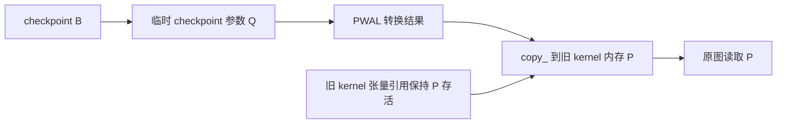
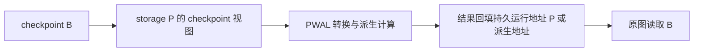

# Layerwise 与 Direct 权重重载的方法级代码走读

Layerwise 通过“重建加载目标、重新后处理、拷回旧运行张量”维护原图引用的地址。Direct 在保留参数的 storage 上恢复 checkpoint 视图，直接加载新权重，再由各后处理实现把运行权重和派生数据写回持久地址。

Layerwise 的临时层让 loader 可以在原始布局中加载，同时保留原图持有的运行张量。Direct 将原有 storage 复用于加载阶段，因此省去了 Layerwise 的通用逐层 materialize 与统一回拷流程。通信缓冲、后处理临时结果，以及特殊布局所需的持久加载区，仍由实际实现决定。

源码基线为 vLLM `ecc827ebbf627792e97a44f328fddac95e293129`，对应 2026-11-19 已核对的 main。本文分析 checkpoint-format 更新，BF16 为主要例子，方法与行号均绑定该提交。示意代码用于解释数据流。

## 1. 先区分四种对象

| 对象 | 作用 | 在两种机制中的位置 |
| --- | --- | --- |
| checkpoint 输入张量 | 从磁盘或 trainer 得到的源数据，可能跨进程传输 | 两者都需要，生命周期受 loader 和通信实现约束 |
| loader 目标参数 | 接受 checkpoint 分片，带 weight_loader、TP/融合/打包属性 | Layerwise 从 meta 元数据重建；Direct 恢复保留对象的加载视图与属性 |
| kernel 运行张量 | 推理算子真正读取的权重，可能已转置、融合或重排 | 图捕获记录其地址，更新后需在相同地址提供新运行数据 |
| 派生张量 | 从权重计算的投影、倒数、列表元素等 | 必须随权重刷新，并保持图所读取的对象/地址 |

一个 Python `Parameter` 对象、它的 `.data` 视图、底层 storage 和图记录的地址是不同层次。保留参数名或 Python 对象，并不能单独证明图在读新数据。

BF16 表示元素精度，加载布局与运行布局仍可能不同。例如融合 QKV、MoE expert 拆分、MLA 吸收投影、NPU NZ 都可能改变布局或引入新运行张量。普通 BF16 Linear 的后处理也可能很轻，具体行为由 kernel/backend 决定。

## 2. 两条路径从哪里分开

传输会话通常经过 worker 的 `start_weight_update`、`update_weights`、`finish_weight_update`，engine 使用公共 reload 生命周期。磁盘更新的 `inplace.reload_weights(..., is_checkpoint_format=True)` 也走相同的核心分派。

```text
checkpoint-format 入口
  start_reload(model)
    direct 开启  → begin_direct_reload(model)
    layerwise    → initialize_layerwise_reload(model)

  model.load_weights(checkpoint_tensors)
    保留模型原有的名字路由、TP/EP、融合和 weight_loader

  finish_reload(model, config, device)
    direct 开启  → finish_direct_reload(...)
    layerwise    → finalize_layerwise_reload(...)
```

`VLLM_RELOAD_MODE=direct` 由 `direct_reload_enabled()` 读取。公共生命周期中 `_weight_update_active` 是进程级加载窗口标记，worker/engine 另外维护会话状态。模型视图恢复后到成功 finish 之间，调用方需要保持暂停。

预处理后的 kernel-format 输入在 `inplace.reload_weights` 的另一分支中直接 `param.copy_`，然后在 `weights_already_processed()` 上下文刷新 module hooks。该路径的输入已经分片并转换，需与本文 checkpoint-format 对照区分。

入口源码见 [lifecycle.py](https://github.com/vllm-project/vllm/blob/ecc827ebbf627792e97a44f328fddac95e293129/vllm/model_executor/model_loader/reload/lifecycle.py#L26)、[inplace.py](https://github.com/vllm-project/vllm/blob/ecc827ebbf627792e97a44f328fddac95e293129/vllm/model_executor/model_loader/reload/inplace.py#L34)、[GPUWorker](https://github.com/vllm-project/vllm/blob/ecc827ebbf627792e97a44f328fddac95e293129/vllm/v1/worker/gpu_worker.py#L1731)。

## 3. Layerwise 冷启动记录了什么

### 3.1 initialize_model 与 record_metadata_for_reloading

`model_loader/utils.py::initialize_model()` 构造模型后调用 `record_metadata_for_reloading(model)`。这个时点在普通冷加载 checkpoint 之前，因此保存的是模型构造时的加载目标定义。

`record_metadata_for_reloading()` 遍历 module，为每层建立 `LayerReloadingInfo`。`capture_layer_to_meta()` 将所选参数和 buffer 转为 meta 张量，保留张量类和自定义属性。meta 对象描述 shape、stride、dtype 等信息，不保存 A 的设备权重内容。实现还会跳过部分模块/张量，并排除与参数共享 storage 的特定非持久 buffer。

`sanitize_layer_refs` 处理元数据里的 layer 引用，配合弱引用表避免元数据持有模型造成引用环。

### 3.2 LayerReloadingInfo 的主要字段

| 字段 | 保存内容 | 用途 |
| --- | --- | --- |
| `restore_metadata` | 参数、buffer 的 meta 对象 | 重建 checkpoint 加载目标 |
| `restore_device` | 目标设备上下文 | materialize 临时层 |
| `kernel_tensors` | 本轮开始时实际运行参数和 buffer 的引用 | 转换完成后回拷并恢复注册 |
| `kernel_non_persistent_buffers` | 非持久 buffer 名称集合 | 恢复 buffer 注册语义 |
| `loaded_weights` | 参数名与绑定后的 loader 调用参数 | 保留输入并在实体化后重放 |
| `load_numel` / `load_numel_total` | 已加载元素数与预计元素数 | 判断何时可以执行该层后处理 |
| `defer_processing` | 延迟标记 | 将处理推迟到整体 finalize |

这里存在两种保存行为。冷启动保存 meta 定义；每轮更新开始保存现有 kernel 张量引用。后者通常只增加引用，并不复制一份完整 A。

源码见 [initialize_model](https://github.com/vllm-project/vllm/blob/ecc827ebbf627792e97a44f328fddac95e293129/vllm/model_executor/model_loader/utils.py#L84)、[record_metadata_for_reloading](https://github.com/vllm-project/vllm/blob/ecc827ebbf627792e97a44f328fddac95e293129/vllm/model_executor/model_loader/reload/layerwise.py#L74)、[meta.py](https://github.com/vllm-project/vllm/blob/ecc827ebbf627792e97a44f328fddac95e293129/vllm/model_executor/model_loader/reload/meta.py#L98)、[LayerReloadingInfo](https://github.com/vllm-project/vllm/blob/ecc827ebbf627792e97a44f328fddac95e293129/vllm/model_executor/model_loader/reload/types.py#L15)。

## 4. Layerwise 一轮更新的方法链

### 4.1 initialize_layerwise_reload 保存旧运行对象并恢复 meta 目标

对每个需要重载的 module，它按顺序执行：

1. `info.kernel_tensors = get_layer_params_buffers(layer)` 保存当前注册参数和 buffer 的引用。
2. 保存非持久 buffer 名单。
3. `restore_layer_on_meta(layer, info)` 删除所选现有注册项，并把 meta 定义注册回模块。
4. `initialize_online_processing(layer)` 初始化计数并包装 weight loader。

此时原图需要的运行内存仍由 `kernel_tensors` 等引用保活，模块属性下的加载目标已切回 meta 定义。该流程没有重新调用整个 Transformer block 的构造函数，重建的主要是各 module 所选的参数/buffer。

### 4.2 make_online_process_loader 缓存调用并统计元素数

`_wrap_parameters_weight_loader()` 把参数上的原 loader 包装成 `online_process_loader`。模型的 `load_weights` 仍负责名字路由，但到达底层参数时会进入包装器。

包装器执行以下工作：

- 更新本层预期加载量，并处理稍后注册的参数。
- 绑定原 loader 的参数，把 `(param_name, BoundArguments)` 放进 `info.loaded_weights`。
- 调用 `get_numel_loaded(original_loader, bound_args)`。它实际执行原 loader，并通过 `CopyCounter(TorchDispatchMode)` 统计 `copy_` 元素数。常见目标此时是 meta，主要完成逻辑加载和计数。
- 普通可在线处理层达到预计元素量后，进入 `_layerwise_process()`。attention-like 层或显式 defer 的层等待最终 finalize。

`loaded_weights` 保留的是调用参数和其中张量的引用，没有统一对输入再做一次 clone。若源张量位于设备内存，引用会延长其生存期。如果 packed buffer 在这些张量真正被重放前已遭覆写，后续 loader 可能读到错误字节，通信实现必须负责相应顺序和所有权。

`get_numel_loaded()` 会将计数上限约束到目标参数可加载量，处理原 loader 内部多次 `copy_` 的情况。它依然依赖 loader 的真实行为和本层计数定义。

### 4.3 _layerwise_process 分配实体、重放加载

```text
_layerwise_process(layer, info)
  materialize_layer(layer, info)
    对选定的 meta 张量调用 materialize_meta_tensor
      empty_strided(...).zero_() → 新的实际加载内存
  解开 layerwise loader 包装
  for name, args in info.loaded_weights
    args.arguments['param'] = 当前新实体参数
    原 weight_loader(*args.args, **args.kwargs)
  _process_loaded_layer(layer, info)
```

**临时层数据内存的明确分配点是 `materialize_meta_tensor()`。** 它按原定义分配并清零，以防 loader 未写入的 padding 留下脏值。普通重载使用记录设备；某些在线量化/offload 分支可以选择 CPU staging。

### 4.4 _process_loaded_layer 运行 PWAL，然后通用回拷

该方法清理相关一次性 guard，调用层的 `quant_method.process_weights_after_loading(layer)`，必要时重新协调 TP 属性。`quant_method` 的命名也覆盖未量化方法，具体可能执行转置、融合、pack，或基本无需变换。

随后 `_copy_and_restore_kernel_tensors()` 把当前处理结果 `copy_` 到 `info.kernel_tensors` 中保存的旧参数/buffer，再调用 `_place_kernel_tensors()`，将这些旧对象重新注册回模块。

buffer 有细分规则，已消失的 buffer 和部分未加载的非持久 buffer 不做该次通用拷贝。普通 tensor 属性、Python expert-list 元素等也不会自动进入这份 registered 参数/buffer 列表，需要对应后处理或 hook 正确刷新。

### 4.5 finalize_layerwise_reload 收尾

`finalize_layerwise_processing()` 处理尚未完成的层，包括 padding 导致计数未达标的层、显式 defer 层和 attention-like 层。完全没有收到新数据的已加载层可恢复原 kernel 张量作为 fallback。

attention-like 层由 `_finalize_attention_layer()` 单列处理。其中 scale 重载经过 `_reload_attention_scales()`，其假定包含 dtype/shape 兼容等条件。

最后 `finalize_layerwise_reload()` 调用公共 `finalize_model_weights(model)` 执行 module hooks。Layerwise 也需要这些整体收尾，不能把它概括为所有处理都在某层最后一个 tensor 到达时完成。

方法位置见 [initialize_layerwise_reload](https://github.com/vllm-project/vllm/blob/ecc827ebbf627792e97a44f328fddac95e293129/vllm/model_executor/model_loader/reload/layerwise.py#L98)、[make_online_process_loader](https://github.com/vllm-project/vllm/blob/ecc827ebbf627792e97a44f328fddac95e293129/vllm/model_executor/model_loader/reload/layerwise.py#L166)、[_layerwise_process](https://github.com/vllm-project/vllm/blob/ecc827ebbf627792e97a44f328fddac95e293129/vllm/model_executor/model_loader/reload/layerwise.py#L363)、[_copy_and_restore_kernel_tensors](https://github.com/vllm-project/vllm/blob/ecc827ebbf627792e97a44f328fddac95e293129/vllm/model_executor/model_loader/reload/layerwise.py#L448)、[finalize_layerwise_processing](https://github.com/vllm-project/vllm/blob/ecc827ebbf627792e97a44f328fddac95e293129/vllm/model_executor/model_loader/reload/layerwise.py#L247)、[CopyCounter](https://github.com/vllm-project/vllm/blob/ecc827ebbf627792e97a44f328fddac95e293129/vllm/model_executor/model_loader/reload/meta.py#L163)。

## 5. Layerwise 为何需要临时参数

假设 checkpoint 的 BF16 权重是 `[2, 3]`，某后端冷启动后把它转置、实体化为 `[3, 2]` 运行权重，图捕获地址记为 `P`。这个例子用于说明布局差异，具体模型需按其 kernel 实现走读。

下一轮原 loader 仍期望往 `[2, 3]` 的目标中写入，并依赖加载属性完成分片。原图需要 `[3, 2]` 的运行数据留在 `P`。Layerwise 用两个物理区域同时满足这两种需求。



临时参数使原 loader 和原 PWAL 可以在接近冷启动的加载对象上工作。PWAL 可以重排张量、生成新对象，最终由统一回拷把结果送到旧运行地址。meta 定义避免在 start 时就为所有层同时实体化全部加载目标，包装 loader 再按层组织处理。

这一实现选择也带来约束。乱序输入、多个未收齐的层、attention defer、padding 或共享映射，都可能延长输入缓存和临时对象的存活期。派生属性若引用临时参数，通用 registered 张量回拷未必能修复那个引用。实际代码需要按派生对象的所有权刷新，问题是否发生取决于具体路径。

`max_layer_reload_bytes()` 按冷启动 meta 定义估算最大的 checkpoint 层字节数，可用于考虑单层 materialize 的开销。实际更新峰值还包括传输输入、待处理层缓存、转换工作区及 allocator 行为。

## 6. Direct 如何复用原有 storage

### 6.1 冷启动 record_checkpoint_layout

普通冷启动先由 `BaseModelLoader.load_model()` 加载 A，再进入公共 `process_weights_after_loading()`。Direct 在 PWAL 前调用 `record_checkpoint_layout()`，记录的是当时已加载张量的布局和属性。

| 记录 | 保存内容 | 后续用途 |
| --- | --- | --- |
| `tensor._ckpt` | owner、shape/stride/dtype/offset、loader 属性、storage 基址 | 重建加载视图、恢复分片/pack 属性、处理 storage 搬移后的 offset |
| `_ckpt_param_names` | 所有带记录的参数名，含别名 | 识别部分同名 Parameter 替换问题 |
| `_ckpt_owner` | 模型所有权标记 | 约束共享 target/draft 张量的布局恢复和清零 |
| `_ckpt_modules` | 冷启动 module 集合 | 后续 quant-method pass 复用原模块，避免新增 LoRA wrapper 导致重复处理 |
| `_required_params` | 冷加载时 loader 上报的参数集合 | finish 前检查本轮交付完整性 |

`_ckpt` 主要保存元数据，没有在这里额外分配一层 checkpoint 参数实体。某个 PWAL 若会压缩权重，保留足够的底层 storage 才能让下一轮恢复 checkpoint 视图。

### 6.2 begin_direct_reload 的预检和视图恢复

```text
begin_direct_reload(model)
  检查存在冷启动记录
  _check_params_kept(model)
  views = _checkpoint_views(model)    # 先计算并检查所有候选视图
  设置 begun 标记，开始统计本轮加载名
  for tensor, view in views
    tensor.data = view
  恢复 owned 张量的 loader 属性
  对 owned 且 fill_on_reload 的张量整项清零
```

`_checkpoint_views()` 对布局变化的张量读取 `_ckpt`，计算 stride 的真实跨度，并检查当前 storage 的容量。storage 若搬移过，则使用当前 offset。共享张量的受限布局变更会被拒绝。

`storage_view()` 使用 `torch.empty(0, ...).set_(storage, offset, shape, stride)` 构造视图。它会创建视图对象，但加载数据仍位于既有 storage。容量检查由 `_checkpoint_views()` 负责。

以上一节 `[2, 3]` 与 `[3, 2]` 的例子说明，Direct begin 把 `P` 解释为 `[2, 3]` checkpoint 目标。此时 `P` 中可能仍是运行态 A 的字节，重新解释没有执行转置的逆运算，后续 loader 会覆盖它。在完整更新成功前，图不能运行。

`_check_params_kept()` 主要检查当前同名参数是否丢失记录，没有通过原始名字集合差检测全部删除/改名。加载名台账、完整性和实际 loader 路径仍需联合验证。

### 6.3 原 loader 直接写目标

普通 checkpoint 路径继续调用 `model.load_weights()` 及其原有 weight loader。切分、融合 QKV、专家映射等仍由模型处理。Direct core 不再为逐层完成判断包装 `make_online_process_loader()`，也没有对应的通用 `materialize_layer()` 步骤。

新的完整性跟踪可能包装模型级 `load_weights` 以收集返回的加载名。它的作用是记账，区别于 Layerwise 的缓存输入、元素计数和重放。Online quant 或自有 loader 的包装行为需按其专用路径单独走读。

### 6.4 finish_direct_reload 重跑后处理

执行顺序是消费 begun 标记、`_check_update_complete()`、非 CPU 设备同步、清相关 quant-method 一次性 guard，最后进入公共 `process_weights_after_loading()`。

公共 PWAL 按记录模块调用各层的 quant-method 后处理，随后执行 `finalize_model_weights()`。后者 children-first 调用 module hook，对 quant-method 所拥有的子树有遍历边界；deferred attention 判断用于选择 device loading context。

每个生成运行数据的实现负责保持其持久地址。常用工具包括：

| 方法 | 当前行为 | 审查重点 |
| --- | --- | --- |
| `replace_parameter` | 尽量保留原 Parameter，布局相同时 copy，不同时尝试写入旧 storage | 保留对象与保留地址分别检查 |
| `_in_own_storage` | 若范围、设备、对齐等条件满足，在旧 storage 建结果视图并 copy | 条件不满足时可返回新张量，后续可能重绑 `.data` |
| `retire_parameter` | 保留源参数供下轮加载，标记其退出 kernel 参数枚举 | loader 入口与运行消费者对应关系 |
| `refill_derived` | shape/dtype/device 匹配时 copy 到旧派生属性，否则 setattr | 派生对象是否拥有独立 storage，布局变化是否破坏图契约 |

Direct 的保址由具体实现和验证共同保证。公共工具并没有覆盖所有分支的严格保址拒绝器。

源码见 [record_checkpoint_layout](https://github.com/vllm-project/vllm/blob/ecc827ebbf627792e97a44f328fddac95e293129/vllm/model_executor/model_loader/reload/direct.py#L188)、[_checkpoint_views](https://github.com/vllm-project/vllm/blob/ecc827ebbf627792e97a44f328fddac95e293129/vllm/model_executor/model_loader/reload/direct.py#L240)、[begin_direct_reload](https://github.com/vllm-project/vllm/blob/ecc827ebbf627792e97a44f328fddac95e293129/vllm/model_executor/model_loader/reload/direct.py#L276)、[finish_direct_reload](https://github.com/vllm-project/vllm/blob/ecc827ebbf627792e97a44f328fddac95e293129/vllm/model_executor/model_loader/reload/direct.py#L308)、[公共 PWAL](https://github.com/vllm-project/vllm/blob/ecc827ebbf627792e97a44f328fddac95e293129/vllm/model_executor/model_loader/utils.py#L149)、[module hooks](https://github.com/vllm-project/vllm/blob/ecc827ebbf627792e97a44f328fddac95e293129/vllm/model_executor/model_loader/weight_utils.py#L1522)、[参数工具](https://github.com/vllm-project/vllm/blob/ecc827ebbf627792e97a44f328fddac95e293129/vllm/model_executor/utils.py#L113)。

## 7. 同一个转置例子的两种写法

以下伪代码省略状态检查，假设 checkpoint 与运行结果均为 BF16、元素数相同、转换结果可写入现有 storage。

```python
# Layerwise 示意
old_runtime = layer.weight         # graph 已捕获其 storage P
temporary = allocate_checkpoint_parameter(shape=(2, 3))
original_weight_loader(temporary, checkpoint_b)
processed = temporary.t().contiguous()
old_runtime.copy_(processed)       # 新结果回到 P
layer.weight = old_runtime

# Direct 示意
layer.weight.data = checkpoint_view_of_existing_storage_P(shape=(2, 3))
original_weight_loader(layer.weight, checkpoint_b)
processed = layer.weight.t().contiguous()
replace_parameter(layer, "weight", processed)  # 条件满足时回填 P
```

Direct 中 `processed` 仍可能分配临时数据。减少的是 Layerwise 专门创建的可加载参数实体与末尾通用回拷流程；转换算法需要的工作区仍存在。有的 PWAL 可原位完成，有的仍需计算到临时结果再 copy 回持久地址。



Direct begin 后旧 A 已不受保护，可能被 padding 清零或 loader 覆盖。这支持加载阶段复用原区域，也意味着更新失败后没有旧 A 的模型级回滚保证。

## 8. 内存开销与边界

| 内存部分 | Layerwise | Direct |
| --- | --- | --- |
| 持久运行权重 | 原 kernel storage 保活，最终接收回拷 | storage 可在加载与运行阶段复用，必须满足容量和布局条件 |
| 通用临时加载层 | meta 定义 materialize 后产生 | 普通 direct core 通过已有 storage 视图加载 |
| 输入数据 | loaded_weights 可能持有多个未完成层的源张量 | 普通 loader 可边到边写；实际保活仍依模型/通信实现 |
| PWAL 工作区 | 按层处理时可能产生 | finish 逐模块处理时仍可能产生 |
| 派生运行状态 | 原 hook/处理实现维护 | 原位刷新和消费者保址必须逐路径成立 |
| 特殊 staging | 某些量化/offload 路径使用 | NPU ND 加载区 + NZ 运行区等设计仍可需要额外持久区域 |

这张表描述内存种类，具体峰值要测。Layerwise 也可能在线逐层释放缓存，Direct 的转换和大派生计算同样可能抬高峰值。

当前基线 Direct 在 loader 返回加载名时检查冷启动所加载的参数集合。模型不报告加载名时无法据此检查；dummy 冷启动的首次更新用于建立集合；显式保留参数有例外。这是参数名层级检查，不能单独证明所有 shard/expert 区域都已写满。

Layerwise 对未发送层有恢复旧 kernel 张量的有限 fallback；Direct 按其完整性契约重跑后处理，调用方应发送所有必需输入。两者都需要暂停和明确的失败处理，均不提供全模型原子回滚。

## 9. 对 Ascend BF16 适配的直接含义

1. 先确认模型原 loader 能在下一轮找到 checkpoint 源参数。对转换后删除源对象的分支，核对保留/退休策略与原始加载名。
2. 核对 BF16 运行态是否有转置、融合、expert-list、MLA/KPool 或 NPU NZ。逐个记录实际算子读取的地址和输入格式。
3. 运行格式为 opaque NZ 时，先证明 checkpoint 可加载区域与物理布局关系。已有 storage 普通 strided view 的语义不足以替代 NPU format 验证。ND staging + 持久 NZ 运行区是需专门实现和验收的候选。
4. 通信从 begin/padding 到 receive/load，再到 finish 保证顺序。Layerwise 的延迟重放和 Direct 的直接写入有不同的输入保活需求，两种模式分别回归。
5. 用全层 Qwen3 dense/MoE 的 A→A→B→A 和独立冷 B 验证，比较参数、派生值、图实际 replay 和内存。仅 shape、checksum 或 Python 对象身份一致，覆盖不了全部运行态问题。

## 10. 建议走读顺序

| 顺序 | 文件与方法 | 走读时关注的问题 |
| --- | --- | --- |
| 1 | `reload/lifecycle.py::start_reload/finish_reload` | 模式分派和调用边界 |
| 2 | `model_loader/utils.py::initialize_model`、`layerwise.py::record_metadata_for_reloading` | Layerwise 如何在构造后记录 meta 定义 |
| 3 | `layerwise.py::initialize_layerwise_reload`、`meta.py::restore_layer_on_meta` | 旧 kernel 引用保存在哪里，模块参数被替换成什么 |
| 4 | `make_online_process_loader`、`meta.py::get_numel_loaded` | 输入为何会缓存、何时被判定可处理 |
| 5 | `_layerwise_process`、`meta.py::materialize_layer/materialize_meta_tensor` | 临时参数数据内存在哪分配 |
| 6 | `_process_loaded_layer`、`_copy_and_restore_kernel_tensors`、`_place_kernel_tensors` | 结果如何进入原图地址，旧对象如何注册回来 |
| 7 | `finalize_layerwise_processing`、`_finalize_attention_layer` | 延迟层和 attention scale 的收尾 |
| 8 | `direct.py::record_checkpoint_layout/_checkpoint_views/begin_direct_reload` | storage 容量、offset、视图、loader 属性和 padding |
| 9 | `direct.py::finish_direct_reload`、公共 PWAL、`replace_parameter/refill_derived` | 完整性、转换、图地址和派生状态由谁维护 |
| 10 | 具体模型 `load_weights` 与 BF16 method/hook | 公共机制在目标模型的真实可达分支 |

按这个顺序走读可以看到，Layerwise 用临时加载对象兼容原 loader 与后处理，再统一恢复旧运行对象；Direct 复用已有存储建立可加载视图，再依赖每条后处理路径正确维护运行地址。两者的差别最终落在加载目标的存储来源、转换结果的回填位置和派生对象的生命周期上。
