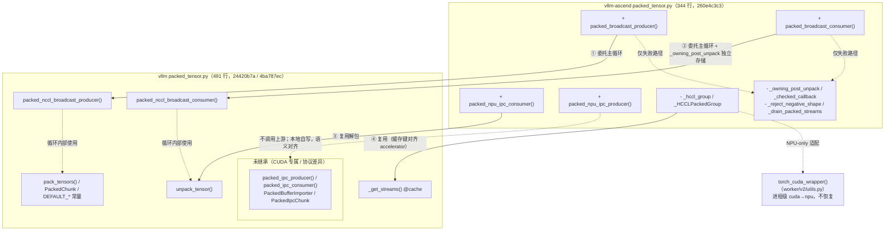

# Packed tensor 继承

## 1. 背景：可控范围内继承上游 vLLM 实现

本 PR（`packed-vllm-loop-reuse` 分支）的目标是**在可控范围内继承上游 vLLM 的 packed tensor 实现**：

## 2. 方法清单对照

### 2.1 上游 vLLM `vllm/distributed/weight_transfer/packed_tensor.py`（491 行，main 24420b7a）

| 符号 | 类型 | 作用 |
| --- | --- | --- |
| `_get_streams(device_idx, num_buffers)` | 函数 | 按 (设备号， slot 数) 缓存 stream 组 |
| `unpack_tensor(packed, names, shapes, dtypes, tensor_sizes)` | 函数 | 把 packed 字节流解成命名 tensor views（内部有 contiguous 拷贝） |
| `PackedChunk` | dataclass | 一个 chunk 的元数据（HCCL 循环内部使用） |
| `pack_tensors(...)` | 函数 | tensor 打成 packed 字节流（producer 内部使用） |
| `packed_nccl_broadcast_producer(...)` | 函数 | HCCL/NCCL 广播发送主循环 |
| `packed_nccl_broadcast_consumer(..., device=...)` | 函数 | 广播接收主循环 |
| `packed_ipc_producer(...)` | 函数 | CUDA IPC 发送循环 |
| `packed_ipc_consumer(...)` | 函数 | CUDA IPC 接收（rebuild_cuda_tensor + unpack + clone） |
| `PackedIpcChunk` | dataclass | IPC chunk 元数据 |
| `PackedBufferImporter` | 类 | 消费侧 IPC 重建缓存（防止跨 chunk refcount 泄漏） |

### 2.2 vllm-ascend `vllm_ascend/distributed/weight_transfer/packed_tensor.py`（344 行，260e4c3c3）

| 符号 | 类型 | 作用                                                                      |
| --- | --- |-------------------------------------------------------------------------|
| `packed_broadcast_producer(...)` | 函数 | HCCL 广播发送入口：包装 transport 与回调后委托上游                                       |
| `packed_broadcast_consumer(...)` | 函数 | HCCL 广播接收入口：包装独立存储回调后委托上游                                               |
| `packed_npu_ipc_producer(...)` | 函数 | NPU IPC 发送（本地实现）                                                        |
| `packed_npu_ipc_consumer(...)` | 函数 | NPU IPC 接收（本地实现）                                                        |
| `_hccl_group` / `_HCCLPackedGroup` | 私有 | NPU 传输适配：复用上游 `_get_streams`、broadcast 前后 flush + 同步、per-slot buffer 登记 |
| `_owning_post_unpack` | 私有 | NPU 独立存储：unpack 得到 views 后逐项 clone                                    |
| `_checked_callback` | 私有 | `post_iter_func` 返回值校验（dtype/numel 契约）                                  |
| `_reject_negative_shape` | 私有 | 负 shape 校验，HCCL 与 IPC 共用                                                |
| `_drain_packed_streams` / `_UNSYNCHRONIZED_BUFFERS` | 私有 | 仅失败路径：drain 所有 slot，保留未同步 storage 到进程退出                                 |
| `torch_cuda_wrapper`（worker/v2/utils.py） | 复用 | 进程级 `torch.cuda` → `torch.npu` 适配（docstring 注明不恢复）                      |

## 3. 逐方法继承判定

| 上游方法 | Ascend 是否继承 | 继承方式 / 不继承原因                                                                                                                                                                                                                                                                                                                                            |
| --- | --- |---------------------------------------------------------------------------------------------------------------------------------------------------------------------------------------------------------------------------------------------------------------------------------------------------------------------------------------------------------|
| `_get_streams` | ✅ 完全继承 | `_hccl_group` 内复用；缓存键统一为 `torch.accelerator.current_device_index()`                                                                                                                                                                                                                                                                                     |
| `unpack_tensor` | ✅ 完全继承 | HCCL 循环内由上游调用；NPU IPC consumer 也直接调用                                                                                                                                                                                                                                                                                                                    |
| `PackedChunk` | ✅ 间接继承 | 上游 HCCL 循环内部使用，随循环一并继承                                                                                                                                                                                                                                                                                                                                  |
| `pack_tensors` | ✅ 间接继承 | 上游 producer 内部调用，随循环一并继承                                                                                                                                                                                                                                                                                                                                |
| `packed_nccl_broadcast_producer` | ✅ 委托继承 | Ascend 入口做三件事：`_hccl_group` 提供 NPU transport、`_checked_callback` 校验回调、异常路径本地 drain；主循环整体委托                                                                                                                                                                                                                                                              |
| `packed_nccl_broadcast_consumer` | ✅ 委托继承 | Ascend 入口做四件事：metadata 负 shape 校验、`_owning_post_unpack` 独立存储（上游返回 views，而本侧需要独立存储契约）、`device=f"npu:{...}"` 参数、委托上游。无跨 chunk event 修复；读序缺口在真实 HCCL 时序下未复现（详见 v1.0.8 快照 5.4）                                                                                                                                                                              |
| `packed_ipc_producer` | ❌ 不继承，自写 `packed_npu_ipc_producer` | 硬障碍：① `torch.empty(device="cuda")` 硬编码 CUDA 设备字符串，NPU 上直接失败（torch_cuda_wrapper 不改 device 字符串）；② 上游 yield `PackedIpcChunk`，NPU 格式为 dict，不一致；③ 上游 `if total_bytes:` 对全零元素 chunk 不发送，NPU 语义要求全零 chunk 也发送元数据。 |
| `packed_ipc_consumer` | ❌ 不继承，自写 `packed_npu_ipc_consumer` | 硬障碍：① `torch.cuda.get_device_properties(device_index).uuid` ；② `rebuild_cuda_tensor` 不可用，改用 torch_npu 的 `rebuild_npu_tensor`。其余逻辑（`content_size` 截断、`unpack_tensor` + clone）与上游一致                                                                                                                                                                       |
| `PackedBufferImporter` | ❌ 不继承 | 硬依赖 `rebuild_cuda_tensor`；不混入本 PR                                                                                                                                                                                                                                                                                                                       |
| `PackedIpcChunk` | ❌ 不继承 | 现有 NPU 调用方跨进程传 dict；需给上游类型引入运行时依赖，纯重构无功能收益                                                                                                                                                                                                                                                                                              |

### 3.1 继承关系图

## 4. HCCL producer / consumer 与 IPC producer / consumer环节对照

本章按“环节 | 上游 vLLM | vllm-ascend | 差异性质”逐环节对比四个入口方法，差异性质分三档：**一致**（继承复用）、**适配**（本地包装解决）、**差异**（上游写死了设备专属调用或协议，无法包装绕过）。

### 4.1 HCCL producer：`packed_nccl_broadcast_producer` ↔ `packed_broadcast_producer`

| 环节 | vLLM（24420b7a） | vllm-ascend（260e4c3c3） | 差异性质 |
| --- | --- | --- |------|
| 参数校验 | 无 | `buffer_size_bytes` / `num_buffers` 正数校验 | 增强   |
| stream 获取 | `_get_streams(torch.accelerator.current_device_index(), n)`（@cache） | 相同，且以同一键预热缓存 | 一致   |
| slot 轮转 / in_flight | 保留在途 chunk 引用防提前释放 | 相同（随主循环继承） | 一致   |
| 打包 | `pack_tensors(iterator, post_iter_func, size)`，回调无校验 | 相同；`post_iter_func` 经 `_checked_callback` 校验 dtype/numel | 适配   |
| 通信 | `group.broadcast(chunk.packed_tensor, src)`（PyNcclCommunicator） | 同签名 transport：`_HCCLPackedGroup` 先 flush torch_npu 异步队列、broadcast 前后双同步、登记每 slot buffer | 适配   |
| stream 上下文 | `with torch.cuda.stream(...)` | 依赖 `torch_cuda_wrapper` 映射为 npu stream | 适配 |
| 结尾清理 | 无条件 drain 所有 slot | 正常路径交给上游 drain；仅异常时本地保留清理 | 适配   |

### 4.2 HCCL consumer：`packed_nccl_broadcast_consumer` ↔ `packed_broadcast_consumer`

| 环节 | vLLM | vllm-ascend | 差异性质 |
| --- | --- | --- | --- |
| metadata 迭代 | 直接 `next(iterator)` | `metadata()` 生成器逐项负 shape 校验 | 增强 |
| 接收 buffer | `torch.empty(sizes, device=device)`，device 默认 `"cuda"` | 显式传 `device=f"npu:{...}"` | 适配 |
| 事件链 | `prev_received` wait/record + `record_stream(*streams, caller_stream)` | 相同（随主循环继承） | 一致 |
| 解包回调 | `post_unpack_func(unpack_tensor(packed, ...))` 直接传 views | `_owning_post_unpack` 包装：views 逐项 clone 后转交（独立存储契约） | 适配 |
| slot 完成 | `slot_done` event + 下轮 synchronize（避开 ROCm 共享队列） | 相同 | 一致 |
| 结尾清理 | 无条件 drain | 仅异常路径本地 drain | 适配 |

**结论**：除独立存储包装与 device 参数外全部一致 → ✅ 委托继承。读序缺口在真实 HCCL 时序下未复现（v1.0.8 快照 5.4）。

### 4.3 IPC producer：`packed_ipc_producer` ↔ `packed_npu_ipc_producer`

| 环节 | vLLM | vllm-ascend | 差异性质 |
| --- | --- | --- | --- |
| 共享 buffer | `torch.empty(size, device="cuda")` | `torch.empty(size, device="npu")` | **差异**（device 字符串写死在函数体内，无法传参，见 4.7 残留 ①） |
| 句柄导出 | `reduce_tensor` → 消费端 `rebuild_cuda_tensor` 重建 | `reduce_tensor` 存 args，约定消费端用 `rebuild_npu_tensor` | 适配（torch_npu 导入时自动 patch `reduce_tensor` 支持 NPU，见 4.7） |
| 分包 / copy | contiguous → view(uint8) → copy_；超限 ValueError | 逐行相同 | 一致 |
| 同步 | `torch.accelerator.current_stream().synchronize()` | `torch.npu.current_stream().synchronize()` | 适配 |
| 回调 | `post_iter_func` 原样 | `_checked_callback` 校验 | 增强 |
| chunk 协议 | yield `PackedIpcChunk` dataclass | yield dict（跨进程协议） | **差异**（换协议需两端同版本升级，零功能收益） |
| 空 chunk | `if total_bytes:` 全零元素 chunk 不发送 | `if names:` 全零元素 chunk 仍发送元数据 | 语义差异 |

**结论**：分包与 copy 核心一致；句柄导出可解（torch_npu 自动 patch），yield 协议是选型而非 CUDA 障碍，唯一无法绕过的是 `device="cuda"` 字面量（L339，见 4.7 残留 ①）→ ❌ 本地自写（语义对齐，共享 `_checked_callback`）。

### 4.4 IPC consumer：`packed_ipc_consumer` ↔ `packed_npu_ipc_consumer`

| 环节 | vLLM | vllm-ascend                                                     | 差异性质                                              |
| --- | --- |-----------------------------------------------------------------|---------------------------------------------------|
| UUID 解析 | `torch.cuda.get_device_properties(i).uuid` | 调用方传入 `physical_npu_id`（`npu_generate_uuid` 生成，见 4.6）           | **差异**                                            |
| 重建 | `rebuild_cuda_tensor`+ `PackedBufferImporter` 缓存 | `rebuild_npu_tensor`（torch_npu，懒加载）+ device_index / 参数长度校验      | 可注入（类继承覆写 `rebuild()` 即可） |
| 句柄查找 | UUID not in handle → ValueError | 相同                                                              | 一致                                                |
| 元数据校验 | `getattr(torch, dn)` 解析 dtype | 在此基础上增加了 isinstance(dtype) / 四表长度一致 / 负 shape / content_size 校验 | 增强                                                |
| 截断 | `packed[:content_size]` | 相同                                                              | 一致                                                |
| 解包 + clone | `unpack_tensor` + 逐项 clone | 相同（直接调用上游 `unpack_tensor`）                                      | 一致                                                |
| refcount 防泄漏 | importer 保证一次 export 配一次释放 | 未引入；NPU 侧独立评估，不混入本 PR                                           | 差异                                                |

**结论**：无法绕过的有 UUID 解析一处

### 4.5 IPC 设备绑定代码的解耦继承分析

**仓内已有的同类解法**（`npu_ipc_engine.py`）：`NPUIPCWeightTransferEngine` / `NPUIPCTrainerWeightTransferEngine` 直接继承上游 `IPCWeightTransferEngine` / `IPCTrainerWeightTransferEngine`，只覆写 CUDA 专属部分。三类 cuda 绑定的对应解法：

| 上游 cuda 绑定 | vllm-ascend 解法 | 位置 |
| --- | --- | --- |
| `torch.cuda.get_device_properties().uuid` 作 IPC key | `npu_generate_uuid()` = `{host_ip}-{物理chip_id}`，经 `ASCEND_RT_VISIBLE_DEVICES` 做逻辑→物理映射，替代硬件 UUID（`torch.npu.get_device_properties` 存在且 props 可能带 uuid，platform.py 在用，但选型未依赖它） | npu_ipc_engine.py `npu_generate_uuid` |
| `rebuild_cuda_tensor` | `torch_npu.multiprocessing.reductions.rebuild_npu_tensor`（懒加载）+ 重建时覆写 device_index | npu_ipc_engine.py `receive_weights` |
| `reduce_tensor` 对 NPU 的支持 | torch_npu 导入时自动 patch `torch.multiprocessing.reductions.reduce_tensor`（经 `_share_npu_()`），producer 侧无需改 | npu_ipc_engine.py docstring |
| `torch.cuda.Stream/stream` 等 API | `torch_cuda_wrapper` 进程级重绑（14 个 API） | worker/v2/utils.py |

**函数调用缺口**：

1. producer 的 `ipc_buffer = torch.empty(buffer_size_bytes, dtype=torch.uint8, device="cuda")` ascend 无法传参绕过，需上游优化传参；
2. consumer 的 `rebuild_cuda_tensor` 按名导入（上游 L418），wrapper 只重绑 `torch.cuda.*` 命名空间、兜不住 reductions 模块；替换它只能做进程级 monkey patch——即 P1-2 已删除的污染模式，不能走回头路；
3. wrapper 未重绑 `torch.cuda.get_device_properties`——全仓 git 历史（`-S` 检索）从未有人写过或重绑过该调用，仓内替代先例走的是 vLLM Platform 扩展点：`NPUPlatform.get_device_uuid()` 直接调 `torch.npu.get_device_properties(device_id).uuid`（无 uuid 即 RuntimeError），`num_compute_units()` 把 CUDA 的 `multi_processor_count` 概念映射为 `cube_core_num`（带两级 fallback）。

## 5. packed 相关未合入 PR 的影响分析

继承重构（#20676）完成后，仓库中其余 packed weight transfer 未合入 PR 是否还需要改：

| PR                                 | 内容 | 继承完成后是否还需要 |
|------------------------------------| --- | --- |
| #20740 IPC 一次性导入                   | NPU IPC 每次重建/释放导致 producer refcount 负数泄漏；引入一次性导入缓存 | **仍需要，不受影响**。与第 4.4 节“importer 不继承、NPU 侧独立修复”的决策吻合，可视为 `PackedBufferImporter` 思想的 NPU 落地；与 #20676 仅需 rebase 协调（同文件不同区域） |
| #19127 跨 chunk 乱序                  | 基于 hook / 本地循环的跨 chunk event + clone record_stream 方案（+286/-33） | **被继承取代**。hook 已删除、真机最小用例未复现读序缺口（v1.0.8 快照 5.4）；可关闭，或改写为 `_owning_post_unpack` 内几行 wait_event 的可选加固后重提 |
| #12713 打包前源 stream 同步              | producer 打包读源 tensor 时源可能在 caller stream 在途，仅同步 slot stream 不够（+4/-0） | **仍需要，但补丁位置要改**。缺口在委托后的上游循环中同样存在，4 行修复应改挂到本地入口（`_hccl_group` 进入循环前同步 caller stream），不能继续打在旧本地循环上 |
| #18763 单 stream 加载（v0.30.0）        | release 分支：跨 chunk 加载顺序修复 | 不受影响。release 分支保留本地循环，独立于 main 重构 |
| #20614 packed 修复 backport（v0.30.0） | release 分支 backport #19164 | 不受影响。同上 |

**合入顺序建议**：先合 #20676（继承基座）→ #12713 按新入口重提、#20740 rebase → 关闭 #19127（或按可选加固改写）
