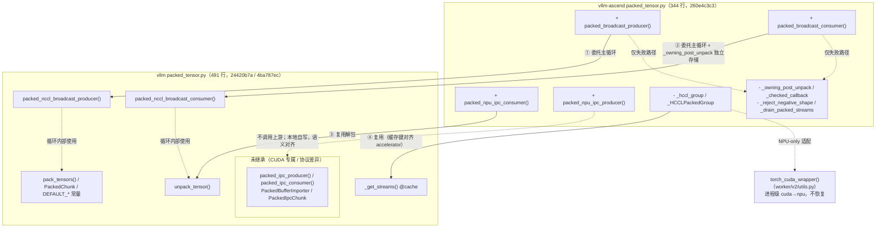

# Packed tensor 继承对照

文档版本：**v1.0.10**。版本记录见 [CHANGELOG.md](CHANGELOG.md)；v1.0.8 及以前的流程详解、图表与真机验证记录见 [versions/](versions/README.md)。

## 1. 背景：可控范围内继承上游 vLLM 实现

Ascend 侧原本自有一套 packed weight transfer 实现（449 行，含 HCCL 循环、NPU IPC 与 owning-unpack hook）。本 PR（`packed-vllm-loop-reuse` 分支）的目标是**在可控范围内继承上游 vLLM 的 packed tensor 实现**：

- **继承基准**：vLLM main `24420b7a` 与 v0.33.0 `4ba787ec` 双配套（`.github/vllm-main-verified.commit` 固定）。
- **可控范围**：HCCL 主循环、stream 管理、打包/解包这类纯逻辑全部委托上游；只在与 NPU 适配、独立存储契约、跨进程协议相关的地方保留本地代码。
- **硬约束**：不重绑定任何 vLLM 模块属性（owning-unpack hook 已删除）；不修改上游文件；上游行为契约用护栏 UT 固定（pin bump 即红）。
- **当前代码**：`260e4c3c3`，Ascend 侧 344 行（原 449 行）。

## 2. 方法清单对照

### 2.1 上游 vLLM `vllm/distributed/weight_transfer/packed_tensor.py`（491 行，main 24420b7a）

| 符号 | 类型 | 作用 |
| --- | --- | --- |
| `DEFAULT_PACKED_BUFFER_SIZE_BYTES` / `DEFAULT_PACKED_NUM_BUFFERS` | 常量 | 默认 1GB buffer、2 slot |
| `_get_streams(device_idx, num_buffers)` | 函数（@cache） | 按 (设备号， slot 数) 缓存 stream 组 |
| `unpack_tensor(packed, names, shapes, dtypes, tensor_sizes)` | 函数 | 把 packed 字节流解成命名 tensor views（内部有 contiguous 拷贝） |
| `PackedChunk` | dataclass | 一个 chunk 的元数据（HCCL 循环内部使用） |
| `pack_tensors(...)` | 函数 | 把命名 tensor 打成 packed 字节流（producer 内部使用） |
| `packed_nccl_broadcast_producer(...)` | 函数 | HCCL/NCCL 广播发送主循环 |
| `packed_nccl_broadcast_consumer(..., device=...)` | 函数 | 广播接收主循环 |
| `PackedIpcChunk` | dataclass | IPC chunk 元数据 |
| `packed_ipc_producer(...)` | 函数 | CUDA IPC 发送循环（单共享 buffer + reduce_tensor 句柄） |
| `PackedBufferImporter` | 类 | 消费侧 IPC 重建缓存（防止跨 chunk refcount 泄漏） |
| `packed_ipc_consumer(...)` | 函数 | CUDA IPC 接收（rebuild_cuda_tensor + unpack + clone） |

### 2.2 vllm-ascend `vllm_ascend/distributed/weight_transfer/packed_tensor.py`（344 行，260e4c3c3）

| 符号 | 类型 | 作用 |
| --- | --- | --- |
| `packed_broadcast_producer(...)` | 函数 | HCCL 广播发送入口：包装 transport 与回调后委托上游 |
| `packed_broadcast_consumer(...)` | 函数 | HCCL 广播接收入口：包装独立存储回调后委托上游 |
| `packed_npu_ipc_producer(...)` | 函数 | NPU IPC 发送（本地实现，yield dict 协议） |
| `packed_npu_ipc_consumer(...)` | 函数 | NPU IPC 接收（本地实现，rebuild_npu_tensor） |
| `_hccl_group` / `_HCCLPackedGroup` | 私有 | NPU 传输适配：复用上游 `_get_streams`、broadcast 前后 flush + 同步、per-slot buffer 登记 |
| `_owning_post_unpack` | 私有 | 独立存储回调：unpack 得到 views 后逐项 clone 再转交 engine 回调 |
| `_checked_callback` | 私有 | `post_iter_func` 返回值校验（dtype/numel 契约） |
| `_reject_negative_shape` | 私有 | 负 shape 校验，HCCL 与 IPC 共用 |
| `_drain_packed_streams` / `_UNSYNCHRONIZED_BUFFERS` | 私有 | 仅失败路径：drain 所有 slot，保留未同步 storage 到进程退出 |
| `torch_cuda_wrapper`（worker/v2/utils.py） | 复用 | 进程级 `torch.cuda` → `torch.npu` 适配（docstring 注明不恢复） |

## 3. 逐方法继承判定

| 上游方法 | Ascend 是否继承 | 继承方式 / 不继承原因 |
| --- | --- | --- |
| `DEFAULT_PACKED_BUFFER_SIZE_BYTES` / `DEFAULT_PACKED_NUM_BUFFERS` | ✅ 完全继承 | 直接引用上游常量 |
| `_get_streams` | ✅ 完全继承 | `_hccl_group` 内复用；缓存键统一为 `torch.accelerator.current_device_index()`（与上游循环一致，否则分叉出第二套缓存）。真机已验证 accelerator C 级 API 在 NPU 正常解析 |
| `unpack_tensor` | ✅ 完全继承 | HCCL 循环内由上游调用；NPU IPC consumer 也直接调用。未对齐 offset 由其内部 contiguous 拷贝保证安全 |
| `PackedChunk` | ✅ 间接继承 | 上游 HCCL 循环内部使用，Ascend 不触碰，随循环一并继承 |
| `pack_tensors` | ✅ 间接继承 | 上游 producer 内部调用，随循环一并继承 |
| `packed_nccl_broadcast_producer` | ✅ 委托继承 | Ascend 入口只做三件事：`_hccl_group` 提供 NPU transport、`_checked_callback` 校验回调、异常路径本地 drain；主循环整体委托 |
| `packed_nccl_broadcast_consumer` | ✅ 委托继承 | Ascend 入口做四件事：metadata 负 shape 校验、`_owning_post_unpack` 独立存储（上游返回 views，而本侧需要独立存储契约）、`device=f"npu:{...}"` 参数、委托上游。无跨 chunk event 修复；读序缺口在真实 HCCL 时序下未复现（详见 v1.0.8 快照 5.4） |
| `PackedIpcChunk` | ❌ 不继承 | 现有 NPU 调用方跨进程传 dict；dataclass 需两端同版本且给上游类型引入运行时依赖，pin bump 时远端进程也需同步升级。纯重构无功能收益，等上游强制再跟 |
| `packed_ipc_producer` | ❌ 不继承，自写 `packed_npu_ipc_producer` | 硬障碍无法绕过：① `torch.empty(device="cuda")` 硬编码 CUDA 设备字符串，NPU 上直接失败（torch_cuda_wrapper 不改 device 字符串）；② 上游 yield `PackedIpcChunk`，NPU 协议是 dict，需协议转换；③ 上游 `if total_bytes:` 对全零元素 chunk 不发送，NPU 语义要求全零 chunk 也发送元数据。曾做过整循环委托实验（约 312 行，需 empty 重定向 + reduce 转发 + 全空前缀特殊路径 + 协议转换），复杂度超过自写，已撤回。共享的部分：`_checked_callback`、`unpack_tensor`、buffer 复用与 copy 逻辑与上游逐行对齐 |
| `PackedBufferImporter` | ❌ 不继承 | 硬依赖 `rebuild_cuda_tensor`（CUDA C 级实现，NPU 侧不存在）；引入它还需 NPU engine 侧增加 importer 生命周期管理（跨 chunk 持有 + shutdown close）。refcount 泄漏问题在 NPU 侧独立评估，不混入本 PR |
| `packed_ipc_consumer` | ❌ 不继承，自写 `packed_npu_ipc_consumer` | 硬障碍：① `torch.cuda.get_device_properties(device_index).uuid` 无 NPU 等价 API（物理 NPU UUID 由调用方传入）；② `rebuild_cuda_tensor` 不可用，改用 torch_npu 的 `rebuild_npu_tensor`（含 device_index 覆写与参数校验）。其余逻辑（`content_size` 截断、`unpack_tensor` + clone）与上游一致，其中 `packed[:content_size]` 防御已加 |

**汇总**：上游 11 个符号中，6 个完全/间接继承，2 个委托继承（含 NPU 适配包装），3 个 IPC 相关因 CUDA 专属调用或协议差异无法直接继承，由 2 个自写函数 + dict 协议替代，其中可共享的解包与校验逻辑已复用上游。

### 3.1 继承关系图

