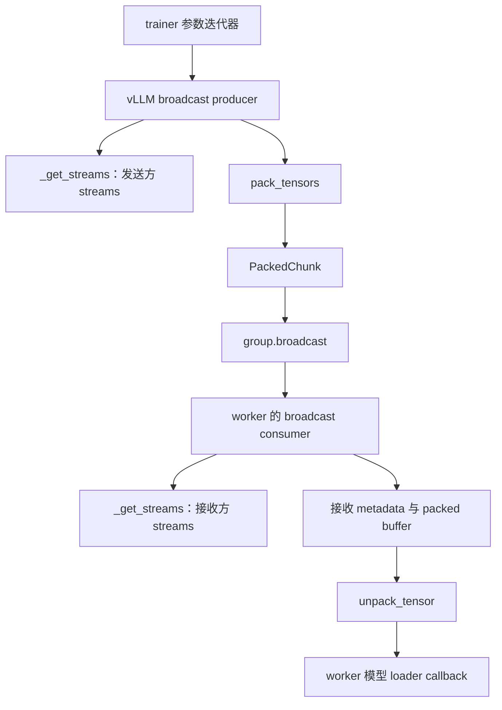
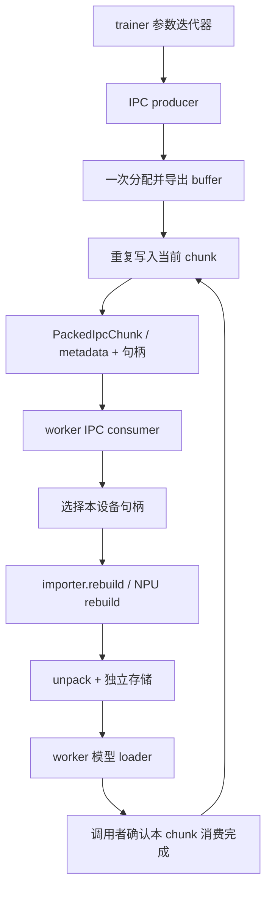
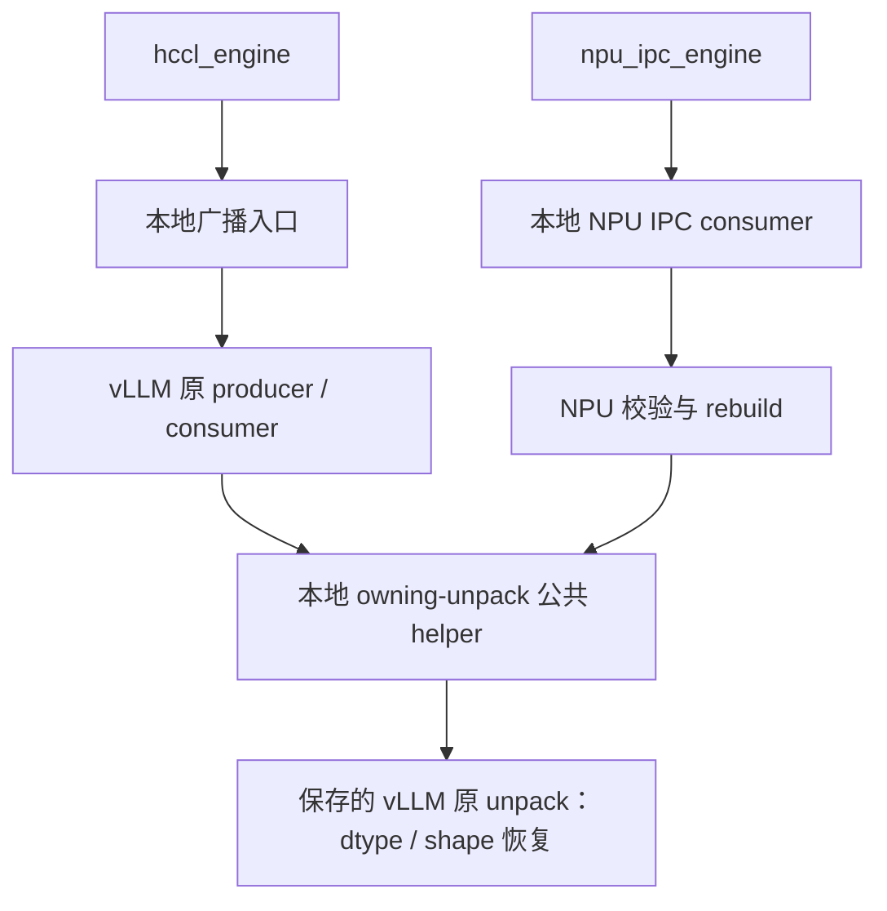

# Packed tensor 方法、流程与复用设计

文档版本：**v1.0.1（阶段草稿归档）**。版本记录见 [CHANGELOG.md](CHANGELOG.md)。

本版归档引入 V2 wrapper 时的本地阶段状态；后续版本将按已提交代码重新同步。

## 1. 阅读基准与方法清单

### 1.1 版本及“当前实现”的定义

本文以已经检查过的固定源码说明流程，不把“当前配套”当成持续变化的 vLLM HEAD：

| 对象 | 基准 | 用途 |
| --- | --- | --- |
| vLLM main 配套 | `24420b7a341af37a9bc3186e6fc6062512e0aa58` | 主要流程说明 |
| vLLM v0.32.0 | `5df63a7203cdb9328d824a27b682e77c7b9928be` | 双版本差异说明 |
| Ascend main 原实现 | `3be5bbe32a9e4b6cd319eeee4a2c545f7728b106` | 识别必须保留的原有功能 |
| Ascend 当前重构实现 | `packed-vllm-loop-reuse`，HEAD `c2d66e163` 加未提交工作区修改 | 本文“当前 Ascend 流程”的主体 |

“当前 Ascend”不是说这些工作区修改已经推送。本文描述的状态是：HCCL 调用 vLLM 原循环；NPU IPC producer/consumer 已恢复为 Ascend main 原样；没有新增跨 chunk callback event 或额外 record_stream 修复。

主要源码：[vLLM 配套 packed_tensor.py](https://github.com/vllm-project/vllm/blob/24420b7a341af37a9bc3186e6fc6062512e0aa58/vllm/distributed/weight_transfer/packed_tensor.py)、[vLLM v0.32.0 对应文件](https://github.com/vllm-project/vllm/blob/5df63a7203cdb9328d824a27b682e77c7b9928be/vllm/distributed/weight_transfer/packed_tensor.py)、[Ascend main 原文件](https://github.com/vllm-project/vllm-ascend/blob/3be5bbe32a9e4b6cd319eeee4a2c545f7728b106/vllm_ascend/distributed/weight_transfer/packed_tensor.py)。

vLLM 和 Ascend main 的源码链接均固定到 commit。当前重构部分按上述本地工作区状态记录，不等同于远端分支 HEAD。本文不依赖原工作目录中的源码快照文件。

### 1.2 vLLM 文件中有哪些方法

`vllm/distributed/weight_transfer/packed_tensor.py` 包含 7 个模块函数、1 个具有 3 个方法的 importer 类，以及 2 个 chunk 数据结构。

| 方法 | 所在一方 | 主要职责 | Ascend 对应项 |
| --- | --- | --- | --- |
| `_get_streams(device_idx, num_buffers)` | 广播发送/接收两方分别调用 | 缓存本进程指定设备的 stream 元组 | 原函数直接使用 |
| `pack_tensors(...)` | 广播发送方 | 迭代参数、预处理、字节化、组成一个 chunk | 原 producer 内部直接使用 |
| `unpack_tensor(...)` | 广播接收方、IPC 接收方 | 字节切分并恢复 dtype/shape，通常返回 views | HCCL 适配后调用；NPU IPC 当前本地解包 |
| `packed_nccl_broadcast_producer(...)` | trainer | 发送 slot 轮转、打包和广播 | `packed_broadcast_producer` |
| `packed_nccl_broadcast_consumer(...)` | worker | 接收 slot 轮转、接收、解包、调用模型 loader | `packed_broadcast_consumer` |
| `packed_ipc_producer(...)` | trainer | 复用一块 IPC buffer，分块写入并产出句柄和 metadata | `packed_npu_ipc_producer` |
| `packed_ipc_consumer(...)` | worker | 选 CUDA 句柄、导入 buffer、解包并 clone | `packed_npu_ipc_consumer` |
| `PackedBufferImporter.__init__()` | IPC worker | 初始化单项映射缓存 | 当前 NPU packed 路径没有对应缓存 |
| `PackedBufferImporter.rebuild(list_args)` | IPC worker | 复用相同句柄的映射，否则重建并替换缓存 | 当前调用 `rebuild_npu_tensor`，未套用该缓存 |
| `PackedBufferImporter.close()` | IPC worker | 释放所持映射引用 | 当前没有本地 importer 对象可供 close |

数据结构和常量：

| 项目 | 内容 |
| --- | --- |
| `PackedChunk` | `packed_tensor`、`names`、`shapes`、`dtypes`、`tensor_sizes` |
| `PackedIpcChunk` | `names`、`shapes`、`dtype_names`、`tensor_sizes`、`ipc_handle` |
| 默认配置 | `DEFAULT_PACKED_BUFFER_SIZE_BYTES`、`DEFAULT_PACKED_NUM_BUFFERS` |

这里所谓“继承方案”主要指直接调用函数和复用数据结构。packed 层没有 producer/consumer 基类；不为满足“继承”字面含义新增基类。引擎层的 HCCL/NCCL 类继承已是 main 的基础，不在本 PR 重新改造。

## 2. 各方法大致流程

### 2.1 流程概览

| 方法 | 大致流程 |
| --- | --- |
| `_get_streams` | 接收设备和 slot 数 → 查函数缓存 → 首次创建 streams → 返回元组 |
| `pack_tensors` | 取参数 → callback → contiguous/flatten/uint8 → 累计 metadata 和字节数 → 超阈值或迭代结束 → cat → PackedChunk |
| `unpack_tensor` | 按 sizes split → 各段恢复 dtype → 恢复 shape → 返回带名字的 tensors |
| broadcast producer | 取 streams → 等待当前发送 slot → 打包 → broadcast → 保留 chunk 引用 → slot 轮转 → 最终 drain |
| broadcast consumer | 取 streams → 等待接收 slot 可复用 → 聚合 metadata → 分配接收 buffer → broadcast → 原有依赖处理 → unpack → loader callback → 轮转 → 最终 drain |
| IPC producer | 分配并导出共享 buffer 一次 → 处理参数 → buffer 将放不下时先产出上一块 → 拷入本块 → EOF 产出剩余 metadata |
| importer `__init__` | 设置空缓存项 |
| importer `rebuild` | 构造句柄 key → 命中返回旧映射 → 未命中 CUDA rebuild → 替换缓存 |
| importer `close` | 丢弃缓存项引用 |
| IPC consumer | 查询设备 UUID → 选句柄 → 修正 device index → importer.rebuild → 按有效长度截取 → unpack → clone |

### 2.2 广播方法的调用关系

发送 slot、接收 slot 是各自进程内的轮转位置。发送 packed buffer 和接收 packed buffer 也是不同对象；通信传递的是数据，不是共享同一块 storage。

### 2.3 IPC 方法的调用关系

IPC producer 的 generator 只产出数据描述，不会自己调度 worker RPC。调用者必须等待 worker 不再读取本次共享 buffer 后，才推进下一次 generator 写入。

## 3. 按方法详细对照与复用方案

### 3.1 `_get_streams`

**vLLM 流程**

以 `(device_idx, num_buffers)` 为缓存 key；未命中时创建 `num_buffers` 个 `torch.cuda.Stream(device=device_idx)`，返回 tuple；后续相同 key 复用同一组对象。这样避免每次更新创建新 stream，使 allocator 缓存按 stream 分散。

**当前 Ascend 流程**

main 原实现每次 producer/consumer 调用新建 NPU streams。当前重构先在 `_hccl_group` 中调用 vLLM 原缓存函数，登记本次清理所需 streams；随后 vLLM 循环也取同一个缓存元组。`_hccl_group` 使用既有 V2 `torch_cuda_wrapper()`，让 Stream 创建走 NPU。

**差异**

stream 从“每次新建”变为“按设备和数量缓存”；创建 API 的后端不同。共享缓存意味着不能据此声称支持同设备并发 transfer。

**继承/复用方案**

直接调用 vLLM 原 `_get_streams`，不复制缓存，不包装函数。Ascend 只适配 stream 创建 API。

**复用内容与保留边界**

复用缓存 key、创建数量和返回结构；保留 NPU API 转发和异常清理登记。未来若私有函数的 key、签名或缓存语义改变，需要重新核对“循环与 finally 使用同一组 streams”的前提。

### 3.2 `pack_tensors`

**vLLM 流程**

1. 从 iterator 取 `(name, orig_tensor)`。
2. 调用 `post_iter_func`，执行 contiguous、flatten、view(uint8)。
3. 从原 tensor 记录 name、shape、dtype，从转换结果记录字节数。
4. 将该 tensor 纳入本 chunk；累计大小大于阈值时停止，否则继续取参数。
5. 没有 tensor 时返回 None；否则 cat 成一个 uint8 buffer，返回 PackedChunk。单 tensor 超过阈值会 warning，但仍可发送。

**当前 Ascend 流程**

main 原 producer 内联这些步骤。当前 HCCL producer 已委托 vLLM，因此由 vLLM 原循环直接调用 pack_tensors。本地 `_checked_callback` 保留“预处理必须返回 Tensor，且 dtype/numel 不变”的 main 校验。

NPU IPC 当前在自己的循环中逐段写入一块固定容量 buffer，没有调用 pack_tensors。

**差异**

HCCL 的 buffer_size 是“超过后 flush 的阈值”，不是严格容量；IPC 是固定容量，放入下一 tensor 前就必须判断能否容纳，单 tensor 超容量必须拒绝。两种循环不可直接互换。

**继承/复用方案**

HCCL 完整复用；IPC 不用它替换分包循环。

**复用内容与保留边界**

HCCL 复用迭代、线性化、metadata、cat 和阈值规则；本地保留预处理结果验证、参数入口检查。IPC 中只有几行字节化相似，不值得为此引入不匹配的分包工具。

### 3.3 `unpack_tensor`

**vLLM 流程**

按 tensor_sizes 对 packed uint8 buffer 做 split；每段 contiguous 后 view(dtype)，再 view(shape)，返回 `(name, tensor)` 列表。对于已经连续的切片，contiguous 通常不复制，因此结果仍是 packed buffer 的 view。

**当前 Ascend 流程**

main 原 HCCL consumer 和 NPU IPC consumer 都先 clone 字节切片，再恢复 dtype/shape，保证独立 storage，也能处理混合 dtype 的未对齐 offset。

当前重构在 `_install_owning_unpack` 中保存 vLLM 原 unpack，安装 owning-unpack 分派：先 split，每段 clone，再将单 tensor metadata 交给保存的 vLLM 原函数恢复 dtype/shape。HCCL 原循环调用该分派。NPU IPC 已恢复 main 本地实现，仍按 offset 切片、clone、view/reshape；没有调用这套 hook。

**差异**

原 vLLM 返回 views；Ascend 原契约允许 callback 保留或修改输入，不得别名 packed buffer。另外，uint8 offset=6 的切片不能直接 view(int64)，但 clone 后 offset=0 可以。

**继承/复用方案**

不能直接返回原 vLLM views。当前保留字节 clone，再调用原 unpack。下一步可评估将 owning-unpack 提成同文件公共 helper，供 HCCL 和 IPC 共用；这只是方案，尚未实施。

**复用内容与保留边界**

复用 dtype/shape 恢复实现；保留独立存储和字节对齐。每 tensor 多一次原函数调用的成本尚未做硬件评估。这个兼容层不引入 callback 完成 event 或额外 record_stream，也不代表跨 chunk 时序问题已解决。

注意：hook 替换的是 vLLM packed 模块的 unpack 符号；若该模块其他函数随后查找这个符号，也会看到 owning 行为。它不是仅对某次 HCCL 调用生效的局部分派。当前 NPU IPC 本地函数不查这个符号。

### 3.4 `packed_nccl_broadcast_producer` → `packed_broadcast_producer`

**vLLM 流程**

1. 取得缓存 streams，初始化每 slot 一个 in-flight chunk 引用。
2. host 等待当前发送 stream 完成，释放该 slot 的旧 chunk 引用。
3. 在当前 slot 的 stream 上调用 pack_tensors。
4. 没有 chunk 则结束；有 chunk 则调用传入 group.broadcast。
5. 保留 chunk 引用至该 slot 安全复用，移动到下一 slot。
6. 迭代结束后同步全部 streams。

**当前 Ascend 流程**

main 原实现本地维护取参数、打包、cat、slot 轮转和 finally。当前入口先校验配置、安装 owning-unpack 适配，进入使用既有 V2 wrapper 的 `_hccl_group`，再直接调用原 vLLM producer。传入的 group 是 `_HCCLPackedGroup`，其 broadcast 调用真实 PyHcclCommunicator，并显式传入当前 NPU stream。

本地包装器登记每 slot 最后一个通信 buffer，在 native HCCL 前后同步；contextmanager 在退出时执行 main 已有的 `_drain_packed_streams`。

**差异**

设备 API、通信对象和异常清理契约不同；主分包循环可以保持 vLLM 原样。当前 native 通信前后使用保守 host 完成边界，不能把 stream 数大于一直接解读为已经恢复有效重叠。

**继承/复用方案**

直接调用 vLLM 原 producer，不复制其函数体，不改引擎建组或 trainer RPC。

**复用内容与保留边界**

复用 pack_tensors、PackedChunk、slot 轮转、in-flight 引用和正常 drain；保留 HCCL stream 参数、native 边界、callback 校验及异常 finally。

### 3.5 `packed_nccl_broadcast_consumer` → `packed_broadcast_consumer`

**vLLM 流程**

main 配套的顺序为：

1. 取缓存 streams、caller stream，初始化 per-slot metadata、prev_received 和 slot_done。
2. 若 slot 上已有完成 event，在 host 上等待该 event，再进入对应 stream。
3. 从 iterator 累加 metadata 和字节数，超过与 producer 相同的阈值时形成 chunk。
4. 分配 uint8 接收 buffer，调用 group.broadcast。
5. 当前 stream 等前一个 receive-ready event，记录本次 receive-ready event，并对 raw packed buffer 记录 slot/caller streams。
6. 调用 unpack_tensor，再调用 worker 提供的 post_unpack_func。
7. callback 提交后记录当前 slot_done event，轮转 slot；EOF 处理剩余 metadata，最后 drain 全部 streams。

v0.32.0 没有上述 receive-ready event 链、raw buffer 跨 stream 记录和 slot_done event；其循环在复用 slot 前直接 synchronize，对每 slot 保存 packed tensor 引用。分包和解包接口一致。

**当前 Ascend 流程**

main 原实现本地累加 metadata、分配、广播、clone 解包、调用 loader 和 finally。当前入口保留配置及 negative-shape 检查，通过 `_hccl_group` 调原 vLLM consumer，明确传 `device="npu:N"`；通信和 owning-unpack 由本地边界适配，其余随安装的 vLLM 版本执行。

**差异**

原 vLLM 默认 CUDA 分配，Ascend 必须显式 NPU device；原 view 解包不同于 main 独立存储契约；正常结尾 drain 不覆盖所有异常路径。双版本本身的接收依赖差异保留，不在这里复制两套本地循环。

**继承/复用方案**

直接调用安装版本的原 consumer。NPU/HCCL 边界保留，Ascend 不新增一条跨 chunk callback event 链。

**复用内容与保留边界**

复用 metadata 分包、buffer 分配、slot 轮转、vLLM 自带 event/record_stream 和正常 drain；保留 NPU device、HCCL 完成边界、owning 解包和异常清理。vLLM 自带依赖仍会执行，但不能据此沿用此前 Ascend 专门修复分支的硬件结论。

### 3.6 `packed_ipc_producer` → `packed_npu_ipc_producer`

**vLLM 流程**

1. 分配固定容量 `device="cuda"` 的 uint8 buffer，经 reduce_tensor 导出一次句柄。
2. 对每个参数预处理并线性化；单 tensor 超容量则拒绝。
3. 若本 chunk 非空且下一 tensor 放不下，先同步写入 stream，yield 当前 PackedIpcChunk。
4. 调用方消费完成、恢复 generator 后，重置 metadata，将新 tensor 拷入同一 buffer。
5. EOF 时若 total_bytes 非零，同步并 yield 最后一块。

main 配套同步使用 torch.accelerator.current_stream；v0.32.0 使用 torch.cuda.current_stream。这是此方法的版本差异，分包与全空判断相同。

**当前 Ascend 流程**

当前函数已恢复 main 原样：分配 NPU buffer、导出一次句柄、校验 callback 的 dtype/numel、检查固定容量、分块 copy、同步 NPU stream，yield 现有 dict 协议。EOF 使用 `if names`，因此全零元素参数仍产出 metadata。

**差异**

包括设备分配、stream API、导出入口适配、dataclass 与 dict 协议，以及全空输入语义。直接套 vLLM 会丢失全空参数 metadata。HCCL 的 pack_tensors 也不能替代此循环，因为它不遵守固定容量限制。

**继承/复用方案**

当前不整体委托。此前实验可通过设备分配代理、reduce_tensor 转发、全空前缀检测和 payload 转换实现，但为了较少的代码减少引入多个边界，已撤回。

**复用内容与保留边界**

目前整个 producer 保持本地。可选的局部共享是 callback 结果验证；连续化与字节化仅几行，不建议单独拆文件。将来 vLLM 提供 device/export 扩展点且全空语义一致后，再评估原 generator 复用。

### 3.7 `PackedBufferImporter.__init__`

**vLLM 流程**

将 `_entry` 初始化为 None。后续只缓存一个 `(key, mapped_tensor)`。

**当前 Ascend 流程**

NPU packed consumer 每次直接调用 rebuild_npu_tensor，没有使用这个 importer。NPU 引擎虽然继承 IPC 引擎类，不能因此认为 CUDA importer 就进入了它的消费路径。

**差异**

不是初始化字段不同，而是整个映射缓存及其所有者生命周期尚未接入 NPU 路径。

**继承/复用方案**

不单独继承一个只有字段初始化的方法。必须连同 rebuild/close 的设备语义和引擎所有权一起评估。

**复用内容与保留边界**

暂无实际复用；可借鉴单项缓存结构，但不把它算作已经复用的收益。

### 3.8 `PackedBufferImporter.rebuild`

**vLLM 流程**

由 list_args 构造 tuple key；key 命中则返回已导入 buffer；未命中则调用函数内导入的 rebuild_cuda_tensor，替换 `_entry`，返回新映射。vLLM 以此匹配一个 export 对应一次 rebuild/release，避免逐 chunk 重建造成 CUDA refcount 问题。

**当前 Ascend 流程**

本地 consumer 先选择 NPU 物理 ID 的句柄，修正 args[6] 为接收 device index，直接 rebuild_npu_tensor，然后消费本 chunk。

**差异**

rebuild API 写死 CUDA；NPU 的 export/release 语义不能仅凭 CUDA 的泄漏结论推断。缓存还需要跨调用共享并在明确时机释放，仅改函数名不够。

**继承/复用方案**

当前不继承、不修改 CUDA rebuild 全局入口来绕过限制。未来需要 NPU 多进程验证后，优先推动 rebuild 工厂或后端回调扩展点；若仅复制 key 查找的几行，收益也有限。

**复用内容与保留边界**

当前仍保留 NPU 重建。映射缓存属于生命周期变化，不能作为本轮普通循环复用顺手加入。

### 3.9 `PackedBufferImporter.close`

**vLLM 流程**

将 `_entry` 设为 None，释放 importer 持有的映射引用；其他外部引用仍可能延长实际 tensor 生命周期。拥有 importer 的引擎负责调用关闭。

**当前 Ascend 流程**

本地 packed consumer 没有持久 importer 对象，因此没有这一关闭步骤；映射及局部变量按原 NPU 路径释放。

**差异**

缓存所有权和释放时机不同，不能将“存在 close 方法”视为可以安全共享 CUDA importer。

**继承/复用方案**

当前不接入。若未来引入 NPU importer，必须同时明确 FINISH、下一次 export、SHUTDOWN 的释放策略，并测试多进程回收；那将超出本轮只改 packed 文件的范围。

**复用内容与保留边界**

关闭逻辑本身很短，不值得脱离整体生命周期单独继承。

### 3.10 `packed_ipc_consumer` → `packed_npu_ipc_consumer`

**vLLM 流程**

1. 从 torch.cuda.get_device_properties(device_index) 取得 GPU UUID。
2. 从 ipc_handle 选择本设备句柄，将 args[6] 改为接收 device index。
3. 使用调用者传入的 importer；没有则创建临时 PackedBufferImporter，并 rebuild。
4. 按 sum(tensor_sizes) 截取有效 buffer，转换 dtype_names。
5. 调用 unpack_tensor，对结果逐个 clone，返回独立 tensors。

其 importer 参数允许复用同一次 export 的映射；临时 importer 仅适合单 chunk 语义。当前配套和 v0.32.0 的此方法一致。

**当前 Ascend 流程**

当前函数已恢复 main 原样：

1. 从调用方接收 physical_npu_id，而不是查询 CUDA properties。
2. 校验 device_index、UUID、dtype、metadata 长度、shape、byte size 和句柄长度。
3. 选择 NPU 句柄，修正接收 device index，调用 rebuild_npu_tensor。
4. 检查声明的有效字节数不超过实际 buffer，再截取有效区域。
5. 本地按 offset 取字节切片，先 clone，再 view(dtype)/reshape(shape)，返回结果。

**差异**

设备身份来源、重建 API、额外校验、importer 缓存策略不同。解包顺序也不同：vLLM 先 view 再 clone，Ascend 先 clone 字节再 view，因此能处理未对齐 offset。

**继承/复用方案**

不整体调用 CUDA consumer。将其分为“校验、NPU 重建、公共解包”三个部分，前两部分本地保留；最后一部分可与 HCCL 的 owning-unpack 共享。后者是下一步可讨论方案，当前代码尚未实施。

**复用内容与保留边界**

可共享 byte split、独立存储、dtype/shape 恢复工具；保留 physical_npu_id 接口、NPU rebuild、main 全部 metadata 保护和既有释放语义。为强行调用原 consumer 而伪造 CUDA UUID、替换 reductions 或套入未经验证的缓存，不符合最小兼容原则。

### 3.11 `PackedChunk`、`PackedIpcChunk` 与默认常量

**vLLM 流程**

PackedChunk 描述广播 buffer 及 metadata；PackedIpcChunk 描述共享 buffer 的句柄及 metadata；二者只承载数据，不负责通信或同步。默认常量提供 1 GiB 阈值/容量和 2 个广播 slots。

**当前 Ascend 流程**

HCCL 由原 producer 创建 PackedChunk，本地不再维护副本。IPC 继续 yield engine 已消费的 dict。默认常量直接引用 vLLM。

**差异**

广播主要是内部 chunk 对象，IPC metadata 跨 engine 调用边界，需要保持现有 payload 字段。复用 dataclass 不等于复用了分包行为。

**继承/复用方案**

HCCL 数据结构和常量直接用；IPC 暂不为了结构统一额外做 dataclass/dict 转换。

**复用内容与保留边界**

不新增本地 PackedChunk 类；不改 NPU IPC 字典协议。还需记住同一个 buffer_size 名称在广播和 IPC 中分别表示 flush 阈值与严格容量。

## 4. 文件之间如何组织复用

### 4.1 当前文件边界

| 文件 | 当前职责 | 本轮是否修改 |
| --- | --- | --- |
| vLLM `distributed/weight_transfer/packed_tensor.py` | 原打包、广播循环、stream 缓存、解包、CUDA IPC 工具 | 不改安装源码；本模块安装 owning-unpack，设备 API 使用既有 V2 wrapper |
| Ascend `distributed/weight_transfer/packed_tensor.py` | HCCL 薄入口和设备边界、原清理保障、本地 NPU IPC | 修改 |
| Ascend `distributed/weight_transfer/hccl_engine.py` | 建组、更新编排、调用本地广播入口 | 保持 main 原样，包括注释 |
| Ascend `distributed/weight_transfer/npu_ipc_engine.py` | 生成 NPU 身份、IPC engine 编排、调用本地 IPC 入口 | 保持 main 原样 |
| Ascend 平台 patch 文件、worker/v2/utils.py | 平台兼容与现有 CUDA→NPU wrapper | 文件保持 main 原样；仅从 packed 入口调用现有 wrapper |
| `tests/ut/distributed/weight_transfer/test_packed_tensor.py` | 既有契约回归和模块作用域检查 | 修改 |

按 NPU-only 进程约束，当前直接复用 `vllm_ascend.worker.v2.utils.torch_cuda_wrapper()`；删除 packed 自己的两个 API 代理类，不再替换 vLLM packed 模块的 torch 引用。现有 wrapper 会替换进程级 torch.cuda 的 stream/event/graph 等属性，退出 with 后不恢复；这是接受的既有行为，不是局部临时替换。独立 trainer 通过 packed 入口同样安装该适配。此前为 IPC 复用尝试的 empty 重定向和 reduce_tensor hook 仍不保留。

### 4.2 建议的公共工具关系：尚未实施

建议将 owning-unpack 作为现有 Ascend packed_tensor.py 内的 helper，不新建 adapter/utils 文件。HCCL 安装的 unpack hook 与 NPU IPC consumer 都调用它；需保证 helper 调用的是保存的 vLLM 原函数，不能再通过被替换后的同名符号递归调用自己。

callback 结果验证也可以小范围共用 `_checked_callback`，但只有在减少重复且不改变 iterator 时机、错误信息和 callback 次数时才值得做。不能为了形式统一重写 IPC 循环。

不要从 packed_tensor.py 反向导入 npu_ipc_engine.py 的 npu_generate_uuid：engine 已导入 packed，容易形成循环依赖；physical_npu_id 当前由调用方传入即可。

### 4.3 共享与独立维护的最终划分

| 层次 | 应共享 | 应独立保留 |
| --- | --- | --- |
| 通用打包/广播 | vLLM HCCL producer/consumer、pack_tensors、PackedChunk、stream cache | HCCL native stream 和异常边界 |
| 公共解包 | 字节切片、独立存储、dtype/shape 恢复，必要时同文件 helper | NPU metadata 和设备校验 |
| IPC 分包 | 将来扩展点成熟后再评估 | 当前固定容量循环与全空 metadata 行为 |
| IPC 映射 | 不凭 CUDA 结论直接套用 | NPU rebuild 和生命周期 |
| 引擎编排 | 沿用 main 已有继承关系 | 不在本 PR 修改建组和多 source rank 能力 |

## 5. 收益、代价与验证边界

### 5.1 代码与维护成本

main 原 packed 文件 449 行；V2 wrapper 复用前的 HCCL 复用、IPC 本地版本为 352 行；当前删除代理后为 339 行。此前 HCCL+IPC 都复用且补兼容的实验约 312 行：IPC 额外省约 40 行级别，但带来设备分配、reduce 转发、全空输入特殊路径与协议转换。因此已恢复 IPC 主体，下一步只评估解包工具层共享。

行数不是唯一指标：原循环和分包 bugfix 能随配套更新进入执行路径，是 HCCL 复用的主要收益；私有函数、module hook 和每 tensor 原函数调用则是本地仍需检视的成本。不能声称所有未来修改都零适配。

### 5.2 必须保留的功能

- callback 输入不别名 packed buffer，可保留或修改。
- 混合 dtype 未对齐 offset 能恢复；标量和零元素 metadata 不丢失。
- callback 输出 dtype/numel 和 IPC metadata 的原校验继续生效。
- 异常退出尝试 drain 所有 slots；失败存储保留，异常优先级不回退。
- NPU IPC 的已有句柄协议和重建逻辑不变。

这些是 main 已有契约，并非本轮另做跨 chunk 修复。新增 callback event 或跨 stream reader 生命周期方案仍不在范围内。

### 5.3 已有验证与未完成项

本轮代码此前在两套配套的 CPU weight-transfer UT 均为 **179 passed、无 xfail、退出码 0**；main 原有测试函数全部保留。IPC 两个函数源码与 Ascend main 一致。本轮测试包括 weight-transfer 单测和现有 `tests/ut/worker/v2/test_v2_utils.py`；weight-transfer 为 178 项，V2 wrapper 为 1 项。日志：测试 的 `/path/to/artifact`、`v2-wrapper-vllm-v032.log`。本轮没有验证新发布的 v0.33.0 配套。

Ruff/diff 检查通过；当前重构形态尚未完成真实 NPU、IPC 多进程或模型 E2E 验收。此前另一个跨 chunk 修复形态的硬件通过结果不能移作本形态证据。

本地已改为复用 V2 wrapper，但没有实施 4.2 的公共 helper。代码与本版文档均未提交、未推送，等待本地评审；远端文档仍为 v1.0.0。
