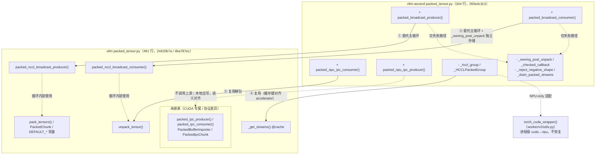
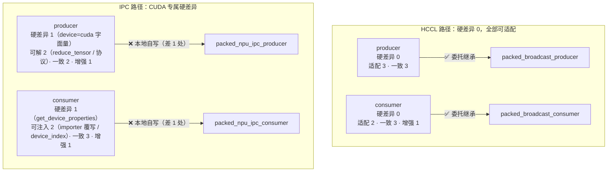

# Packed tensor 继承对照

文档版本：**v1.0.15**。版本记录见 [CHANGELOG.md](CHANGELOG.md)；v1.0.8 及以前的流程详解、图表与真机验证记录见 [versions/](versions/README.md)。

## 1. 背景：可控范围内继承上游 vLLM 实现

Ascend 侧原本自有一套 packed weight transfer 实现（449 行，含 HCCL 循环、NPU IPC 与 owning-unpack hook）。本 PR（`packed-vllm-loop-reuse` 分支）的目标是**在可控范围内继承上游 vLLM 的 packed tensor 实现**：

- **继承基准**：vLLM main `24420b7a` 与 v0.33.0 `4ba787ec` 双配套（`.github/vllm-main-verified.commit` 固定）。
- **可控范围**：HCCL 主循环、stream 管理、打包/解包这类纯逻辑全部委托上游；只在与 NPU 适配、独立存储契约、跨进程协议相关的地方保留本地代码。
- **硬约束**：不重绑定任何 vLLM 模块属性（owning-unpack hook 已删除）；不修改上游文件；上游行为契约用护栏 UT 固定（pin bump 即红）。
- **当前代码**：`260e4c3c3`，Ascend 侧 344 行（原 449 行）。

## 2. 方法清单对照

### 2.1 上游 vLLM `vllm/distributed/weight_transfer/packed_tensor.py`（491 行，main 24420b7a）

| 符号 | 类型 | 作用 |
| --- | --- | --- |
| `DEFAULT_PACKED_BUFFER_SIZE_BYTES` / `DEFAULT_PACKED_NUM_BUFFERS` | 常量 | 默认 1GB buffer、2 slot |
| `_get_streams(device_idx, num_buffers)` | 函数（@cache） | 按 (设备号， slot 数) 缓存 stream 组 |
| `unpack_tensor(packed, names, shapes, dtypes, tensor_sizes)` | 函数 | 把 packed 字节流解成命名 tensor views（内部有 contiguous 拷贝） |
| `PackedChunk` | dataclass | 一个 chunk 的元数据（HCCL 循环内部使用） |
| `pack_tensors(...)` | 函数 | 把命名 tensor 打成 packed 字节流（producer 内部使用） |
| `packed_nccl_broadcast_producer(...)` | 函数 | HCCL/NCCL 广播发送主循环 |
| `packed_nccl_broadcast_consumer(..., device=...)` | 函数 | 广播接收主循环 |
| `PackedIpcChunk` | dataclass | IPC chunk 元数据 |
| `packed_ipc_producer(...)` | 函数 | CUDA IPC 发送循环（单共享 buffer + reduce_tensor 句柄） |
| `PackedBufferImporter` | 类 | 消费侧 IPC 重建缓存（防止跨 chunk refcount 泄漏） |
| `packed_ipc_consumer(...)` | 函数 | CUDA IPC 接收（rebuild_cuda_tensor + unpack + clone） |

### 2.2 vllm-ascend `vllm_ascend/distributed/weight_transfer/packed_tensor.py`（344 行，260e4c3c3）

| 符号 | 类型 | 作用 |
| --- | --- | --- |
| `packed_broadcast_producer(...)` | 函数 | HCCL 广播发送入口：包装 transport 与回调后委托上游 |
| `packed_broadcast_consumer(...)` | 函数 | HCCL 广播接收入口：包装独立存储回调后委托上游 |
| `packed_npu_ipc_producer(...)` | 函数 | NPU IPC 发送（本地实现，yield dict 协议） |
| `packed_npu_ipc_consumer(...)` | 函数 | NPU IPC 接收（本地实现，rebuild_npu_tensor） |
| `_hccl_group` / `_HCCLPackedGroup` | 私有 | NPU 传输适配：复用上游 `_get_streams`、broadcast 前后 flush + 同步、per-slot buffer 登记 |
| `_owning_post_unpack` | 私有 | 独立存储回调：unpack 得到 views 后逐项 clone 再转交 engine 回调 |
| `_checked_callback` | 私有 | `post_iter_func` 返回值校验（dtype/numel 契约） |
| `_reject_negative_shape` | 私有 | 负 shape 校验，HCCL 与 IPC 共用 |
| `_drain_packed_streams` / `_UNSYNCHRONIZED_BUFFERS` | 私有 | 仅失败路径：drain 所有 slot，保留未同步 storage 到进程退出 |
| `torch_cuda_wrapper`（worker/v2/utils.py） | 复用 | 进程级 `torch.cuda` → `torch.npu` 适配（docstring 注明不恢复） |

## 3. 逐方法继承判定

| 上游方法 | Ascend 是否继承 | 继承方式 / 不继承原因 |
| --- | --- | --- |
| `DEFAULT_PACKED_BUFFER_SIZE_BYTES` / `DEFAULT_PACKED_NUM_BUFFERS` | ✅ 完全继承 | 直接引用上游常量 |
| `_get_streams` | ✅ 完全继承 | `_hccl_group` 内复用；缓存键统一为 `torch.accelerator.current_device_index()`（与上游循环一致，否则分叉出第二套缓存）。真机已验证 accelerator C 级 API 在 NPU 正常解析 |
| `unpack_tensor` | ✅ 完全继承 | HCCL 循环内由上游调用；NPU IPC consumer 也直接调用。未对齐 offset 由其内部 contiguous 拷贝保证安全 |
| `PackedChunk` | ✅ 间接继承 | 上游 HCCL 循环内部使用，Ascend 不触碰，随循环一并继承 |
| `pack_tensors` | ✅ 间接继承 | 上游 producer 内部调用，随循环一并继承 |
| `packed_nccl_broadcast_producer` | ✅ 委托继承 | Ascend 入口只做三件事：`_hccl_group` 提供 NPU transport、`_checked_callback` 校验回调、异常路径本地 drain；主循环整体委托 |
| `packed_nccl_broadcast_consumer` | ✅ 委托继承 | Ascend 入口做四件事：metadata 负 shape 校验、`_owning_post_unpack` 独立存储（上游返回 views，而本侧需要独立存储契约）、`device=f"npu:{...}"` 参数、委托上游。无跨 chunk event 修复；读序缺口在真实 HCCL 时序下未复现（详见 v1.0.8 快照 5.4） |
| `PackedIpcChunk` | ❌ 不继承 | 现有 NPU 调用方跨进程传 dict；dataclass 需两端同版本且给上游类型引入运行时依赖，pin bump 时远端进程也需同步升级。纯重构无功能收益，等上游强制再跟 |
| `packed_ipc_producer` | ❌ 不继承，自写 `packed_npu_ipc_producer` | 硬障碍无法绕过：① `torch.empty(device="cuda")` 硬编码 CUDA 设备字符串，NPU 上直接失败（torch_cuda_wrapper 不改 device 字符串）；② 上游 yield `PackedIpcChunk`，NPU 协议是 dict，需协议转换；③ 上游 `if total_bytes:` 对全零元素 chunk 不发送，NPU 语义要求全零 chunk 也发送元数据。曾做过整循环委托实验（约 312 行，需 empty 重定向 + reduce 转发 + 全空前缀特殊路径 + 协议转换），复杂度超过自写，已撤回。共享的部分：`_checked_callback`、`unpack_tensor`、buffer 复用与 copy 逻辑与上游逐行对齐 |
| `PackedBufferImporter` | ❌ 不继承 | 硬依赖 `rebuild_cuda_tensor`（CUDA C 级实现，NPU 侧不存在）；引入它还需 NPU engine 侧增加 importer 生命周期管理（跨 chunk 持有 + shutdown close）。refcount 泄漏问题在 NPU 侧独立评估，不混入本 PR |
| `packed_ipc_consumer` | ❌ 不继承，自写 `packed_npu_ipc_consumer` | 硬障碍：① `torch.cuda.get_device_properties(device_index).uuid` 无 NPU 等价 API（物理 NPU UUID 由调用方传入）；② `rebuild_cuda_tensor` 不可用，改用 torch_npu 的 `rebuild_npu_tensor`（含 device_index 覆写与参数校验）。其余逻辑（`content_size` 截断、`unpack_tensor` + clone）与上游一致，其中 `packed[:content_size]` 防御已加 |

**汇总**：上游 11 个符号中，6 个完全/间接继承，2 个委托继承（含 NPU 适配包装），3 个 IPC 相关因 CUDA 专属调用或协议差异无法直接继承，由 2 个自写函数 + dict 协议替代，其中可共享的解包与校验逻辑已复用上游。

### 3.1 继承关系图

## 4. 四个方法逐环节对照：HCCL producer / consumer 与 IPC producer / consumer

本章按“环节 | 上游 vLLM | vllm-ascend | 差异性质”逐环节对比四个入口方法，差异性质分三档：**一致**（随继承直接复用）、**适配**（可本地包装解决）、**硬差异**（上游写死了 CUDA 专属调用或协议，无法包装绕过）。结论由硬差异数量决定继承与否。

### 4.1 HCCL producer：`packed_nccl_broadcast_producer` ↔ `packed_broadcast_producer`

| 环节 | vLLM（24420b7a） | vllm-ascend（260e4c3c3） | 差异性质 |
| --- | --- | --- | --- |
| 参数校验 | 无 | `buffer_size_bytes` / `num_buffers` 正数校验 | 增强 |
| stream 获取 | `_get_streams(torch.accelerator.current_device_index(), n)`（@cache） | 相同，且以同一键预热缓存 | 一致 |
| slot 轮转 / in_flight | 保留在途 chunk 引用防提前释放 | 相同（随主循环继承） | 一致 |
| 打包 | `pack_tensors(iterator, post_iter_func, size)`，回调无校验 | 相同；`post_iter_func` 经 `_checked_callback` 校验 dtype/numel | 适配 |
| 通信 | `group.broadcast(chunk.packed_tensor, src)`（PyNcclCommunicator） | 同签名 transport：`_HCCLPackedGroup` 先 flush torch_npu 异步队列、broadcast 前后双同步、登记每 slot buffer | 适配 |
| stream 上下文 | `with torch.cuda.stream(...)` | 依赖 `torch_cuda_wrapper` 映射为 npu stream | 适配 |
| 结尾清理 | 无条件 drain 所有 slot | 正常路径交给上游 drain；仅异常时本地保留清理（护栏 UT 钉住上游 drain 存在） | 适配 |

**结论**：主循环、轮转、打包完全一致，差异全部是可包装的适配项 → ✅ 委托继承。

### 4.2 HCCL consumer：`packed_nccl_broadcast_consumer` ↔ `packed_broadcast_consumer`

| 环节 | vLLM | vllm-ascend | 差异性质 |
| --- | --- | --- | --- |
| metadata 迭代 | 直接 `next(iterator)` | `metadata()` 生成器逐项负 shape 校验 | 增强 |
| 接收 buffer | `torch.empty(sizes, device=device)`，device 默认 `"cuda"` | 显式传 `device=f"npu:{...}"` | 适配 |
| 事件链 | `prev_received` wait/record + `record_stream(*streams, caller_stream)` | 相同（随主循环继承，真机已验证） | 一致 |
| 解包回调 | `post_unpack_func(unpack_tensor(packed, ...))` 直接传 views | `_owning_post_unpack` 包装：views 逐项 clone 后转交（独立存储契约） | 适配 |
| slot 完成 | `slot_done` event + 下轮 synchronize（避开 ROCm 共享队列） | 相同 | 一致 |
| 结尾清理 | 无条件 drain | 仅异常路径本地 drain | 适配 |

**结论**：除独立存储包装与 device 参数外全部一致 → ✅ 委托继承。读序缺口在真实 HCCL 时序下未复现（v1.0.8 快照 5.4）。

### 4.3 IPC producer：`packed_ipc_producer` ↔ `packed_npu_ipc_producer`

| 环节 | vLLM | vllm-ascend | 差异性质 |
| --- | --- | --- | --- |
| 共享 buffer | `torch.empty(size, device="cuda")` | `torch.empty(size, device="npu")` | **硬差异**（device 字符串写死在函数体内，无法传参，见 4.7 残留 ①） |
| 句柄导出 | `reduce_tensor` → 消费端 `rebuild_cuda_tensor` 重建 | `reduce_tensor` 存 args，约定消费端用 `rebuild_npu_tensor` | 适配（torch_npu 导入时自动 patch `reduce_tensor` 支持 NPU，见 4.7） |
| 分包 / copy | contiguous → view(uint8) → copy_；超限 ValueError | 逐行相同 | 一致 |
| 同步 | `torch.accelerator.current_stream().synchronize()` | `torch.npu.current_stream().synchronize()` | 适配 |
| 回调 | `post_iter_func` 原样 | `_checked_callback` 校验 | 增强 |
| chunk 协议 | yield `PackedIpcChunk` dataclass | yield dict（跨进程协议） | **硬差异**（换协议需两端同版本升级，零功能收益） |
| 空 chunk | `if total_bytes:` 全零元素 chunk 不发送 | `if names:` 全零元素 chunk 仍发送元数据 | 语义差异 |

**结论**：分包与 copy 核心一致；句柄导出可解（torch_npu 自动 patch），yield 协议是选型而非 CUDA 障碍，唯一无法绕过的是 `device="cuda"` 字面量（L339，见 4.7 残留 ①）→ ❌ 本地自写（语义对齐，共享 `_checked_callback`）。

### 4.4 IPC consumer：`packed_ipc_consumer` ↔ `packed_npu_ipc_consumer`

| 环节 | vLLM | vllm-ascend | 差异性质 |
| --- | --- | --- | --- |
| UUID 解析 | `torch.cuda.get_device_properties(i).uuid` | 调用方传入 `physical_npu_id`（`npu_generate_uuid` 生成，见 4.6） | **硬差异**（函数体内直接调用，见 4.7 残留 ②） |
| 重建 | `rebuild_cuda_tensor`（CUDA C 级）+ `PackedBufferImporter` 缓存 | `rebuild_npu_tensor`（torch_npu，懒加载）+ device_index / 参数长度校验 | 可注入（importer 是公开参数，类继承覆写 `rebuild()` 即可，见 4.7 修正） |
| 句柄查找 | UUID not in handle → ValueError | 相同 | 一致 |
| 元数据校验 | `getattr(torch, dn)` 解析 dtype | 同 + isinstance(dtype) / 四表长度一致 / 负 shape / content_size 校验 | 增强 |
| 截断 | `packed[:content_size]` | 相同 | 一致 |
| 解包 + clone | `unpack_tensor` + 逐项 clone | 相同（直接调用上游 `unpack_tensor`） | 一致 |
| refcount 防泄漏 | importer 保证一次 export 配一次释放 | 未引入；NPU 侧独立评估，不混入本 PR | 硬差异 |

**结论**：解包与 clone 一致；重建可经 importer 注入解决，真正无法绕过的只有 UUID 获取一处（L468-469，见 4.7）→ ❌ 本地自写（但继承可行性高于 producer，仅差一处）。

### 4.5 对照总览

**总结论**：继承与否由硬差异决定——HCCL 两个方法没有任何无法解决的差异（device 由参数传入、通信接口同签名、事件链可复用），全部环节要么一致要么可本地包装，因此整体委托继承；IPC 两个方法各只剩 1 处函数体内的 CUDA 调用无法在 ascend 侧解决（producer 的 `device="cuda"` 字面量、consumer 的 `get_device_properties().uuid`），其余"硬差异"经逐项核查均可在 ascend 侧解决（wrapper 重绑、torch_npu 自动 patch、importer 类继承覆写），因此本地实现、仅在解包/校验/分包等可共享环节复用上游。完整穷举见 4.7。

### 4.7 CUDA 操作穷举与最终继承边界

对上游 `packed_tensor.py`（491 行，main 24420b7a）全部 CUDA 相关操作逐行穷举，按"ascend 侧能否解决"分三类。本节修正 4.3–4.5 的初步判定。

**A 类：已解决**（wrapper / 等价 API / 真机验证）

| 操作 | 位置 | 解法 |
| --- | --- | --- |
| `torch.cuda.Stream` / `torch.cuda.stream(...)` | L23-24、L180、L270 | `torch_cuda_wrapper` 重绑，真机 gate 验证 |
| `torch.accelerator.current_device_index/current_stream` | L168、L223、L362、L383 | C 级实现直接解析 NPU，真机验证 |
| `torch.Event()` / `record_stream` / `wait_event` / `.synchronize()` | L248-259、L176/193/269/296 | npu 等价 API，真机验证 |
| `pack_tensors` 的 `device="cuda"` **默认参数** | L203 | 调用方显式传 npu 设备串（现有实现已如此；pack 本体是 CPU 内存操作） |

**B 类：vllm-ascend 侧可解决，无需上游改动**

| 操作 | 位置 | 解法 |
| --- | --- | --- |
| `reduce_tensor`（NPU tensor 支持） | L12、L340 | torch_npu 导入时自动 patch（经 `_share_npu_()`），npu_ipc_engine 已实证 |
| `rebuild_cuda_tensor` + `PackedBufferImporter` 缓存 | L418-423、L482 | **修正 4.4 初判**：importer 是 consumer 的公开参数（默认 None 才 new 基类），可定义 `NPUBufferImporter(PackedBufferImporter)` 类继承覆写 `rebuild()` 调 `rebuild_npu_tensor`——缓存/refcount 对账逻辑是纯 Python，直接继承复用；handle 元组布局与 CUDA 一致，`list_args[6] = device_index`（上游 L480）原样可用 |
| `PackedIpcChunk` dataclass 协议 | L300-310 | 非 CUDA 问题：dataclass 可直接构造/接收，ascend 选 dict 是跨进程协议选型，不是继承障碍 |

**C 类：无法在 ascend 侧解决——全部残留仅此 2 处**

| # | 操作 | 位置 | 为什么绕不过 | 上游最小改动 |
| --- | --- | --- | --- | --- |
| ① | `torch.empty(..., device="cuda")` 字面量 | producer L339 | 写死在函数体内无法传参；wrapper 不能重绑 `torch.empty`（污染所有代码路径，比 P1-2 的 hook 面更大）；NPU-only 环境 device="cuda" 直接 RuntimeError | 一行：`device: str = "cuda"` 参数化，调用方传 "npu" |
| ② | `torch.cuda.get_device_properties(device_index).uuid` | consumer L468-469 | 函数体内直接调用；仓内替代先例走 Platform 扩展点但上游代码不走 Platform API；补绑扩大 wrapper 重绑面 | 两行：uuid 获取改为可注入参数（ascend 传 `npu_generate_uuid` 结果）或走 Platform API |

**最终继承边界**（修正后）：

- HCCL producer / consumer：A 类全覆盖 → ✅ 委托继承（现状）。
- IPC producer：仅差残留 ① → ① 合入后即可删 `packed_npu_ipc_producer` 改直调上游（`reduce_tensor`、`PackedIpcChunk`、分包/copy 全部直接用）。
- IPC consumer：仅差残留 ② → ② 合入后定义 `NPUBufferImporter(PackedBufferImporter)` 覆写 `rebuild()`，删自写 consumer 改直调上游 + 注入 uuid。
- 两个上游改动合计约 3 行，均为纯参数化、对 CUDA 路径零行为影响，适合作为后续小 PR 提给上游；合入前维持现状（自写 IPC）不变。

### 4.6 IPC cuda 绑定的可解性与继承路径

IPC 的“硬差异”并非全部不可解——仓库 engine 层已有成熟先例，逐项核对如下。

**仓内已有的同类解法**（`npu_ipc_engine.py`）：`NPUIPCWeightTransferEngine` / `NPUIPCTrainerWeightTransferEngine` 直接继承上游 `IPCWeightTransferEngine` / `IPCTrainerWeightTransferEngine`，只覆写 CUDA 专属部分。三类 cuda 绑定的对应解法：

| 上游 cuda 绑定 | vllm-ascend 解法 | 位置 |
| --- | --- | --- |
| `torch.cuda.get_device_properties().uuid` 作 IPC key | `npu_generate_uuid()` = `{host_ip}-{物理chip_id}`，经 `ASCEND_RT_VISIBLE_DEVICES` 做逻辑→物理映射，替代硬件 UUID（`torch.npu.get_device_properties` 存在且 props 可能带 uuid，platform.py 在用，但选型未依赖它） | npu_ipc_engine.py `npu_generate_uuid` |
| `rebuild_cuda_tensor`（CUDA C 级） | `torch_npu.multiprocessing.reductions.rebuild_npu_tensor`（懒加载）+ 重建时覆写 device_index（handle 元组下标 6，收发双方逻辑卡号可能不同） | npu_ipc_engine.py `receive_weights` |
| `reduce_tensor` 对 NPU 的支持 | torch_npu 导入时自动 patch `torch.multiprocessing.reductions.reduce_tensor`（经 `_share_npu_()`），producer 侧无需改 | npu_ipc_engine.py docstring |
| `torch.cuda.Stream/stream` 等 API | `torch_cuda_wrapper` 进程级重绑（14 个 API） | worker/v2/utils.py |

**为什么函数级直调上游仍差三个口子**：

1. producer 的 `device="cuda"` 是函数内字面量默认值（上游 L339），ascend 无法传参绕过，需上游一行参数化；
2. consumer 的 `rebuild_cuda_tensor` 按名导入（上游 L418），wrapper 只重绑 `torch.cuda.*` 命名空间、兜不住 reductions 模块；替换它只能做进程级 monkey patch——即 P1-2 已删除的污染模式，不能走回头路；
3. wrapper 未重绑 `torch.cuda.get_device_properties`——全仓 git 历史（`-S` 检索）从未有人写过或重绑过该调用，仓内替代先例走的是 vLLM Platform 扩展点：`NPUPlatform.get_device_uuid()` 直接调 `torch.npu.get_device_properties(device_id).uuid`（无 uuid 即 RuntimeError），`num_compute_units()` 把 CUDA 的 `multi_processor_count` 概念映射为 `cube_core_num`（带两级 fallback）。

**注入时的选型注意**：weight_transfer 引擎未用 platform 的 `get_device_uuid`，而是自建 `npu_generate_uuid`（host_ip + 物理 chip 号）——结合 platform 里"无 uuid 就 RuntimeError"的防御写法，说明 props.uuid 在部分 torch_npu/CANN 版本上不可靠。因此将来上游若把 uuid 查找改为可注入，ascend 侧应注入 `npu_generate_uuid` 而非 `get_device_uuid`（跨版本稳定、同 chip 进程必一致）；若上游走 Platform API 路线，则现有覆写零适配直接可用。

**继承路径建议**：

- 本 PR：维持自写 IPC。解法已落在 engine 层（`packed_npu_ipc_consumer` 内部用 `rebuild_npu_tensor` + `npu_uuid` + device_index 覆写，与 engine 同构）；函数级直调的口子中两个要动上游。
- 中期：向上游提 2 个极小 PR——① producer 的 `device` 参数化；② consumer 的 rebuild 函数与 UUID 查找改为可注入。合入后 ascend 可删自写 producer/consumer，改直调上游 + `npu_generate_uuid`，与 HCCL 路径的委托继承形态对齐。

## 5. packed 相关未合入 PR 的影响分析

继承重构（#20676）完成后，仓库中其余 packed weight transfer 未合入 PR 是否还需要改（截至 2026-11-11 检索，简要）：

| PR | 内容 | 继承完成后是否还需要 |
| --- | --- | --- |
| #20740 IPC 一次性导入 | NPU IPC 每次重建/释放导致 producer refcount 负数泄漏；引入一次性导入缓存 | **仍需要，不受影响**。与第 4.4 节“importer 不继承、NPU 侧独立修复”的决策吻合，可视为 `PackedBufferImporter` 思想的 NPU 落地；与 #20676 仅需 rebase 协调（同文件不同区域） |
| #18078 拆分工具与后端 | 把 packed_tensor 序列化/反序列化从 HCCL、NPU IPC 后端拆出（+728/-256，恰好覆盖 #20676 的两个文件） | **需要重大返工**。其拆分对象在继承后结构已变（循环委托上游、IPC 收敛为两个入口函数），与本 PR 直接冲突；需在 #20676 合入后基于新结构重评甚至重写 |
| #16999 HCCL buffer stream 生命周期 | 旧本地 producer 循环的四项修复：按设备缓存 stream、同 slot stream 打包+广播、在途 buffer 保活、结尾 drain | **被继承取代，可关闭**。上游循环本身就包含这四项（见 4.1）；release 分支同类问题由 #18763 / #20614 覆盖 |
| #19127 跨 chunk readiness | 基于 hook / 本地循环的跨 chunk event + clone record_stream 方案（+286/-33） | **被继承取代**。hook 已删除、真机最小用例未复现读序缺口（v1.0.8 快照 5.4）；可关闭，或改写为 `_owning_post_unpack` 内几行 wait_event 的可选加固后重提 |
| #12713 打包前源 stream 同步 | producer 打包读源 tensor 时源可能在 caller stream 在途，仅同步 slot stream 不够（+4/-0） | **仍需要，但补丁位置要改**。缺口在委托后的上游循环中同样存在，4 行修复应改挂到本地入口（`_hccl_group` 进入循环前同步 caller stream），不能继续打在旧本地循环上 |
| #18763 单 stream 加载（v0.30.0） | release 分支：跨 chunk 加载顺序修复 | 不受影响。release 分支保留本地循环，独立于 main 重构 |
| #20614 packed 修复 backport（v0.30.0） | release 分支 backport #19164 | 不受影响。同上 |

**合入顺序建议**：先合 #20676（继承基座）→ #12713 按新入口改 4 行重提、#20740 rebase → #18078 基于新结构重评 → 关闭 #16999、#19127（或按可选加固改写）。
