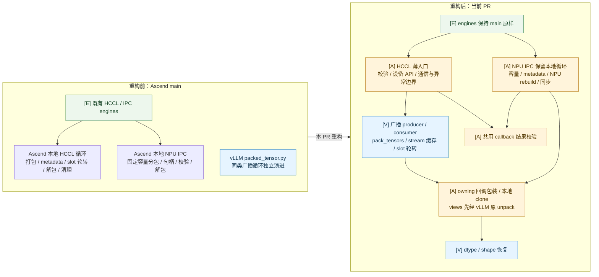
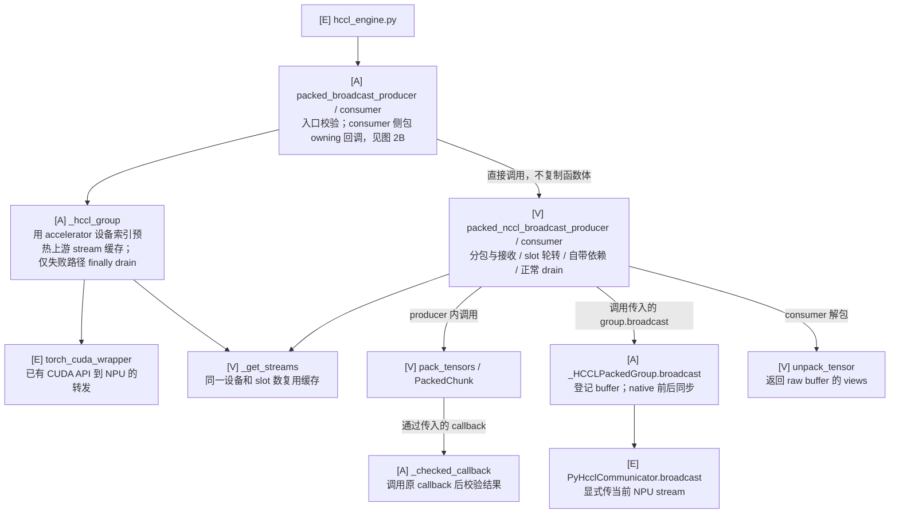
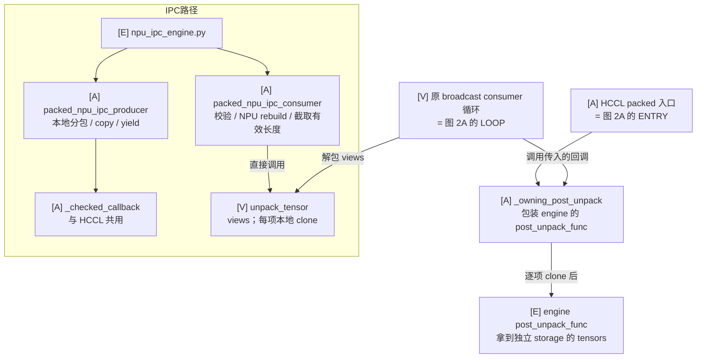
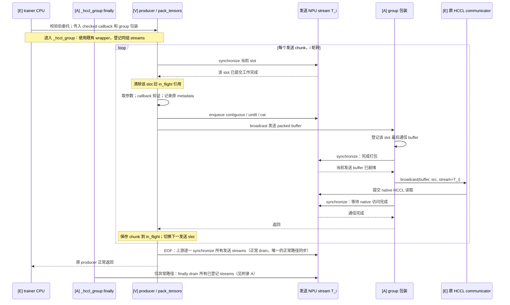
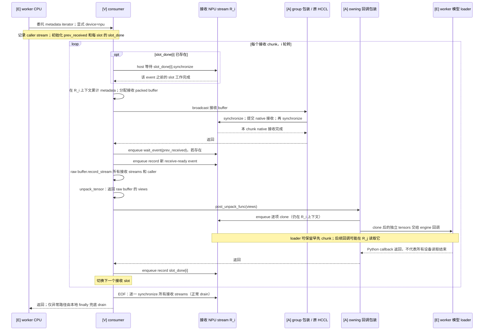
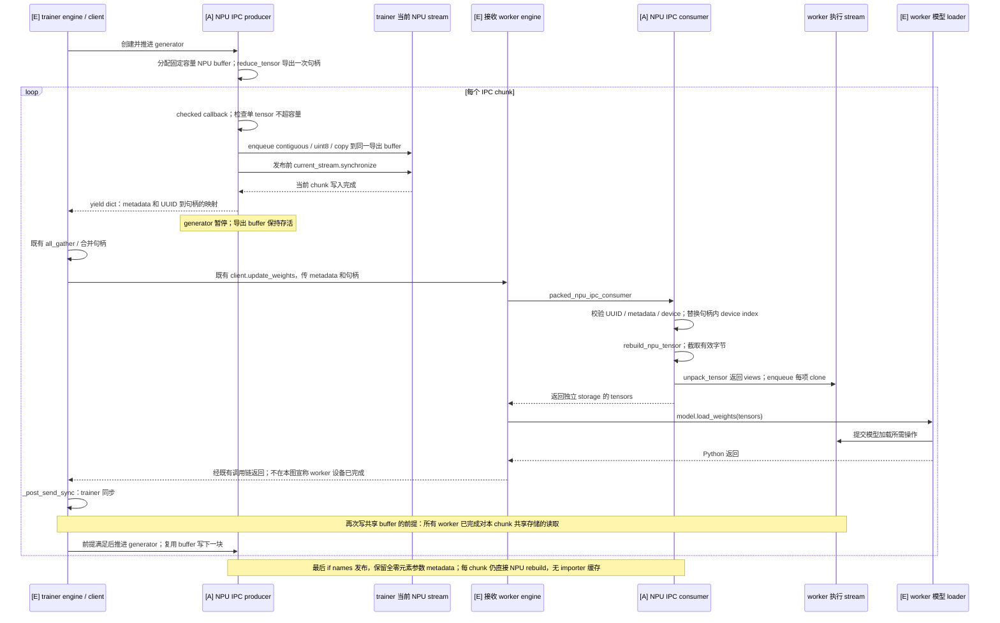
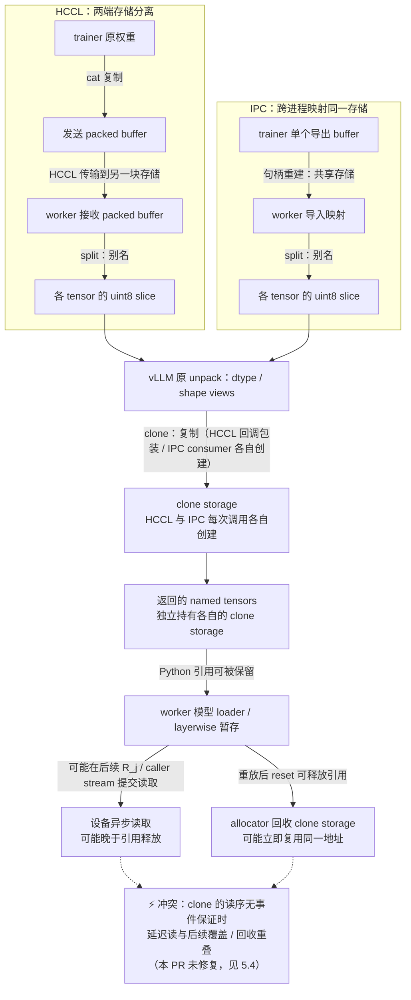
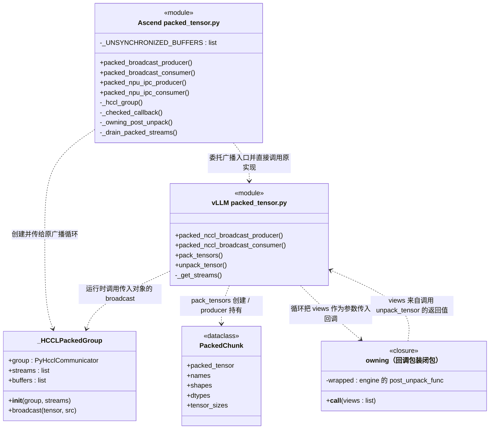
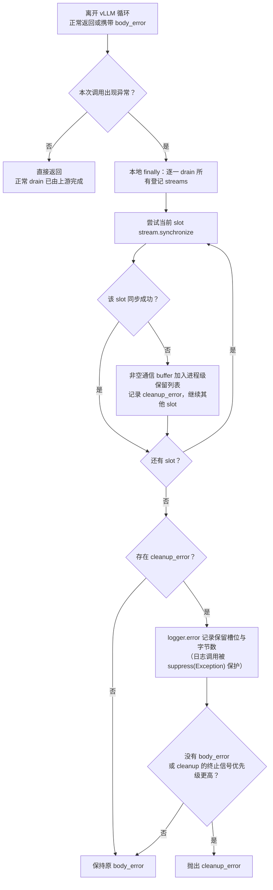

# Packed tensor 方法、流程与复用设计

文档版本：**v1.0.7**。版本记录见 [CHANGELOG.md](CHANGELOG.md)。

## 1. 阅读基准与方法清单

### 1.1 版本及“当前实现”的定义

本文以已经检查过的固定源码说明流程，不把“当前配套”当成持续变化的 vLLM HEAD：

| 对象 | 基准 | 用途 |
| --- | --- | --- |
| vLLM main 配套 | `24420b7a341af37a9bc3186e6fc6062512e0aa58` | 主要流程说明 |
| vLLM v0.33.0 | `4ba787ec9959e566d3b587a796dff07673324da5` | 双版本差异说明 |
| Ascend main 原实现 | `37854b83ed4c91f90dc609d62d1e90e351005315` | 识别必须保留的原有功能 |
| Ascend 当前重构实现 | `packed-vllm-loop-reuse`，已提交并推送 `773c8947eda1dc7c7586abdd4fd04ada056fa962` | 本文“当前 Ascend 流程”的主体 |

“当前 Ascend”以已推送的 773c8947e 为准：HCCL 调用 vLLM 原循环；IPC 保留本地固定容量分包、NPU 句柄校验与重建，共用 `_checked_callback`；独立存储由 HCCL 侧的 `_owning_post_unpack` 回调包装和 IPC 侧的本地 clone 提供，**不再重绑定任何 vLLM 模块属性**。正常路径 drain 委托上游，仅失败路径执行本地保留清理。没有新增跨 chunk callback event 或额外 record_stream 修复；这不表示跨 chunk 问题已经解决。

主要源码：[vLLM 配套 packed_tensor.py](https://github.com/vllm-project/vllm/blob/24420b7a341af37a9bc3186e6fc6062512e0aa58/vllm/distributed/weight_transfer/packed_tensor.py)、[vLLM v0.33.0 对应文件](https://github.com/vllm-project/vllm/blob/4ba787ec9959e566d3b587a796dff07673324da5/vllm/distributed/weight_transfer/packed_tensor.py)、[Ascend main 原文件](https://github.com/vllm-project/vllm-ascend/blob/37854b83ed4c91f90dc609d62d1e90e351005315/vllm_ascend/distributed/weight_transfer/packed_tensor.py)。

源码链接均固定到 commit。[当前 Ascend 实现](https://github.com/Liccol/vllm-ascend/blob/773c8947eda1dc7c7586abdd4fd04ada056fa962/vllm_ascend/distributed/weight_transfer/packed_tensor.py)是本版逐方法对照的依据。v0.32.0 仅属于历史验证，不再是本版当前 release 配套。

### 1.2 vLLM 文件中有哪些方法

`vllm/distributed/weight_transfer/packed_tensor.py` 包含 7 个模块函数、1 个具有 3 个方法的 importer 类，以及 2 个 chunk 数据结构。

| 方法 | 所在一方 | 主要职责 | Ascend 对应项 |
| --- | --- | --- | --- |
| `_get_streams(device_idx, num_buffers)` | 广播发送/接收两方分别调用 | 缓存本进程指定设备的 stream 元组 | 原函数直接使用 |
| `pack_tensors(...)` | 广播发送方 | 迭代参数、预处理、字节化、组成一个 chunk | 原 producer 内部直接使用 |
| `unpack_tensor(...)` | 广播接收方、IPC 接收方 | 字节切分并恢复 dtype/shape，通常返回 views | HCCL 由 `_owning_post_unpack` 包装回调后 clone；IPC consumer 显式 clone |
| `packed_nccl_broadcast_producer(...)` | trainer | 发送 slot 轮转、打包和广播 | `packed_broadcast_producer` |
| `packed_nccl_broadcast_consumer(...)` | worker | 接收 slot 轮转、接收、解包、调用模型 loader | `packed_broadcast_consumer` |
| `packed_ipc_producer(...)` | trainer | 复用一块 IPC buffer，分块写入并产出句柄和 metadata | `packed_npu_ipc_producer` |
| `packed_ipc_consumer(...)` | worker | 选 CUDA 句柄、导入 buffer、解包并 clone | `packed_npu_ipc_consumer` |
| `PackedBufferImporter.__init__()` | IPC worker | 初始化单项映射缓存 | 当前 NPU packed 路径没有对应缓存 |
| `PackedBufferImporter.rebuild(list_args)` | IPC worker | 复用相同句柄的映射，否则重建并替换缓存 | 当前调用 `rebuild_npu_tensor`，未套用该缓存 |
| `PackedBufferImporter.close()` | IPC worker | 释放所持映射引用 | 当前没有本地 importer 对象可供 close |

数据结构和常量：

| 项目 | 内容 |
| --- | --- |
| `PackedChunk` | `packed_tensor`、`names`、`shapes`、`dtypes`、`tensor_sizes` |
| `PackedIpcChunk` | `names`、`shapes`、`dtype_names`、`tensor_sizes`、`ipc_handle` |
| 默认配置 | `DEFAULT_PACKED_BUFFER_SIZE_BYTES`、`DEFAULT_PACKED_NUM_BUFFERS` |

这里所谓“继承方案”主要指直接调用函数和复用数据结构。packed 层没有 producer/consumer 基类；不为满足“继承”字面含义新增基类。引擎层的 HCCL/NCCL 类继承已是 main 的基础，不在本 PR 重新改造。

## 2. 各方法大致流程

### 2.1 流程概览

| 方法 | 大致流程 |
| --- | --- |
| `_get_streams` | 接收设备和 slot 数 → 查函数缓存 → 首次创建 streams → 返回元组 |
| `pack_tensors` | 取参数 → callback → contiguous/flatten/uint8 → 累计 metadata 和字节数 → 超阈值或迭代结束 → cat → PackedChunk |
| `unpack_tensor` | 按 sizes split → 各段恢复 dtype → 恢复 shape → 返回带名字的 tensors |
| broadcast producer | 取 streams → 等待当前发送 slot → 打包 → broadcast → 保留 chunk 引用 → slot 轮转 → 最终 drain |
| broadcast consumer | 取 streams → 等待接收 slot 可复用 → 聚合 metadata → 分配接收 buffer → broadcast → 原有依赖处理 → unpack → loader callback → 轮转 → 最终 drain |
| IPC producer | 分配并导出共享 buffer 一次 → 处理参数 → buffer 将放不下时先产出上一块 → 拷入本块 → EOF 产出剩余 metadata |
| importer `__init__` | 设置空缓存项 |
| importer `rebuild` | 构造句柄 key → 命中返回旧映射 → 未命中 CUDA rebuild → 替换缓存 |
| importer `close` | 丢弃缓存项引用 |
| IPC consumer | 查询设备 UUID → 选句柄 → 修正 device index → importer.rebuild → 按有效长度截取 → unpack → clone |

### 2.2 设计图索引与阅读约定

| 图 | 评审重点 | 对应详述 |
| --- | --- | --- |
| 图 1：重构前后结构 | 删除哪些重复代码，保留哪些硬件边界 | 第 4 章 |
| 图 2A / 2B：函数复用与适配 | 直接委托、通信包装、owning 回调包装分别在哪里 | 3.1～3.5、3.10 |
| 图 3A / 3B：HCCL 收发时序 | 打包、native 通信、解包和 loader 的提交顺序及等待位置 | 3.4～3.5 |
| 图 4：IPC 收发时序 | 共享 buffer 的发布、重建、消费与下一次覆盖 | 3.6、3.10 |
| 图 5：存储与生命周期 | view、clone、loader 引用与设备读取完成的区别 | 3.3、5.4 |
| 图 6：UML 静态结构与复用边界 | 模块操作、真实类、回调闭包与依赖关系，区分类继承与函数委托 | 2.8、3.1～3.5、3.10 |
| 附图 A：异常清理 | drain、失败 storage 保留与异常优先级 | 附录 A |

所有图描述第 1.1 节的固定源码，**不是拟议跨 chunk 修复方案**。图中 `[V]` 表示 vLLM 原实现，`[A]` 表示本 PR 的 Ascend packed 适配，`[E]` 表示既有引擎、worker 或模型代码，不在本 PR 修改。

packed 层用的是**函数委托和包装**，其结构在第 2.8 节 UML 图中以依赖箭头表示，不是类继承。引擎类继承沿用 main；本 PR 不改变引擎建组、RPC 协议或 loader 实现，不再展开背景类图。

术语按一方分别命名：

| 名称 | 归属及含义 |
| --- | --- |
| 发送 slot / T_i | trainer 进程内的轮转位置 / 对应发送 stream |
| 接收 slot / R_i | 同一个接收 worker 进程内的轮转位置 / 对应接收 stream |
| 发送 / 接收 packed buffer | HCCL 两端各自分配的存储，不是共享同一块 storage |
| IPC 导出 buffer / 导入映射 | trainer 分配的共享存储 / worker 对该存储的映射，二者指向同一 payload |
| worker 模型 loader | worker 的模型权重加载逻辑；HCCL 由 post_unpack_func 调用，IPC 由既有 engine 调用 |
| caller stream | 进入 vLLM consumer 时记录的 worker 当前 stream，与 R_i 分开表述 |

时序图的实线表示 Python 调用、提交或控制流，虚线表示返回；带 `enqueue` 的步骤仅表示设备工作入队。**Python 返回、event.record 返回和 loader 返回均不自动表示设备执行完成**。只有明确标出的 synchronize 等待才表示对应对象的 host 完成边界。

### 2.3 图 1：重构前后结构对比

图 1 的收益是 HCCL 主循环随已安装的 vLLM 演进，不再在 Ascend 抄一份循环；**不是整个 packed 文件清空**。NPU IPC 主循环、设备句柄和原有兼容契约仍需本地维护。颜色只辅助阅读，职责以 `[V]/[A]/[E]` 文字为准。

### 2.4 图 2A / 2B：函数复用与适配关系

**图 2A：HCCL 主循环委托与通信适配。**

**图 2B：owning 回调包装与保留的本地 IPC。** 这里只展开共享路径，不重复 HCCL 通信边界；节点与图 2A 对应（`HCCL packed 入口` 即图 2A 的 ENTRY，`原 broadcast consumer 循环` 即图 2A 的 LOOP）。整个流程不重绑定任何 vLLM 模块属性。

图 2A / 2B 的两侧影响范围：

- `torch_cuda_wrapper` 修改进程级 `torch.cuda` 的 stream/event/graph 等 API，退出后不恢复；当前按 NPU-only 约束复用该已有行为。它不把 HCCL 改成 NCCL，也不覆盖 `torch.accelerator`。
- `_owning_post_unpack` 只是我们传给原循环的回调包装，随调用结束即弃，不修改任何模块属性；views→clone 的顺序意味着解包结果先经 vLLM 原函数、再在包装内取得独立 storage。

IPC 复用 callback 验证和 `unpack_tensor` 的 dtype/shape 恢复，clone 由 consumer 本地完成；**未委托 vLLM IPC producer、consumer 或 importer**。`_get_streams`、`pack_tensors` 等不新增本地同名副本。

### 2.5 图 3：HCCL packed 收发时序

以下用发送 T_i 和接收 R_i 表示两端各自的 slot stream；相同下标不表示跨进程共享 stream。metadata 由既有编排提供，**不通过 packed buffer 自动发送**。双方必须采用相同参数顺序和分包阈值，才能形成匹配的 broadcast 序列。

**图 3A：发送方。** 每次 broadcast 的接收端位于图 3B；图中的“通信完成”仅指当前 stream 上已提交的工作。

`buffer_size_bytes` 在这里是 flush 阈值：先加入 tensor，再判断累计大小是否超过阈值。空 iterator 不产生 chunk；阈值不是固定容量上限。包装器在 native HCCL 前后执行保守同步，因此多 slot 不等于已经形成有效通信/计算重叠。图末的 EOF drain 来自 vLLM 原 producer；v1.0.7 起 finally 仅在异常路径执行本地 drain（保留失败 storage 与优先级语义，附录 A），正常路径不再重复同步。

**图 3B：接收 worker。** 本图以 main 配套为准。为避免把“排队”和“完成”混淆，event 依赖的建立与 host 等待分开标注。

main 的 `slot_done` 用于**同一个接收 slot 的复用**，不是让下一个不同 slot 等待前一 callback。v0.33.0 没有这组 slot_done event，复用 slot 前直接 synchronize；其余本图的 receive-ready 链、raw buffer record_stream 和回调包装的 clone 关系相同。

receive-ready event 在 clone **之前**记录；raw buffer 的 record_stream 涵盖 caller stream，因此 raw storage 不会被 allocator 提前复用。但仍不能从本图推导“R_j 已等到 R_i clone 完成”：clone 的设备读没有等待事件，loader 若在 caller 或其他 stream 上读取，读序没有保证。这正是第 5.4 节仍保留的验证边界，本 PR 不额外补 event 链。

### 2.6 图 4：NPU IPC packed 收发时序

IPC 没有 HCCL 的多 slot 广播循环。每个 producer generator 只持有一块固定容量导出 buffer；worker 重建得到的是该共享存储的映射，而不是另一份 payload。

图 4 中“所有 worker 已完成读取”是推进 generator 的**调用方契约**，不是 packed generator 新增的一条 worker 同步，也不是仅凭 RPC 返回就已证明满足。`_post_send_sync` 同步的是 trainer ranks 及其 NPU，不能单独画成 worker clone 完成的保证。此处只说明已有编排边界，本 PR 不修改 engine、client 或 worker 完成确认机制。

每次发布前先判断下一 tensor 能否容纳：单 tensor 超容量拒绝；多 tensor 放不下则先 yield 已有块，调用方恢复 generator 后才写入下一块。空 iterator 不产出；非空但全零元素 iterator 仍产出 metadata。这些语义是保留本地 IPC producer 的原因。

### 2.7 图 5：buffer、view 与 owning tensor 的存储生命周期

下面是存储关系图，箭头文字区分复制和别名，不表示类继承。每个 clone 是字节存储的 owner；返回的 typed tensor 直接持有该 clone storage，不再是原 packed buffer 的 view。HCCL 与 IPC 每次调用分别创建自己的 clone，图中 clone 节点表示共用同一创建语义，不表示共享同一 clone 实例。

生命周期按三个独立条件审视：

| 存储 | 谁持有 | 允许释放或覆盖的前提 | 当前行为与边界 |
| --- | --- | --- | --- |
| HCCL 发送 packed buffer | producer 的 in_flight；本地包装器另登记每 slot 最后通信 buffer | native 读取完成；旧 slot 工作完成 | native 前后同步，slot 轮转等待，退出 drain |
| HCCL 接收 raw buffer | consumer 局部引用；本地包装器登记 | 原 buffer 的异步访问结束 | vLLM 原循环对 raw buffer 记录接收 streams 和 caller |
| IPC 导出 buffer / worker 映射 | 暂停中的 generator / worker 本次 rebuild 结果 | 所有 worker 不再读取该 chunk 的共享字节，才可覆盖 | generator 不自行调度消费确认；依赖调用方编排 |
| owning clone storage | 返回 tensor 本体、loader 暂存引用 | clone 完成后才能读取；所有异步读结束后才能回收复用 | 独立存储已保留；raw buffer 的 record_stream 不覆盖 clone 本身的读序（见 5.4） |

**独立存储、数据就绪和生命周期是三个条件。** clone 保证不再别名原 buffer，但 clone 的提交不是完成证明；loader 持有 Python 引用可延长 storage 存活，却不能代替跨 stream 依赖；引用释放后仍可能有设备读在运行。图 5 的冲突节点（⚡）只标记未解决风险，不能作为本 PR 已修复该问题的证据。

### 2.8 图 6：UML 静态结构与复用边界

图 6 采用 UML 类图记法展示模块、实际类和回调闭包。`«module»` 方框中的操作是 Python **模块函数**，不是某个虚构父类的方法；这里只列出本次实际使用的 vLLM 成员。模块函数省略参数，签名和行为见第 3 章。`«closure»` 是入口包装 `post_unpack_func` 时生成的局部函数，也不是新增类。v1.0.7 起 owning 语义由回调包装提供，**不再存在模块属性重绑定**，v1.0.6 的 6B 状态图随之删除。

图 6 的虚线箭头是 UML **依赖/使用**关系，不是时序图的“返回”。图中没有空心三角继承箭头，因为当前 packed 层没有新增父子类关系；也没有将 `_HCCLPackedGroup` 画成 NCCL communicator 的子类，它只通过 `broadcast` 方法满足循环的调用接口。`VllmPacked → Owning` 是普通的函数参数传递：上游循环以 `post_unpack_func(unpack_tensor(...))` 的形式调用，包装闭包在自己的函数体内逐项 clone，全程不读写任何模块属性。

| 图中关系 | 实际代码及复用方式 | 不应误读为 |
| --- | --- | --- |
| Ascend 模块 → vLLM 模块 | 两个广播入口直接调用 `upstream.packed_nccl_broadcast_*`；IPC consumer 直接调用 `upstream.unpack_tensor` 后本地 clone | Ascend 模块继承了一个 PackedTensor 基类 |
| vLLM 模块 → `_HCCLPackedGroup` | 函数参数 `group` 接收到包装对象，循环运行时调用其 broadcast | vLLM 源码导入了 Ascend 类，或实际使用 NCCL 通信 |
| vLLM 模块 → `PackedChunk` | 原 `pack_tensors` 创建数据对象，原 producer 用 in_flight 持有 | Ascend 另写了 PackedChunk 子类或转换副本 |
| vLLM 模块 → owning 闭包 | consumer 把 `_owning_post_unpack(post_unpack_func)` 作为 `post_unpack_func` 参数传入 | vLLM 被打补丁，或全局替换了 unpack 符号 |
| owning 闭包 → engine 回调 | 每项 views clone 后调用原 `post_unpack_func`，返回值被丢弃 | 回调结果回写上游循环 |

模块操作前的 `+ / -` 仅区分公开入口与下划线内部 helper；Python 不因此增加访问控制。

**没有复用的部分：** vLLM 的 `packed_ipc_producer`、`packed_ipc_consumer`、`PackedBufferImporter` 和 `PackedIpcChunk` 没有进入当前 NPU IPC 路径，不画成 Ascend 的父类或已复用组件。NPU IPC 的本地分包、句柄重建和 metadata 校验仍在 Ascend 模块内。已有 engine 类继承关系不属于本 PR 的 packed 重构，图 6 不展开。

## 3. 按方法详细对照与复用方案

### 3.1 `_get_streams`

**vLLM 流程**

以 `(device_idx, num_buffers)` 为缓存 key；未命中时创建 `num_buffers` 个 `torch.cuda.Stream(device=device_idx)`，返回 tuple；后续相同 key 复用同一组对象。这样避免每次更新创建新 stream，使 allocator 缓存按 stream 分散。

**当前 Ascend 流程**

main 原实现每次 producer/consumer 调用新建 NPU streams。当前重构先在 `_hccl_group` 中调用 vLLM 原缓存函数，登记本次清理所需 streams；随后 vLLM 循环也取同一个缓存元组。`_hccl_group` 使用既有 V2 `torch_cuda_wrapper()`，让 Stream 创建走 NPU。

**差异**

stream 从“每次新建”变为“按设备和数量缓存”；创建 API 的后端不同。共享缓存意味着不能据此声称支持同设备并发 transfer。

**继承/复用方案**

直接调用 vLLM 原 `_get_streams`，不复制缓存，不包装函数。Ascend 只适配 stream 创建 API。

**复用内容与保留边界**

复用缓存 key、创建数量和返回结构；保留 NPU API 转发和异常清理登记。未来若私有函数的 key、签名或缓存语义改变，需要重新核对“循环与 finally 使用同一组 streams”的前提。

### 3.2 `pack_tensors`

**vLLM 流程**

1. 从 iterator 取 `(name, orig_tensor)`。
2. 调用 `post_iter_func`，执行 contiguous、flatten、view(uint8)。
3. 从原 tensor 记录 name、shape、dtype，从转换结果记录字节数。
4. 将该 tensor 纳入本 chunk；累计大小大于阈值时停止，否则继续取参数。
5. 没有 tensor 时返回 None；否则 cat 成一个 uint8 buffer，返回 PackedChunk。单 tensor 超过阈值会 warning，但仍可发送。

**当前 Ascend 流程**

main 原 producer 内联这些步骤。当前 HCCL producer 已委托 vLLM，因此由 vLLM 原循环直接调用 pack_tensors。本地 `_checked_callback` 保留“预处理必须返回 Tensor，且 dtype/numel 不变”的 main 校验。

NPU IPC 当前在自己的循环中逐段写入一块固定容量 buffer，没有调用 pack_tensors。

**差异**

HCCL 的 buffer_size 是“超过后 flush 的阈值”，不是严格容量；IPC 是固定容量，放入下一 tensor 前就必须判断能否容纳，单 tensor 超容量必须拒绝。两种循环不可直接互换。

**继承/复用方案**

HCCL 完整复用；IPC 不用它替换分包循环。

**复用内容与保留边界**

HCCL 复用迭代、线性化、metadata、cat 和阈值规则；本地保留预处理结果验证、参数入口检查。IPC 中只有几行字节化相似，不值得为此引入不匹配的分包工具。

### 3.3 `unpack_tensor`

**vLLM 流程**

按 tensor_sizes 对 packed uint8 buffer 做 split；每段 contiguous 后 view(dtype)，再 view(shape)，返回 `(name, tensor)` 列表。对于已经连续的切片，contiguous 通常不复制，因此结果仍是 packed buffer 的 view。

**当前 Ascend 流程**

main 原 HCCL consumer 和 NPU IPC consumer 都保证返回独立 storage，也能处理混合 dtype 的未对齐 offset。

当前 HCCL 侧把 engine 的 `post_unpack_func` 交给 `_owning_post_unpack` 包装：原循环调用 `unpack_tensor` 得到 views，包装闭包逐项 `clone()` 后再调用 engine 回调。IPC consumer 在完成原有校验和 NPU rebuild 后直接调用 `upstream.unpack_tensor(...)`，对返回的 views 逐项 clone 后返回，不再维护另一套 offset 解包循环。两条路径都不修改任何 vLLM 模块属性。

**差异**

原 vLLM 返回 views；Ascend 原契约允许 callback 保留或修改输入，不得别名 packed buffer。另外，uint8 offset=6 的切片不能直接 view(int64)，但 unpack 内部恢复 dtype 顺序与 clone 时机配合后不受影响。

**继承/复用方案**

为保持 main 既有独立存储契约，当前保留 clone，只是把 clone 从“替换模块符号”移进我们自己的回调包装。HCCL 与 IPC 都直接调用原 `unpack_tensor`，没有新增独立 helper 文件。HCCL 原生 views 路线是后续候选，会改变该契约，尚未采用。

**复用内容与保留边界**

复用 dtype/shape 恢复实现；保留独立存储。每 tensor 多一次 clone 的成本尚未做硬件评估。这个包装不引入 callback 完成 event 或额外 record_stream，也不代表跨 chunk 时序问题已解决。

注意：包装只是普通函数参数，随本次调用结束即弃；进程内其他任何 `unpack_tensor` 调用者看到的仍是 vLLM 原函数。包装不安装 stream/event 依赖，只负责返回独立存储。

### 3.4 `packed_nccl_broadcast_producer` → `packed_broadcast_producer`

**vLLM 流程**

1. 取得缓存 streams，初始化每 slot 一个 in-flight chunk 引用。
2. host 等待当前发送 stream 完成，释放该 slot 的旧 chunk 引用。
3. 在当前 slot 的 stream 上调用 pack_tensors。
4. 没有 chunk 则结束；有 chunk 则调用传入 group.broadcast。
5. 保留 chunk 引用至该 slot 安全复用，移动到下一 slot。
6. 迭代结束后同步全部 streams。

**当前 Ascend 流程**

main 原实现本地维护取参数、打包、cat、slot 轮转和 finally。当前入口先校验配置，进入使用既有 V2 wrapper 的 `_hccl_group`（用 `torch.accelerator` 的设备索引预热上游 stream 缓存，保证与原循环命中同一组 streams），再直接调用原 vLLM producer。传入的 group 是 `_HCCLPackedGroup`，其 broadcast 调用真实 PyHcclCommunicator，并显式传入当前 NPU stream。

本地包装器登记每 slot 最后一个通信 buffer，在 native HCCL 前后同步；contextmanager 仅在本次调用出现异常时执行 `_drain_packed_streams`——正常路径的 drain 交给上游原 producer，避免重复同步。

**差异**

设备 API、通信对象和异常清理契约不同；主分包循环可以保持 vLLM 原样。当前 native 通信前后使用保守 host 完成边界，不能把 stream 数大于一直接解读为已经恢复有效重叠。

**继承/复用方案**

直接调用 vLLM 原 producer，不复制其函数体，不改引擎建组或 trainer RPC。

**复用内容与保留边界**

复用 pack_tensors、PackedChunk、slot 轮转、in-flight 引用和正常 drain；保留 HCCL stream 参数、native 边界、callback 校验及异常 finally。

### 3.5 `packed_nccl_broadcast_consumer` → `packed_broadcast_consumer`

**vLLM 流程**

main 配套的顺序为：

1. 取缓存 streams、caller stream，初始化 per-slot metadata、prev_received 和 slot_done。
2. 若 slot 上已有完成 event，在 host 上等待该 event，再进入对应 stream。
3. 从 iterator 累加 metadata 和字节数，超过与 producer 相同的阈值时形成 chunk。
4. 分配 uint8 接收 buffer，调用 group.broadcast。
5. 当前 stream 等前一个 receive-ready event，记录本次 receive-ready event，并对 raw packed buffer 记录 slot/caller streams。
6. 调用 unpack_tensor，再调用 worker 提供的 post_unpack_func。
7. callback 提交后记录当前 slot_done event，轮转 slot；EOF 处理剩余 metadata，最后 drain 全部 streams。

v0.33.0 已有 receive-ready event 链和 raw buffer 的 record_stream，但没有 main 的 slot_done 完成 event；复用 slot 前仍直接 synchronize。当前两套配套的 packed 模块 AST 对比只有该 consumer 不同，其他函数和类一致。v0.32.0 没有这些接收保护，属于历史版本，不与 v0.33.0 混淆。

**当前 Ascend 流程**

main 原实现本地累加 metadata、分配、广播、clone 解包、调用 loader 和 finally。当前入口保留配置及 negative-shape 检查，把 engine 的 `post_unpack_func` 包上 `_owning_post_unpack` 后，通过 `_hccl_group` 调原 vLLM consumer，明确传 `device="npu:N"`；通信和 owning clone 由本地边界适配，其余随安装的 vLLM 版本执行。

**差异**

原 vLLM 默认 CUDA 分配，Ascend 必须显式 NPU device；原 view 解包不同于 main 独立存储契约；正常结尾 drain 不覆盖所有异常路径。双版本本身的接收依赖差异保留，不在这里复制两套本地循环。

**继承/复用方案**

直接调用安装版本的原 consumer。NPU/HCCL 边界保留，Ascend 不新增一条跨 chunk callback event 链。

**复用内容与保留边界**

复用 metadata 分包、buffer 分配、slot 轮转、vLLM 自带 event/record_stream、正常 drain 和 negative-shape 校验 helper；保留 NPU device、HCCL 完成边界、回调包装的 owning clone 和异常清理。vLLM 自带依赖仍会执行，但不能据此沿用此前 Ascend 专门修复分支的硬件结论。

### 3.6 `packed_ipc_producer` → `packed_npu_ipc_producer`

**vLLM 流程**

1. 分配固定容量 `device="cuda"` 的 uint8 buffer，经 reduce_tensor 导出一次句柄。
2. 对每个参数预处理并线性化；单 tensor 超容量则拒绝。
3. 若本 chunk 非空且下一 tensor 放不下，先同步写入 stream，yield 当前 PackedIpcChunk。
4. 调用方消费完成、恢复 generator 后，重置 metadata，将新 tensor 拷入同一 buffer。
5. EOF 时若 total_bytes 非零，同步并 yield 最后一块。

当前 main 配套与 v0.33.0 的此方法一致，均使用 torch.accelerator.current_stream 同步，且都以 total_bytes 判断最后一块。历史 v0.32.0 使用 torch.cuda.current_stream，不代表当前 release 行为。

**当前 Ascend 流程**

当前保留 main 的 NPU buffer 分配、一次句柄导出、固定容量分包、copy、stream 同步及 dict 协议。循环前只构造一次 `checked = _checked_callback(post_iter_func)`，各参数通过 checked 完成 Tensor/dtype/numel 检查，再 contiguous/reshape/view(uint8)。EOF 仍为 `if names`，全零元素参数 metadata 不丢失。

**差异**

包括设备分配、stream API、导出入口适配、dataclass 与 dict 协议，以及全空输入语义。直接套 vLLM 会丢失全空参数 metadata。HCCL 的 pack_tensors 也不能替代此循环，因为它不遵守固定容量限制。

**继承/复用方案**

当前不整体委托。此前实验可通过设备分配代理、reduce_tensor 转发、全空前缀检测和 payload 转换实现，但为了较少的代码减少引入多个边界，已撤回。

**复用内容与保留边界**

producer 主循环仍本地维护，callback 结果验证已与 HCCL 共用。连续化和字节化不另拆文件；容量校验、metadata、全空语义和同步不变。将来 vLLM 提供 device/export 扩展点且全空语义一致后，再评估整个 generator 的委托。

### 3.7 `PackedBufferImporter.__init__`

**vLLM 流程**

将 `_entry` 初始化为 None。后续只缓存一个 `(key, mapped_tensor)`。

**当前 Ascend 流程**

NPU packed consumer 每次直接调用 rebuild_npu_tensor，没有使用这个 importer。NPU 引擎虽然继承 IPC 引擎类，不能因此认为 CUDA importer 就进入了它的消费路径。

**差异**

不是初始化字段不同，而是整个映射缓存及其所有者生命周期尚未接入 NPU 路径。

**继承/复用方案**

不单独继承一个只有字段初始化的方法。必须连同 rebuild/close 的设备语义和引擎所有权一起评估。

**复用内容与保留边界**

暂无实际复用；可借鉴单项缓存结构，但不把它算作已经复用的收益。

### 3.8 `PackedBufferImporter.rebuild`

**vLLM 流程**

由 list_args 构造 tuple key；key 命中则返回已导入 buffer；未命中则调用函数内导入的 rebuild_cuda_tensor，替换 `_entry`，返回新映射。vLLM 以此匹配一个 export 对应一次 rebuild/release，避免逐 chunk 重建造成 CUDA refcount 问题。

**当前 Ascend 流程**

本地 consumer 先选择 NPU 物理 ID 的句柄，修正 args[6] 为接收 device index，直接 rebuild_npu_tensor，然后消费本 chunk。

**差异**

rebuild API 写死 CUDA；NPU 的 export/release 语义不能仅凭 CUDA 的泄漏结论推断。缓存还需要跨调用共享并在明确时机释放，仅改函数名不够。

**继承/复用方案**

当前不继承、不修改 CUDA rebuild 全局入口来绕过限制。未来需要 NPU 多进程验证后，优先推动 rebuild 工厂或后端回调扩展点；若仅复制 key 查找的几行，收益也有限。

**复用内容与保留边界**

当前仍保留 NPU 重建。映射缓存属于生命周期变化，不能作为本轮普通循环复用顺手加入。

### 3.9 `PackedBufferImporter.close`

**vLLM 流程**

将 `_entry` 设为 None，释放 importer 持有的映射引用；其他外部引用仍可能延长实际 tensor 生命周期。拥有 importer 的引擎负责调用关闭。

**当前 Ascend 流程**

本地 packed consumer 没有持久 importer 对象，因此没有这一关闭步骤；映射及局部变量按原 NPU 路径释放。

**差异**

缓存所有权和释放时机不同，不能将“存在 close 方法”视为可以安全共享 CUDA importer。

**继承/复用方案**

当前不接入。若未来引入 NPU importer，必须同时明确 FINISH、下一次 export、SHUTDOWN 的释放策略，并测试多进程回收；那将超出本轮只改 packed 文件的范围。

**复用内容与保留边界**

关闭逻辑本身很短，不值得脱离整体生命周期单独继承。

### 3.10 `packed_ipc_consumer` → `packed_npu_ipc_consumer`

**vLLM 流程**

1. 从 torch.cuda.get_device_properties(device_index) 取得 GPU UUID。
2. 从 ipc_handle 选择本设备句柄，将 args[6] 改为接收 device index。
3. 使用调用者传入的 importer；没有则创建临时 PackedBufferImporter，并 rebuild。
4. 按 sum(tensor_sizes) 截取有效 buffer，转换 dtype_names。
5. 调用 unpack_tensor，对结果逐个 clone，返回独立 tensors。

其 importer 参数允许复用同一次 export 的映射；临时 importer 仅适合单 chunk 语义。当前配套和 v0.33.0 的此方法一致。

**当前 Ascend 流程**

当前函数保留 main 的 NPU 边界，最后一段解包已共享：

1. 从调用方接收 physical_npu_id，而不是查询 CUDA properties。
2. 校验 device_index、UUID、dtype、metadata 长度、shape、byte size 和句柄长度。
3. 选择 NPU 句柄，修正接收 device index，调用 rebuild_npu_tensor。
4. 检查声明的有效字节数不超过实际 buffer，再截取有效区域。
5. 直接调用 `upstream.unpack_tensor(...)`，对返回的 views 逐项本地 clone（与上游 IPC consumer 自身的 clone 写法一致），返回独立 storage 的结果。

**差异**

设备身份来源、重建 API、额外校验、importer 缓存策略不同。解包顺序也不同：vLLM 先 view 再 clone（结果为独立 tensor），Ascend 同为 view 再 clone，因此混合 dtype 的未对齐 offset 由原 unpack 的 split/恢复顺序处理。

**继承/复用方案**

不整体调用 CUDA consumer。保留“校验、NPU 重建”两部分，公共解包已与 HCCL 共用。原 metadata 校验和 rebuild 顺序未变，没有新增 importer 缓存或修改跨进程协议。

**复用内容与保留边界**

可共享 byte split、独立存储、dtype/shape 恢复工具；保留 physical_npu_id 接口、NPU rebuild、main 全部 metadata 保护和既有释放语义。为强行调用原 consumer 而伪造 CUDA UUID、替换 reductions 或套入未经验证的缓存，不符合最小兼容原则。

### 3.11 `PackedChunk`、`PackedIpcChunk` 与默认常量

**vLLM 流程**

PackedChunk 描述广播 buffer 及 metadata；PackedIpcChunk 描述共享 buffer 的句柄及 metadata；二者只承载数据，不负责通信或同步。默认常量提供 1 GiB 阈值/容量和 2 个广播 slots。

**当前 Ascend 流程**

HCCL 由原 producer 创建 PackedChunk，本地不再维护副本。IPC 继续 yield engine 已消费的 dict。默认常量直接引用 vLLM。

**差异**

广播主要是内部 chunk 对象，IPC metadata 跨 engine 调用边界，需要保持现有 payload 字段。复用 dataclass 不等于复用了分包行为。

**继承/复用方案**

HCCL 数据结构和常量直接用；IPC 暂不为了结构统一额外做 dataclass/dict 转换。

**复用内容与保留边界**

不新增本地 PackedChunk 类；不改 NPU IPC 字典协议。还需记住同一个 buffer_size 名称在广播和 IPC 中分别表示 flush 阈值与严格容量。

## 4. 文件之间如何组织复用

### 4.1 当前文件边界

| 文件 | 当前职责 | 本轮是否修改 |
| --- | --- | --- |
| vLLM `distributed/weight_transfer/packed_tensor.py` | 原打包、广播循环、stream 缓存、解包、CUDA IPC 工具 | 不改源码；HCCL 经回调包装、IPC 直接调用后本地 clone，设备 API 使用既有 V2 wrapper |
| Ascend `distributed/weight_transfer/packed_tensor.py` | HCCL 薄入口和设备边界、原清理保障、本地 NPU IPC | 修改 |
| Ascend `distributed/weight_transfer/hccl_engine.py` | 建组、更新编排、调用本地广播入口 | 保持 main 原样，包括注释 |
| Ascend `distributed/weight_transfer/npu_ipc_engine.py` | 生成 NPU 身份、IPC engine 编排、调用本地 IPC 入口 | 保持 main 原样 |
| Ascend 平台 patch 文件、worker/v2/utils.py | 平台兼容与现有 CUDA→NPU wrapper | 文件保持 main 原样；仅从 packed 入口调用现有 wrapper |
| `tests/ut/distributed/weight_transfer/test_packed_tensor.py` | 既有契约回归和模块作用域检查 | 修改 |

按 NPU-only 进程约束，当前直接复用 `vllm_ascend.worker.v2.utils.torch_cuda_wrapper()`；删除 packed 自己的两个 API 代理类，不再替换 vLLM packed 模块的 torch 引用。现有 wrapper 会替换进程级 torch.cuda 的 stream/event/graph 等属性，退出 with 后不恢复；这是接受的既有行为，不是局部临时替换。独立 trainer 通过 packed 入口同样安装该适配。此前为 IPC 复用尝试的 empty 重定向和 reduce_tensor hook 仍不保留。

### 4.2 已落地的公共工具关系

公共函数的实际委托与包装关系见第 2.4 节图 2；HCCL 和 IPC 的执行顺序分别见图 3、图 4。

公共解包位于现有 Ascend packed_tensor.py：HCCL 的 `post_unpack_func` 经 `_owning_post_unpack` 包装（views 逐项 clone 后转交 engine 回调），IPC consumer 直接调用原 `unpack_tensor` 后逐项 clone。两条路径都是普通函数调用，不修改任何模块符号。没有新增 adapter/utils 文件。

callback 结果验证也已共用 `_checked_callback`，IPC 仅在循环外创建一次 wrapper，各参数仍调用一次用户 callback。negative-shape 检查同样抽成 `_reject_negative_shape`，HCCL metadata 与 IPC 校验循环共用。

不要从 packed_tensor.py 反向导入 npu_ipc_engine.py 的 npu_generate_uuid：engine 已导入 packed，容易形成循环依赖；physical_npu_id 当前由调用方传入即可。

### 4.3 共享与独立维护的最终划分

| 层次 | 应共享 | 应独立保留 |
| --- | --- | --- |
| 通用打包/广播 | vLLM HCCL producer/consumer、pack_tensors、PackedChunk、stream cache | HCCL native stream 和异常边界 |
| 公共解包 | 字节切片、独立存储、dtype/shape 恢复，必要时同文件 helper | NPU metadata 和设备校验 |
| IPC 分包 | 将来扩展点成熟后再评估 | 当前固定容量循环与全空 metadata 行为 |
| IPC 映射 | 不凭 CUDA 结论直接套用 | NPU rebuild 和生命周期 |
| 引擎编排 | 沿用 main 已有继承关系 | 不在本 PR 修改建组和多 source rank 能力 |

## 5. 收益、代价与验证边界

### 5.1 代码与维护成本

main 原 packed 文件为 449 行；引入既有 V2 wrapper 后为 339 行；v1.0.6 的 e5b128e35 为 324 行。v1.0.7 的 773c8947e 删除了 owning-unpack hook，但新增回调包装、缓存键对齐、drain 门控与共享 shape 校验，为 344 行；另在 UT 中新增上游符号护栏、缓存键与 `_HCCLPackedGroup` 直接用例。此前将 IPC 整个发送循环委托并补兼容的实验约 312 行，但需要分配重定向、reduce 转发、全空前缀特殊路径和协议转换，已撤回。当前只共享通用解包和校验，不强行套用整条 CUDA IPC 路径。

行数不是唯一指标：原循环和分包 bugfix 能随配套更新进入执行路径，是 HCCL 复用的主要收益；回调包装与每 tensor clone 则是本地仍需检视的成本。不能声称所有未来修改都零适配。

### 5.2 必须保留的功能

- callback 输入不别名 packed buffer，可保留或修改。
- 混合 dtype 未对齐 offset 能恢复；标量和零元素 metadata 不丢失。
- callback 输出 dtype/numel 和 IPC metadata 的原校验继续生效。
- 异常退出尝试 drain 所有 slots；失败存储保留，异常优先级不回退。
- NPU IPC 的已有句柄协议和重建逻辑不变。

这些是 main 已有契约，并非本轮另做跨 chunk 修复。新增 callback event 或跨 stream reader 生命周期方案仍不在范围内。

### 5.3 CPU 回归与测试目录

当前 main 配套 24420b7a 与 v0.33.0 4ba787ec 的 CPU 回归均为 **179 passed、无 xfail、退出码 0**。其中 weight-transfer 为 178 项，另有既有 V2 wrapper 用例 1 项。main 原有测试函数均保留。

IPC 共享改动还单独运行了一个全新进程的 IPC 未对齐解包用例，**1 passed**，验证 IPC 不依赖 HCCL 先调用。

main 已将 E2E 公共逻辑迁移到 `tests/e2e/common/rlhf/weight_transfer/`，入口在 `tests/e2e/pull_request/two_card/rlhf/weight_transfer/` 下的 HCCL/IPC 目录。新目录在 main 配套下可收集 **5 个用例**；collection 不是实际执行，不能计为硬件通过。

修改文件 Ruff 和 diff 检查通过。全量 format.sh ci 已尝试：actionlint 按约定跳过，另 5 项检查受 Windows 的 /bin/bash、shellcheck 或路径环境限制，没有宣称全量检查通过。

### 5.4 NPU 解包完整性与跨 chunk 边界

在测试 NPU 上，对 v1.0.6 的 e5b128e35（owning-unpack hook 版本）做了小规模探针。这里使用真实 NPU tensor、算子、stream、event 和 allocator；HCCL 广播由同 stream 的 copy 模拟，未执行真实 HCCL collective、完整模型 E2E 或多进程 IPC。v1.0.7 把 clone 时机从“unpack 前的字节 clone”改为“unpack 后的回调内 clone”，clone 的读序缺口机制相同，但探针数据未按新实现重跑，合并前需按 773c8947e 重做最小用例。

| 验证场景 | 当前代码 | 仅测试进程增加 event + clone record_stream 的对照 |
| --- | --- | --- |
| 混合 dtype、标量、零元素；覆盖并释放原 buffer 后核对解包值、形状、dtype 和数量 | 20/20 轮通过 | 未重复该项 |
| 前一个 chunk 的 owning clone 延迟，后一 slot 读取 | 10/10 轮数据错误 | 10/10 轮通过 |
| 引用释放后，其他 slot 分配并覆盖相同大小的 storage | 10/10 轮数据错误；每轮观察到 4 或 6 次危险地址复用 | 10/10 轮通过，危险复用为 0 |

后两项覆盖 2/3 个 slots，各 5 轮。对照仅在测试进程中增加“前一 callback 后记录 event、后一 unpack 等待”和“clone 记录 reader streams”，没有写入当前生产代码。

因此必须区分：

- 独立存储成立：原 packed buffer 被覆盖，不会改变已经完成的 clone。
- raw storage 的复用保护成立：两套配套（main 与 v0.33.0）的 consumer 都有 receive-ready event 链，并对 raw buffer 记录全部接收 streams 和 caller stream 的 record_stream，allocator 不会提前复用 raw storage。
- 异步读取的读序尚不成立：clone 产生的新 storage 不在上述 record_stream 名单内，clone 的设备读也没有等待事件；loader 若在 caller 或其他 stream 上读取 clone，读序无保证。
- Python loader 保留引用也不等于设备已读完。当前 layerwise 会把参数 bound_args 存入 loaded_weights，重放提交设备操作后 reset 释放引用；跨 stream 就绪及释放后异步读取仍需正确依赖。

这些机制探针错误与前述 CPU UT 的 179 passed 并不矛盾：CPU 假件不能验证实际设备时序。此结果不能外推为所有真实模型 E2E 一定失败，也不能证明真实多进程 IPC 已发生相同问题；它已经足以说明“继承 vLLM 循环”不能作为当前 Ascend 跨 chunk 问题已解决的依据。

### 5.5 当前方案与后续候选

| 内容 | 当前状态 | 后续讨论边界 |
| --- | --- | --- |
| HCCL 回调包装 owning clone / IPC 本地 clone | 已落地（v1.0.7 重写，替代 owning-unpack hook） | 保持 main 既有独立存储，不宣称时序修复完成；包装随调用即弃，不修改模块属性 |
| stream 缓存键与上游统一 | 已落地（`torch.accelerator.current_device_index`） | 前提是真机上 torch.accelerator 能解析 NPU，需真机最小用例验证 |
| 正常路径 drain 委托 | 已落地（仅异常路径走本地 drain） | 依赖上游正常结尾 drain 的存在；配套签名护栏 UT 会在此前提被破坏时提前报错 |
| 上游符号护栏 UT | 已落地 | 签名、consumer `device` 参数、正常 drain 注释，pin bump 即红 |
| IPC producer 公共校验 | 已落地 | 不扩展到整个 IPC 发送循环 |
| HCCL 原生 views | 未采用 | 有望直接使用 vLLM 对 raw buffer 的保护，但会改变独立存储契约；需处理对齐并验证实际 loader 及派生计算 |
| clone 读序修复 | 未采用 | 若真机最小用例证实缺口，在 `_owning_post_unpack` 内补 caller stream 事件等待，纯本地几行 |
| IPC metadata 数据结构 | 未调整 | 仅在确实减少维护成本时考虑 PackedIpcChunk，不改变现有字典协议 |
| IPC importer 缓存 | 不在本次复用范围 | 保持独立问题和独立修复，不混入当前 PR |

本版描述的代码已在 Liccol/vllm-ascend 的 packed-vllm-loop-reuse 分支推送至 773c8947e。当前 PR 只做复用和既有行为兼容，不包含测试对照中的新增跨 chunk event/record_stream 保护。

## 附录 A：HCCL 异常清理边界

附图 A 描述本地 `_hccl_group` 的 finally；**仅当本次调用携带异常时才进入**。正常返回时本地 finally 直接跳过——vLLM 原 producer/consumer 的正常结尾已经 drain 全部 slot，重复同步没有收益（图 3A 的 EOF drain 即为唯一正常路径同步）。

同步失败时没有设备完成证明，因此不主动释放已登记的非空通信 buffer。保留列表不设容量上限，仅用于失败路径，并不能让失败的 communicator 恢复可用；反复重试可能耗尽设备内存。它登记的是最后通信 buffer，不是所有 owning clones，也不构成 clone 异步读取的额外保护。所有 slot 处理完后若存在 cleanup_error，先经 `logger.error` 记录保留槽位与字节数，再判断异常优先级。

这里的“终止信号优先级更高”具体指：body_error 是普通 `Exception`，cleanup_error 是不属于 `Exception` 的 `BaseException`。存在 body_error 时，普通 cleanup 异常不会覆盖它；不论异常优先级如何，都会尝试 drain 其余 slots。
