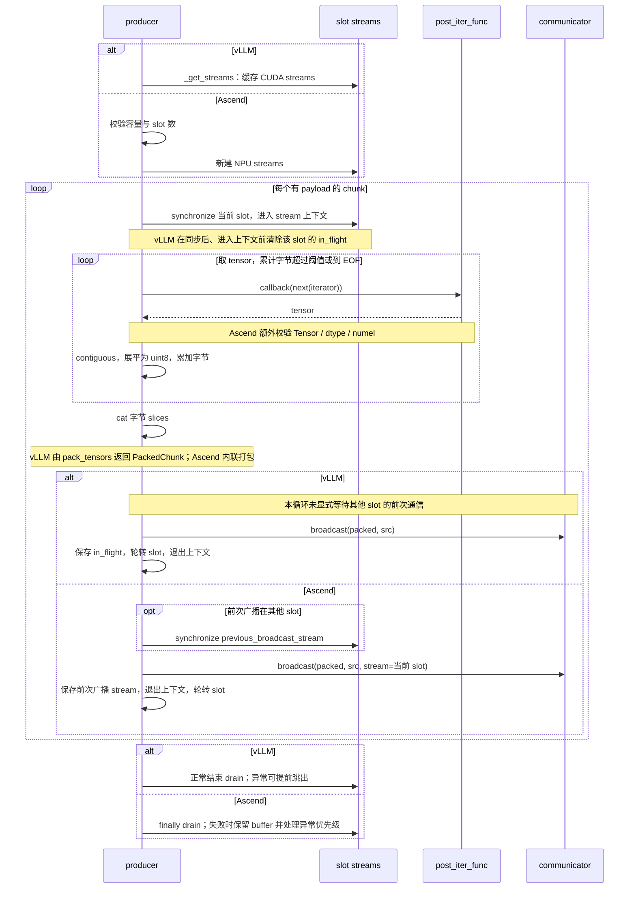
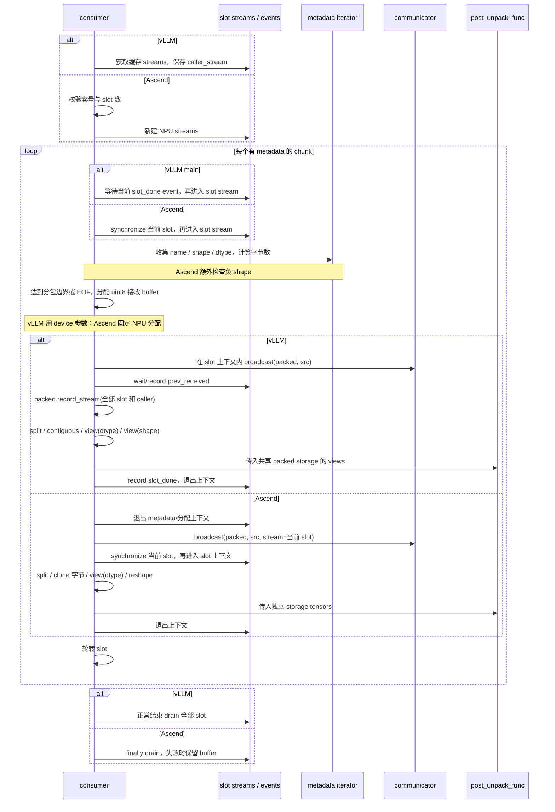
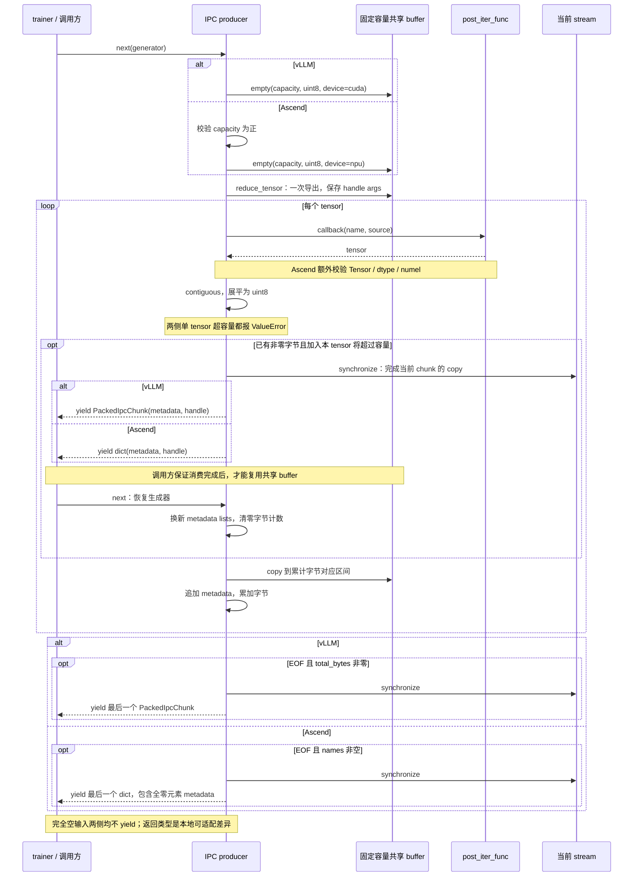
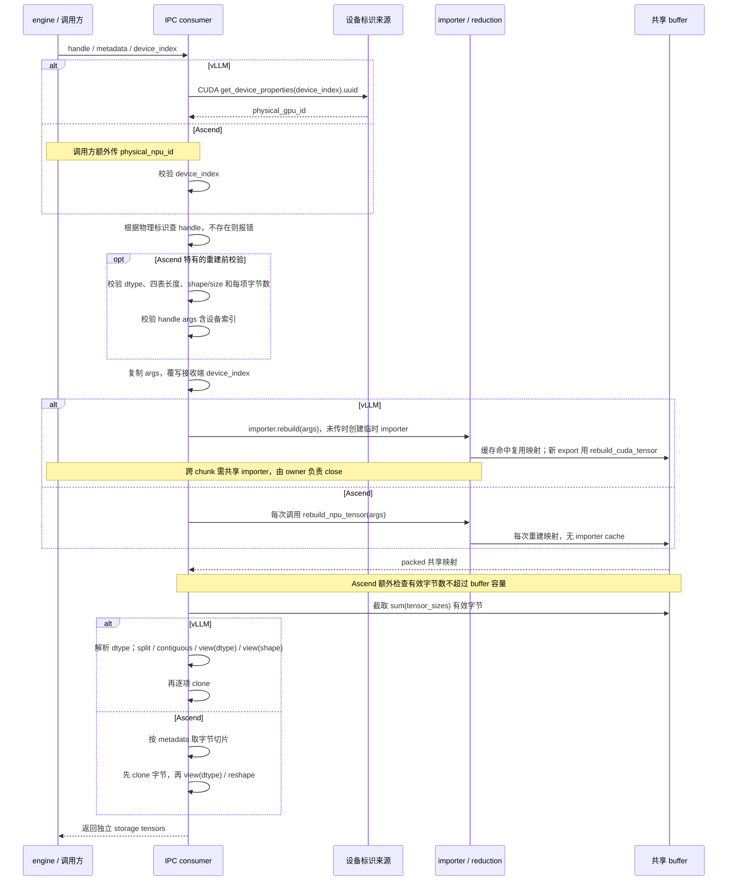

# Packed tensor 四方法合并时序对照

文档版本：**v1.0.26** · 更新日期：2026-11-13

对照 vLLM main `24420b7a` 与 Ascend 重构前基线 `37854b83`。共同步骤只画一次，`alt` 分支和注释标注两侧差异；分支是文档对照，不是运行时选择，也不是两套实现互相调用。当前继承 PR 的适配说明见 [主设计文档](packed-tensor-design.md)，原有分图继续保留。

## 1. HCCL producer

等待当前 slot 不等于等待另一个 slot 的前次广播。当前 PR 用 `_HCCLPackedGroup` 在 native HCCL 前后同步来承担通信边界，不是简单删除旧版的跨 stream 保序。上图展示旧实现，不包含这个修改后的适配器。

## 2. HCCL consumer

上游的 event 和 `record_stream` 保护 raw packed buffer。views 与独立 clone 的区别不等同于“乱序/有序”；独立 clone 仍需要正确的读依赖和 reader 生命周期保护。图示 main 的 slot_done 也不能泛化为所有 tag 的实现。

## 3. IPC producer

“全零元素”指 `numel() == 0`，不是值全为零。`yield` 交付 metadata 和共享 handle 后暂停，不复制整个共享 buffer。返回类型、设备分配和 EOF 发送条件是三个独立差异。

## 4. IPC consumer

设备标识、重建缓存和解包顺序分别标注。本图描述修改前现状，不代表主设计文档第 6 章的硬件扩展点已经落地；本次只补图，不修改生产代码或验证结论。
