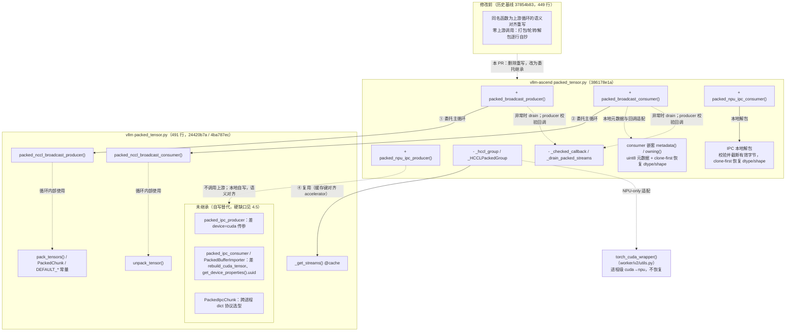

# Packed tensor 继承

> 归档说明：这是 v1.0.17 后、v1.0.18 前的检视修订正文，原稿未标独立版本。环境定位信息已检查脱敏。下文保留当时的源码与测试结论；当前状态见上级目录的设计及验证说明。

## 1. 背景：可控范围内继承上游 vLLM 实现

本 PR（`packed-vllm-loop-reuse` 分支）的目标是**在可控范围内复用上游 vLLM 的 packed tensor 实现**。本文对照 Ascend `386178e1a` 的生产实现及后续 drain 测试修订；上游对照版本为 main `24420b7a`。本 PR 只重构复用边界，不宣称解决跨 chunk 的 clone 读序或生命周期问题。

## 2. 方法清单对照

### 2.1 上游 vLLM `vllm/distributed/weight_transfer/packed_tensor.py`（491 行，main 24420b7a）

| 符号 | 类型 | 作用 |
| --- | --- | --- |
| `_get_streams(device_idx, num_buffers)` | 函数 | 按 (设备号， slot 数) 缓存 stream 组 |
| `unpack_tensor(packed, names, shapes, dtypes, tensor_sizes)` | 函数 | 把 packed 字节流解成命名 tensor views；连续切片上的 contiguous() 不重置 storage offset，直接 view(dtype) 可能因未对齐失败 |
| `PackedChunk` | dataclass | 一个 chunk 的元数据（HCCL 循环内部使用） |
| `pack_tensors(...)` | 函数 | tensor 打成 packed 字节流（producer 内部使用） |
| `packed_nccl_broadcast_producer(...)` | 函数 | HCCL/NCCL 广播发送主循环 |
| `packed_nccl_broadcast_consumer(..., device=...)` | 函数 | 广播接收主循环 |
| `packed_ipc_producer(...)` | 函数 | CUDA IPC 发送循环 |
| `packed_ipc_consumer(...)` | 函数 | CUDA IPC 接收（rebuild_cuda_tensor + unpack + clone） |
| `PackedIpcChunk` | dataclass | IPC chunk 元数据 |
| `PackedBufferImporter` | 类 | 消费侧 IPC 重建缓存（防止跨 chunk refcount 泄漏） |

### 2.2 vllm-ascend `vllm_ascend/distributed/weight_transfer/packed_tensor.py`

**PR 修改前**（历史对照基线 `37854b83`，449 行）：全部本地实现，不调用上游任何符号。

| 符号 | 类型 | 作用 |
| --- | --- | --- |
| `DEFAULT_PACKED_BUFFER_SIZE_BYTES` / `DEFAULT_PACKED_NUM_BUFFERS` | 常量 | 本地定义（数值与上游相同，各自维护） |
| `_drain_packed_streams` + `_UNSYNCHRONIZED_BUFFERS` | 私有 | 失败 drain：保留未同步 storage 到进程退出（PR 前正常/失败路径都走本地 finally） |
| `packed_broadcast_producer(...)` | 函数 | **全本地 HCCL 发送循环**：自建 `torch.npu.Stream` 列表、手动打包（逐个 `next(iterator)` → `contiguous` → dtype/numel 校验 → `view(uint8)` 累加、超限即截断）、`previous_broadcast_stream` 跨流同步、`group.broadcast(..., stream=...)`、finally 无条件 drain |
| `packed_broadcast_consumer(...)` | 函数 | **全本地 HCCL 接收循环**：元数据收集（内联负 shape 校验）、本地分配 npu buffer、broadcast + 同步、**内联 `unpack_tensor`**（clone-first：先 clone 修未对齐再 view/reshape，同时提供独立存储）、同 stream 调 `post_unpack_func` |
| `packed_npu_ipc_producer(...)` | 函数 | 本地 NPU IPC 发送（内联回调校验，逻辑与上游 IPC producer 语义对齐但逐行自写） |
| `packed_npu_ipc_consumer(...)` | 函数 | 本地 NPU IPC 接收（内联切片 clone 解包） |

修改前的核心问题：与上游同名的 `packed_broadcast_producer/consumer` 是上游循环的**语义对齐重写**而非复用

**PR 修改后**：HCCL循环整体委托上游，本地保留 NPU 适配与增强。

| 符号 | 类型 | 作用                                                                      |
| --- | --- |-------------------------------------------------------------------------|
| `packed_broadcast_producer(...)` | 函数 | HCCL 广播发送入口：包装 transport 与回调后委托上游                                       |
| `packed_broadcast_consumer(...)` | 函数 | 校验 shape，把元数据转换为 uint8 字节形状后委托上游；嵌套 owning() 回调先 clone 字节切片，再恢复 dtype/shape |
| `packed_npu_ipc_producer(...)` | 函数 | NPU IPC 发送（本地实现，复用 `_checked_callback`）                                                        |
| `packed_npu_ipc_consumer(...)` | 函数 | 本地校验元数据、重建 NPU handle、截断有效字节，并逐片 clone → view(dtype) → reshape；不调用上游解包 |
| `torch_cuda_wrapper`（worker/v2/utils.py） | 复用 | 进程级 `torch.cuda` → `torch.npu` 适配（退出时不恢复，沿用已有实现）                      |
| `_hccl_group` / `_HCCLPackedGroup` | 私有 | NPU 传输适配：复用上游 `_get_streams`、broadcast 前后 flush + 同步、per-slot buffer 登记 |
| `metadata()` / `owning()` | consumer 嵌套函数 | 维护真实 shape/dtype 队列，向上游提供 uint8 元数据，回调内恢复独立存储 tensor；旧 `_owning_post_unpack` 已删除 |
| `_checked_callback` | 私有 | `post_iter_func` 返回值校验（dtype/numel 契约）                                  |
| 负 shape 校验 | 入口内联 | HCCL metadata() 和 IPC consumer 分别校验，不再保留公共 helper |
| `_drain_packed_streams` / `_UNSYNCHRONIZED_BUFFERS` | 私有 | 仅失败路径：drain 所有 slot，保留未同步 storage 到进程退出                                 |

## 3. 逐方法继承判定

| 上游方法 | Ascend 是否继承 | 继承方式 / 不继承原因                                                                                                        |
| --- | --- |---------------------------------------------------------------------------------------------------------------------|
| `_get_streams` | ✅ 完全继承 | `_hccl_group` 内复用；缓存键统一为 `torch.accelerator.current_device_index()`                                                 |
| `unpack_tensor` | ✅ HCCL 间接复用 | HCCL 只让上游拆分 uint8 views，真实 dtype/shape 在本地 clone 后恢复；IPC 解包完全本地执行 |
| `PackedChunk` | ✅ 间接继承 | 上游 HCCL 循环内部使用，随循环一并继承                                                                                              |
| `pack_tensors` | ✅ 间接继承 | 上游 producer 内部调用，随循环一并继承                                                                                            |
| `packed_nccl_broadcast_producer` | ✅ 委托继承 | Ascend 入口做三件事：`_hccl_group` 提供 NPU transport、`_checked_callback` 校验回调、异常路径本地 drain；主循环整体委托                          |
| `packed_nccl_broadcast_consumer` | ✅ 委托继承 | Ascend 入口做四件事：metadata 负 shape 校验及 uint8 转换、嵌套 owning() 中 clone-first 恢复 dtype/shape、`device=f"npu:{...}"` 参数、委托上游。 |
| `packed_ipc_producer` | ❌ 不继承，自写 `packed_npu_ipc_producer` | 硬障碍：① `torch.empty(device="cuda")` 硬编码 CUDA 设备字符串；② 上游 `if total_bytes:` 对全零元素 chunk 不发送，NPU 语义要求全零 chunk 也发送元数据。   |
| `packed_ipc_consumer` | ❌ 不继承，自写 `packed_npu_ipc_consumer` | 硬障碍：① `torch.cuda.get_device_properties(device_index).uuid` ；② `from torch.multiprocessing.reductions import rebuild_cuda_tensor` 导入不可用，                         |
| `PackedBufferImporter` | ❌ 不继承 | 硬依赖 `rebuild_cuda_tensor` 导入                                                                                        |

### 3.1 继承关系图

## 4. HCCL producer / consumer 与 IPC producer / consumer环节对照

本章按“环节 | 上游 vLLM | vllm-ascend | 差异性质”逐环节对比四个入口方法，差异性质分三档：**一致**（继承复用）、**适配**（本地包装解决）、**差异**（上游写死了设备专属调用或协议，无法包装绕过）。

### 4.1 HCCL producer：`packed_nccl_broadcast_producer` ↔ `packed_broadcast_producer`

| 环节 | vLLM（24420b7a） | vllm-ascend（386178e1a） | 差异性质 |
| --- | --- | --- |------|
| 参数校验 | 无 | `buffer_size_bytes` / `num_buffers` 正数校验 | 增强   |
| stream 获取 | `_get_streams(torch.accelerator.current_device_index(), n)`（@cache） | 相同，且以同一键预热缓存 | 一致   |
| slot 轮转 / in_flight | 保留在途 chunk 引用防提前释放 | 相同（随主循环继承） | 一致   |
| 打包 | `pack_tensors(iterator, post_iter_func, size)`，回调无校验 | 相同；`post_iter_func` 经 `_checked_callback` 校验 dtype/numel | 适配   |
| 通信 | `group.broadcast(chunk.packed_tensor, src)`（PyNcclCommunicator） | 同签名 transport：`_HCCLPackedGroup` 先 flush torch_npu 异步队列、broadcast 前后双同步、登记每 slot buffer | 适配   |
| stream 上下文 | `with torch.cuda.stream(...)` | 依赖 `torch_cuda_wrapper` 映射为 npu stream | 适配 |
| 结尾清理 | 无条件 drain 所有 slot | 正常路径交给上游 drain；仅异常时本地保留清理 | 适配   |

### 4.2 HCCL consumer：`packed_nccl_broadcast_consumer` ↔ `packed_broadcast_consumer`

| 环节 | vLLM | vllm-ascend | 差异性质 |
| --- | --- | --- | --- |
| metadata 迭代 | 直接 `next(iterator)` | `metadata()` 逐项负 shape 校验并转为 `[字节数], uint8`，另存真实 shape/dtype | 增强 |
| 接收 buffer | `torch.empty(sizes, device=device)`，device 默认 `"cuda"` | 显式传 `device=f"npu:{...}"` | 适配 |
| 事件链 | `prev_received` wait/record + `record_stream(*streams, caller_stream)` | 相同（随主循环继承） | 一致 |
| 解包回调 | `post_unpack_func(unpack_tensor(packed, ...))` 直接传 views | 嵌套 owning() 对 uint8 views 逐项 clone → view(dtype) → reshape 后转交，保留未对齐支持 | 适配 |
| slot 完成 | `slot_done` event + 下轮 synchronize（避开 ROCm 共享队列） | 相同 | 一致 |
| 结尾清理 | 无条件 drain | 正常路径由上游 drain，异常路径由本地 drain | 适配 |

### 4.3 IPC producer：`packed_ipc_producer` ↔ `packed_npu_ipc_producer`

| 环节 | vLLM | vllm-ascend | 差异性质                                                    |
| --- | --- | --- |---------------------------------------------------------|
| 共享 buffer | `torch.empty(size, device="cuda")` | `torch.empty(size, device="npu")` | **差异**（device 字符串写死在函数体内，无法传参）                          |
| 句柄导出 | `reduce_tensor` → 消费端 `rebuild_cuda_tensor` 重建 | `reduce_tensor` 存 args，约定消费端用 `rebuild_npu_tensor` | 适配（torch_npu 导入时自动 patch `reduce_tensor` 支持 NPU，[需要验证]） |
| 分包 / copy | contiguous → view(uint8) → copy_；超限 ValueError | 逐行相同 | 一致                                                      |
| 同步 | `torch.accelerator.current_stream().synchronize()` | `torch.npu.current_stream().synchronize()` | 适配                                                      |
| 回调 | `post_iter_func` 原样 | `_checked_callback` 校验 | 增强                                                      |
| chunk 协议 | yield `PackedIpcChunk` dataclass | yield dict（跨进程协议） | **差异**（换协议需两端同版本升级，零功能收益）                               |
| 空 chunk | `if total_bytes:` 全零元素 chunk 不发送 | `if names:` 全零元素 chunk 仍发送元数据 | 语义差异                                                    |

**结论**：分包与 copy 核心一致；句柄导出可解（torch_npu 自动 patch），yield 协议是选型而非 CUDA 障碍，唯一无法绕过的是 `device="cuda"` 字面量（L339）→ ❌ 本地自写（语义对齐，共享 `_checked_callback`）。

### 4.4 IPC consumer：`packed_ipc_consumer` ↔ `packed_npu_ipc_consumer`

| 环节 | vLLM | vllm-ascend                                                     | 差异性质                                              |
| --- | --- |-----------------------------------------------------------------|---------------------------------------------------|
| UUID 解析 | `torch.cuda.get_device_properties(i).uuid` | 调用方传入 `physical_npu_id`（`npu_generate_uuid` 生成）           | **差异**                                            |
| 重建 | `rebuild_cuda_tensor` + `PackedBufferImporter` 缓存 | 本地懒加载 rebuild_npu_tensor，校验并改写 device_index；当前没有 importer 缓存 | 差异 |
| 句柄查找 | UUID not in handle → ValueError | 相同                                                              | 一致                                                |
| 元数据校验 | `getattr(torch, dn)` 解析 dtype | 在此基础上增加了 isinstance(dtype) / 四表长度一致 / 负 shape / content_size 校验 | 增强                                                |
| 截断 | `packed[:content_size]` | 相同                                                              | 一致                                                |
| 解包 + clone | 上游先 view(dtype)，再 clone，未对齐可能先报错 | 本地先 clone 原始字节切片，再 view(dtype)/reshape；不调用上游 unpack_tensor | 适配 |
| refcount 防泄漏 | importer 保证一次 export 配一次释放 | 当前实现未引入；#20740 是独立修复方向                                                | 差异                                                |

**结论**：当前 IPC consumer 保留本地实现，以覆盖 NPU handle 重建、元数据校验和 clone-first 未对齐语义；没有继承上游 consumer/importer，也没有共享全局 unpack hook。

### 4.5 IPC 设备绑定代码的解耦继承分析

**仓内已有的同类解法**（`npu_ipc_engine.py`）：`NPUIPCWeightTransferEngine` / `NPUIPCTrainerWeightTransferEngine` 直接继承上游 `IPCWeightTransferEngine` / `IPCTrainerWeightTransferEngine`，只覆写 CUDA 专属部分。三类 cuda 绑定的对应解法：

| 上游 cuda 绑定 | vllm-ascend 解法 | 位置 |
| --- | --- | --- |
| `torch.cuda.get_device_properties().uuid` 作 IPC key | `npu_generate_uuid()` = `{host_ip}-{物理chip_id}`，经 `ASCEND_RT_VISIBLE_DEVICES` 做逻辑→物理映射，替代硬件 UUID（`torch.npu.get_device_properties` 存在且 props 可能带 uuid，platform.py 在用，但选型未依赖它） | npu_ipc_engine.py `npu_generate_uuid` |
| `rebuild_cuda_tensor` | `torch_npu.multiprocessing.reductions.rebuild_npu_tensor`（懒加载）+ 重建时覆写 device_index | npu_ipc_engine.py `receive_weights` |
| `torch.cuda.Stream/stream` 等 API | `torch_cuda_wrapper` 进程级重绑（14 个 API） | worker/v2/utils.py |

**函数调用缺口**：

1. producer 的 `ipc_buffer = torch.empty(buffer_size_bytes, dtype=torch.uint8, device="cuda")` ascend 无法传参绕过，需上游优化传参；
2. consumer 的 `rebuild_cuda_tensor` 按名导入
3. wrapper 未重绑 `torch.cuda.get_device_properties`

## 5. packed 相关 PR 的影响分析

以下按当前实现分析相关 PR 的技术作用，不以重构自动替代正确性修复；各 PR 的合并状态应以 GitHub 为准：

| PR                                 | 内容 | 继承完成后是否还需要 |
|------------------------------------| --- | --- |
| #20740 IPC 一次性导入                   | NPU IPC 每次重建/释放导致 producer refcount 负数泄漏；引入一次性导入缓存 | **仍需要，不受影响**。与第 4.4 节“importer 不继承、NPU 侧独立修复”的决策吻合，可视为 `PackedBufferImporter` 思想的 NPU 落地；与 #20676 仅需 rebase 协调（同文件不同区域） |
| #19127 跨 chunk 乱序                  | 基于 hook / 本地循环的跨 chunk event + clone record_stream 方案（+286/-33） | **仍需解决其针对的风险**。上游原始 packed buffer 的事件及 record_stream 不自动保护本地 owning clones；不能因复用上游或删除 hook 就关闭该问题。方案应适配当前嵌套 owning() 回调，并分别验证读序与生命周期 |
| #12713 打包前源 stream 同步              | producer 打包读源 tensor 时源可能在 caller stream 在途，仅同步 slot stream 不够（+4/-0） | **仍需要，但补丁位置要改**。缺口在委托后的上游循环中同样存在，4 行修复应改挂到本地入口（`_hccl_group` 进入循环前同步 caller stream），不能继续打在旧本地循环上 |
| #18763 单 stream 加载（v0.30.0）        | release 分支：跨 chunk 加载顺序修复 | 不受影响。release 分支保留本地循环，独立于 main 重构 |
| #20614 packed 修复 backport（v0.30.0） | release 分支 backport #19164 | 不受影响。同上 |

**合入条件**：#20676 可继续作为复用重构评审，但跨 stream clone 的读序和生命周期风险仍是合入前待解决项；#12713、#20740 的独立修复需适配当前入口。不能把 #19127 当作已由继承自动解决。

## 6. 验证边界与剩余风险

### 6.1 正常路径 drain 回归测试

`test_packed_normal_path_drains_every_slot_stream` 按 producer/consumer 和 1/3 个 slot 参数化，各用独立 fixture/cache。测试记录 stream 上下文退出与 synchronize 事件，只断言最后一次上下文退出后，每个 slot 都被依次同步。广播前后同步、打包前等待和另一侧的累计计数都不能替代这个最终 drain。单 chunk 场景还覆盖未使用的 slot。

### 6.2 未对齐与独立存储

三个 BF16 元素占 6 字节，后接 INT64 时其起始偏移不能被 8 整除。连续切片上的 contiguous() 不保证新分配；必须先 clone 原始字节，再恢复真实 dtype。HCCL 通过 uint8 元数据绕开上游提前 view(dtype)，IPC 则直接本地 clone-first。两条路径都保留 BF16×3 + INT64 的回归用例。

### 6.3 跨 stream clone 风险

上游 prev_received 事件在 owning() 回调前记录；它不保证回调中 clone 已就绪。上游 record_stream 作用于原始 packed buffer，也不会自动延长新 clone 在其他 reader stream 上的生命周期。slot_done 和最终 drain 不能替代跨 stream 读之前的依赖或 clone 的 reader-stream 跟踪。

PR 既有作者探针记录：延迟 clone 后跨 slot 读取、allocator pressure 下延迟读取各 10/10 损坏；测试专用的 callback-completion event 加 clone reader-stream tracking 对照各 10/10 正确。这些是历史 NPU 探针记录，使用模拟 collective；本次文档/测试修改没有重新执行它们，也不能当作当前 HEAD 的真实多进程 HCCL、IPC 或完整模型 E2E 通过证据。

### 6.4 修改与执行记录

当前修订只增强 drain 测试和文档，不改变生产算法。对新增测试进行了隔离控制流验证：执行真实上游及本地循环，tensor 使用轻量替身，4/4 用例通过；分别删除 producer/consumer 的最终 drain 后，4/4 负对照均被断言拒绝。这不是完整 PyTorch UT 或 NPU 验证。既有 179 passed 记录对应先前实现，不能直接视为本次新增参数化用例已执行。发布或合入前仍须在配套 vLLM 版本上运行受影响 UT、真实分布式/模型/graph-mode 测试及性能和长期运行验证。
