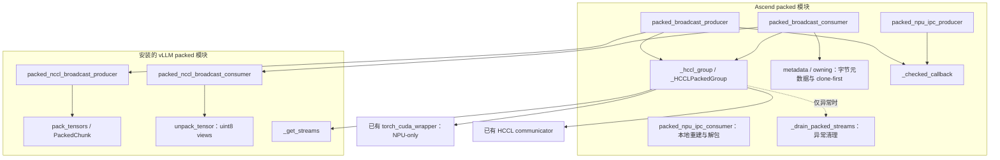

# Packed tensor 上游复用与 NPU 适配设计

文档版本：**v1.0.18** · 更新日期：2026-11-12

> 历史快照：环境定位信息已检查脱敏。下文保留 v1.0.18 的设计正文；指向上级目录的验证说明应为 `../packed-tensor-validation.md`，当前设计见 `../packed-tensor-design.md`。

对应 [PR #20676](https://github.com/vllm-project/vllm-ascend/pull/20676)，代码分支为 `packed-vllm-loop-reuse`。本文的“复用”主要指**函数委托**，不涉及新增 packed 类继承。

## 目录

- [1. 目标与源码基准](#1-目标与源码基准)
- [2. 复用边界与整体结构](#2-复用边界与整体结构)
- [3. HCCL 广播路径](#3-hccl-广播路径)
- [4. NPU IPC 路径](#4-npu-ipc-路径)
- [5. 正确性边界与独立修复](#5-正确性边界与独立修复)
- [6. 验证结果与后续工作](#6-验证结果与后续工作)

测试配置、命令与结果见 [验证说明](../packed-tensor-validation.md)；文档演进见 [版本记录](../CHANGELOG.md) 和 [历史快照](README.md)。

## 1. 目标与源码基准

### 1.1 要解决的问题

重构前，Ascend 在本地维护 HCCL packed 发送和接收循环，包含打包、slot 轮转、接收与清理。即使行为与上游相近，上游修改后仍需人工同步，容易产生维护分叉。

本 PR 将 HCCL 主循环委托给安装的 vLLM，只保留 NPU transport、元数据、独立存储及异常清理适配。NPU IPC 保持本地实现，共享常量与回调校验。公共 API、配置和传输协议保持现有契约。

本 PR 的范围是复用重构。跨 stream 读序、clone 生命周期和 IPC 导入引用计数等问题分别处理，不随本 PR 引入修复，也不因复用上游而视为解决。

### 1.2 固定源码基准

| 组件 | 对照版本 | 用途 |
| --- | --- | --- |
| vLLM Ascend | `870b61a90f299d10728b94080089eb5ab5095c4b` | 当前继承 PR，含最终 drain 测试修订 |
| vLLM tag | v0.33.0，`4ba787ec9959e566d3b587a796dff07673324da5` | tag 配套验证 |
| vLLM main | `24420b7a341af37a9bc3186e6fc6062512e0aa58` | main 配套验证及逐环节对照 |
| Ascend 历史基线 | `37854b83` | 仅解释重构前的本地循环 |

源码入口：[Ascend packed 模块](https://github.com/vllm-project/vllm-ascend/blob/870b61a90f299d10728b94080089eb5ab5095c4b/vllm_ascend/distributed/weight_transfer/packed_tensor.py)、[vLLM main packed 模块](https://github.com/vllm-project/vllm/blob/24420b7a341af37a9bc3186e6fc6062512e0aa58/vllm/distributed/weight_transfer/packed_tensor.py)、[vLLM tag packed 模块](https://github.com/vllm-project/vllm/blob/4ba787ec9959e566d3b587a796dff07673324da5/vllm/distributed/weight_transfer/packed_tensor.py)。内部事件和 IPC importer 的描述以固定 main 为准；运行时直接调用安装版本，不复制 main 实现覆盖 tag。

## 2. 复用边界与整体结构

### 2.1 职责分工

| 能力 | 当前实现 | Ascend 保留的职责 |
| --- | --- | --- |
| HCCL 发送循环 | 委托 `packed_nccl_broadcast_producer` | 参数与回调校验、NPU transport、异常清理 |
| HCCL 接收循环 | 委托 `packed_nccl_broadcast_consumer` | 字节元数据转换、显式 NPU device、clone-first 恢复 dtype/shape |
| 打包与 chunk | 随上游循环复用 `pack_tensors`、`PackedChunk` | 不再维护同一套本地 HCCL 循环 |
| slot stream 缓存 | 复用 `_get_streams` | 使用与上游相同的设备索引和 slot 数作为缓存键 |
| HCCL 解包 | 上游 `unpack_tensor` 只拆分 uint8 views | 本地 `owning()` 创建独立存储，恢复真实类型与形状 |
| NPU IPC 发送/接收 | 保留两个本地函数 | NPU handle、dict 协议、元数据校验、有效字节切片与 clone-first |
| producer 回调校验 | 本地 `_checked_callback` | HCCL 与 IPC 共享 dtype/numel 契约校验 |
| 默认容量与 slot 数 | 引用上游 `DEFAULT_*` 常量 | 避免重复定义 |

生产改动只落在 `packed_tensor.py`，配套修改其 UT 文件。engine 类继承、group 初始化、RPC、平台 patch 和 V2 utility 文件不在本 PR 的改动范围内。

### 2.2 调用结构



图中是调用和适配关系。上游函数名保留 `nccl`，但 `group` 实参是 `_HCCLPackedGroup`，最终调用已有 HCCL communicator，不创建 NCCL communicator。IPC 不调用上游 CUDA IPC producer、consumer 或 importer。

### 2.3 API 适配的作用域

`_hccl_group` 复用既有 `worker/v2/utils.py` 中的 `torch_cuda_wrapper`，将相关 CUDA API 映射到 NPU API。该 wrapper 是进程级重绑定，退出时不恢复，只适用于 NPU-only 进程。

当前实现不重绑定 vLLM 的 `unpack_tensor` 或其他模块函数，也没有全局 owning-unpack hook。`metadata()` 和 `owning()` 都是本次 consumer 调用内的闭包。

## 3. HCCL 广播路径

### 3.1 producer：主循环委托

本地入口校验 `buffer_size_bytes` 和 `num_buffers` 为正数，将 `post_iter_func` 包装为 `_checked_callback`，随后调用上游 producer。

| 环节 | 上游负责 | Ascend 适配 |
| --- | --- | --- |
| stream 与 slot | stream 缓存、slot 轮转、在途 chunk 引用 | 以 `torch.accelerator.current_device_index()` 和 `num_buffers` 获取同一组缓存 stream |
| 打包 | `pack_tensors` 和 chunk 生成 | 校验回调返回 Tensor，且 dtype、numel 与源 tensor 一致 |
| 通信 | 调用 `group.broadcast(tensor, src)` | 转发到 HCCL，显式传入当前 NPU stream |
| 完成与清理 | 正常退出时 drain 全部 slot | 异常路径执行本地 drain 与失败 storage 保留 |

回调校验不验证元素顺序；回调必须保持展平后的元素位置与源元数据对应。不能仅凭 dtype、numel 相同就认为转置等重排满足契约。

### 3.2 consumer：字节元数据与独立存储

接收入口显式传入 `device=f"npu:{...}"`。`metadata()` 校验负 shape，按真实 shape 和 dtype 计算字节数，向上游提供一维 uint8 元数据，同时保存真实 shape/dtype 队列。

上游负责 chunk 划分、接收、事件与 slot 调度，并通过 `unpack_tensor` 得到 uint8 views。嵌套 `owning()` 随后逐项执行：

```text
uint8 字节 view → clone 独立存储 → view(真实 dtype) → reshape(真实 shape)
```

这同时保留独立存储与未对齐混合 dtype 的兼容性。例如 BF16×3 占 6 字节，后续 INT64 的起始偏移不是 8 的倍数；连续切片的 `contiguous()` 不保证新分配，直接 `view(int64)` 可能失败。先 clone 字节再恢复 dtype 可避开原始偏移限制。

`owning` 只表示输出有独立 storage，不表示它已对任意其他 stream 就绪，也不表示 allocator 已跟踪所有异步 reader。相关边界见第 5 章。

### 3.3 native HCCL 同步与异常清理

`_HCCLPackedGroup.broadcast` 先登记当前 slot 的通信 tensor，再同步当前 NPU stream，调用 native HCCL broadcast，最后再次同步。前置同步用于完成 torch_npu 在途工作，后置同步保证 native HCCL 访问完成后再返回上游 tensor 操作。

正常路径由上游结尾 drain 所有 slot，本地不重复执行。异常时 `_drain_packed_streams` 尝试同步每个 slot，不因某个 slot 失败而跳过其余 slot；未能确认完成的非空 buffer 保留在 `_UNSYNCHRONIZED_BUFFERS`，直到进程退出。

该列表只保留引用，不串行化 communicator 或 buffer 的并发访问；失败后重复重试可能持续占用显存。异常优先级规则保留原业务异常，除非清理阶段出现优先级更高的终止信号。

## 4. NPU IPC 路径

### 4.1 当前保留的本地流程

| 环节 | NPU producer | NPU consumer |
| --- | --- | --- |
| 共享存储 | 分配固定容量 NPU buffer，通过 `reduce_tensor` 导出一次 handle 参数 | 查找物理 NPU 标识对应的 handle，校验并改写接收端 device index，用 `rebuild_npu_tensor` 重建 |
| 元数据 | 按源 tensor 保存名称、shape、dtype 和字节数，yield dict | 校验四表长度、dtype、shape、字节数和重建 buffer 容量 |
| 数据处理 | 回调校验后 contiguous、展平为 uint8 并 copy；单 tensor 超容量时报错 | 截取有效字节，再逐片 clone、恢复 dtype/shape |
| chunk 边界 | yield 前同步 producer 当前 stream；复用同一共享 buffer | 返回独立存储 tensor；不引入上游 importer 缓存 |
| 零元素输入 | 非空迭代器即使全是零元素 tensor，也发送元数据；空迭代器不发送 | 保留对应名称、类型和形状 |

producer 当前 stream 的同步只证明当次写入完成。恢复 producer 生成器、复用共享 buffer 之前，接收与加载的完成关系仍依赖现有 engine/trainer 协议；不能把 Python 返回或 RPC 返回本身当作设备完成屏障。

### 4.2 为什么不直接委托上游 IPC

这些限制应区分为设备扩展点、协议与语义差异，不能统称为“CUDA 导入不可用”。

| 上游行为 | 当前 NPU 需求 | 对直接复用的影响 |
| --- | --- | --- |
| producer 内部 `torch.empty(..., device="cuda")` | 分配 NPU buffer | 当前函数没有 device 参数可注入 |
| consumer 用 `get_device_properties(...).uuid` 查 handle | 使用 engine 生成的物理 NPU 标识 | 需要注入标识查找；现有 wrapper 未重绑定该 API |
| importer 默认调用 `rebuild_cuda_tensor` | 使用 `rebuild_npu_tensor` | main 已提供 importer 参数，重建逻辑可通过覆写 importer 适配；不是不可解的导入障碍 |
| yield `PackedIpcChunk` | 保持既有 dict 协议 | 属于协议选择，改变时需协调两端，不是 CUDA 能力缺失 |
| 用 `if total_bytes` 发送最后一个 chunk | 全零元素 chunk 也需发送元数据 | 需保留现有零元素语义 |
| 先按真实 dtype 解包，再 clone | 未对齐时需要 clone-first | 仅替换 device 和 importer 仍不足以保持当前解包契约 |

`torch_npu` 的 reduction 支持已由本次真实多进程 IPC 测试覆盖，但这不等于上游 CUDA IPC 函数可以原样运行。后续若扩大复用，应先明确 device、标识、重建和解包扩展点，再验证 tag/main 差异及零元素、未对齐语义。

### 4.3 engine 类继承与 packed 函数委托的区别

既有 `NPUIPCWeightTransferEngine` 和 trainer engine 通过类继承复用上游 engine，并覆写 NPU 专属部分。其 `npu_generate_uuid` 做逻辑设备到物理设备的映射，`rebuild_npu_tensor` 完成 NPU handle 重建。这些能力解释了 NPU 适配方式，但不代表上游 packed IPC 函数已被复用。

## 5. 正确性边界与独立修复

### 5.1 raw buffer 与 clone 的保护范围

固定 main 中的 `prev_received` 在 `owning()` 前记录，因此只等待它不能证明回调里新提交的 clone 已完成。上游对原始 packed buffer 调用 `record_stream`，也不会自动把新 clone 登记到后续 reader stream。

因此需要分别讨论：

- **读序**：另一个 stream 读取 clone 前，是否等待了 clone 写入完成？
- **生命周期**：Python 引用释放后，allocator 是否知道其他 stream 仍在读取 clone？

`slot_done` 和函数结束时的 drain 不能替代发生在它们之前的跨 stream 读依赖。HCCL 前后同步也不自动覆盖 broadcast 之后新创建的 clone。当前 PR 不增加 callback-completion event 链或 clone reader-stream 跟踪。

既有模拟 collective 的 NPU 延迟探针曾暴露这两类风险；它们属于机制证据，与本次真实 HCCL/IPC E2E 分开理解。常规 E2E 通过不能反证构造性并发场景不存在问题。

### 5.2 相关修复的职责与顺序

下表记录相关方案针对的问题，链接用于追溯技术讨论，不表示各 PR 当前合并状态，也不预设合并冲突只需简单 rebase。

| 参考 | 处理的问题 | 与本 PR 的关系 |
| --- | --- | --- |
| [#19127](https://github.com/vllm-project/vllm-ascend/pull/19127) | 跨 chunk 回调读序与 clone reader 生命周期 | 风险仍需处理；方案须适配当前嵌套 `owning()`，分别验证两类保护 |
| [#12713](https://github.com/vllm-project/vllm-ascend/pull/12713) | 打包前源 tensor 的 caller-stream 依赖 | 委托不自动补齐该依赖；后续补丁应针对新入口或上游扩展点重新设计 |
| [#20740](https://github.com/vllm-project/vllm-ascend/pull/20740) | 多 chunk IPC 一次导出与重复重建/释放的引用计数配对 | 当前 consumer 未引入 importer 缓存；独立修复并验证跨更新与关闭行为 |
| [#18763](https://github.com/vllm-project/vllm-ascend/pull/18763)、[#20614](https://github.com/vllm-project/vllm-ascend/pull/20614) | v0.30.0 release 分支修复 | 不能用本 PR 的配套测试代替 release 分支验证 |

跨 stream 修复已单独保留在 `codex/packed-cross-stream-fix` 分支，按当前安排后续处理。本文和本次配套验证均以纯继承 PR 为准，不包含该分支的生产改动或测试结果。

## 6. 验证结果与后续工作

2026-11-11 已完成固定 Ascend HEAD 与两套 vLLM 的验证：

| 配套 | 受影响 UT | 真实 NPU E2E |
| --- | --- | --- |
| v0.33.0 `4ba787ec` | 186 passed | 5/5 passed |
| main `24420b7a` | 186 passed | 5/5 passed |

每次运行前均核对两侧源码、实际导入路径与文件哈希。Packed 用例通过外部插件移除已有 skip 后实际执行。UT 使用 CPU tensor 和 NPU mock；E2E 使用真实多进程 HCCL/IPC、裁层模型和 `FULL_DECODE_ONLY` 配置。命令、五项用例与验证限制见 [验证说明](../packed-tensor-validation.md)。

这替代了旧文档中“179 项历史 UT、E2E 仅 collection、最终 drain 测试尚未随完整 UT 执行”的状态。正常路径 drain、未对齐与独立存储等用例现已包含在每套 186 项 UT 中。

后续工作包括独立正确性修复、全深度模型、性能和长期运行验证，以及未完成的 CI/pre-commit 检查。当前结果证明所列配置和断言通过，不扩大为任意 stream 调度下的安全性、性能收益或 IPC 无泄漏结论。
