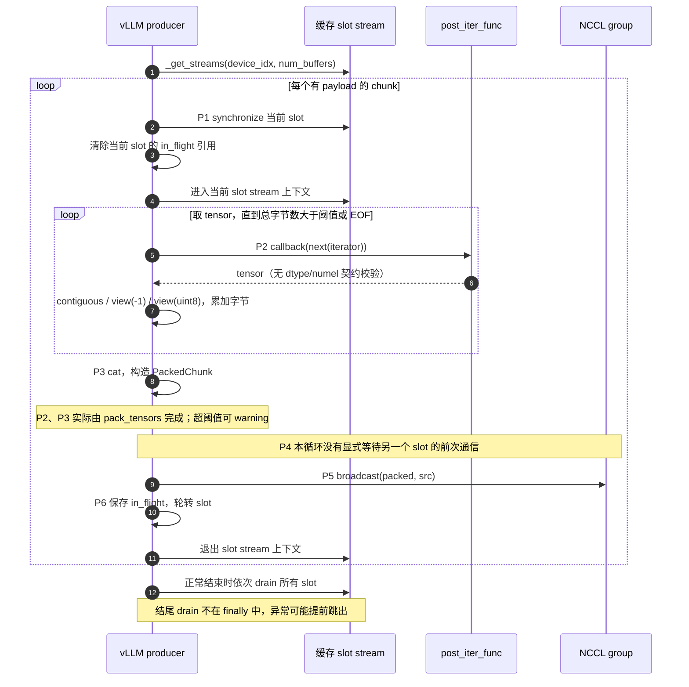
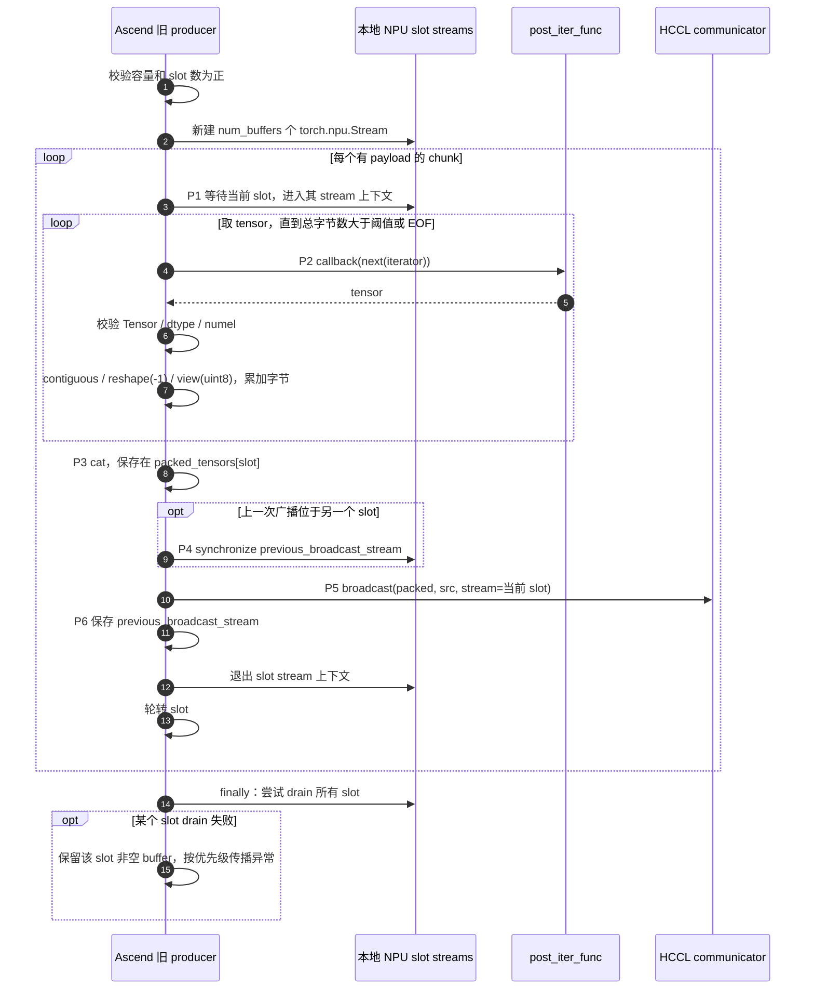
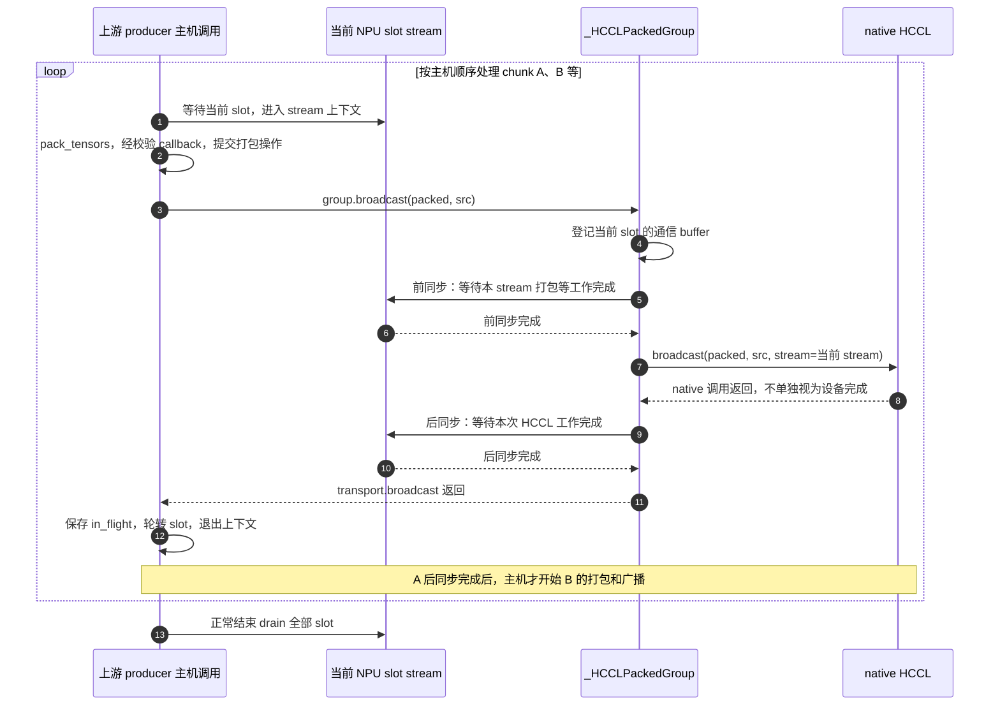
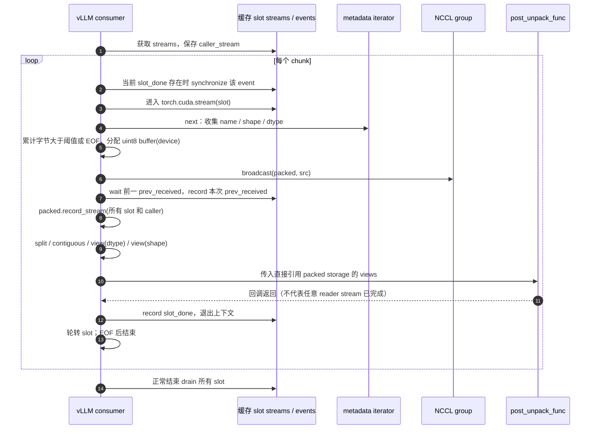
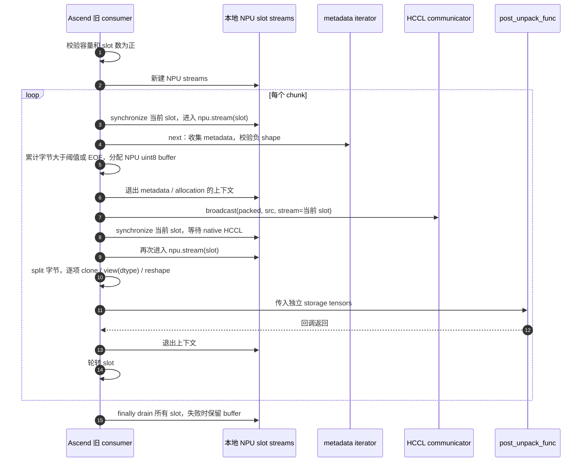
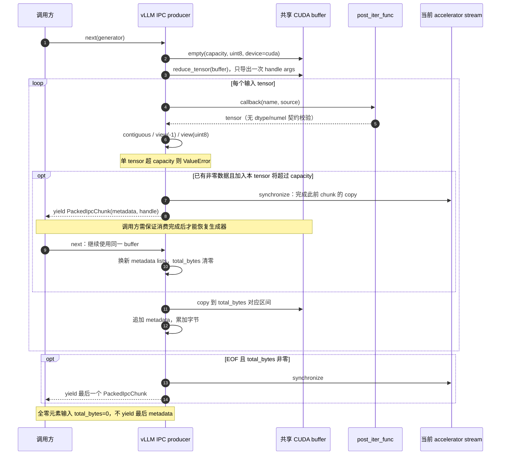
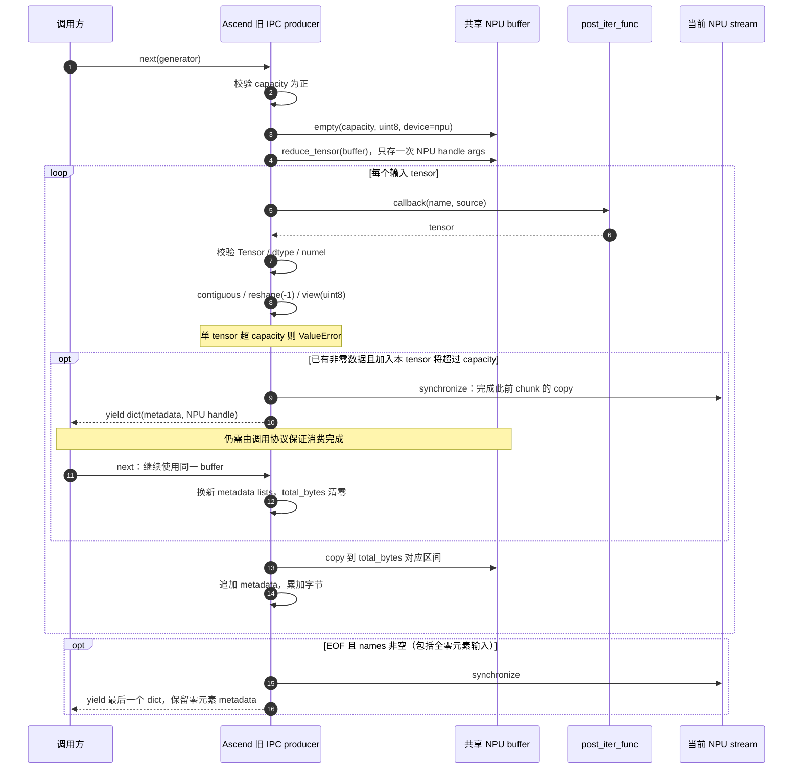
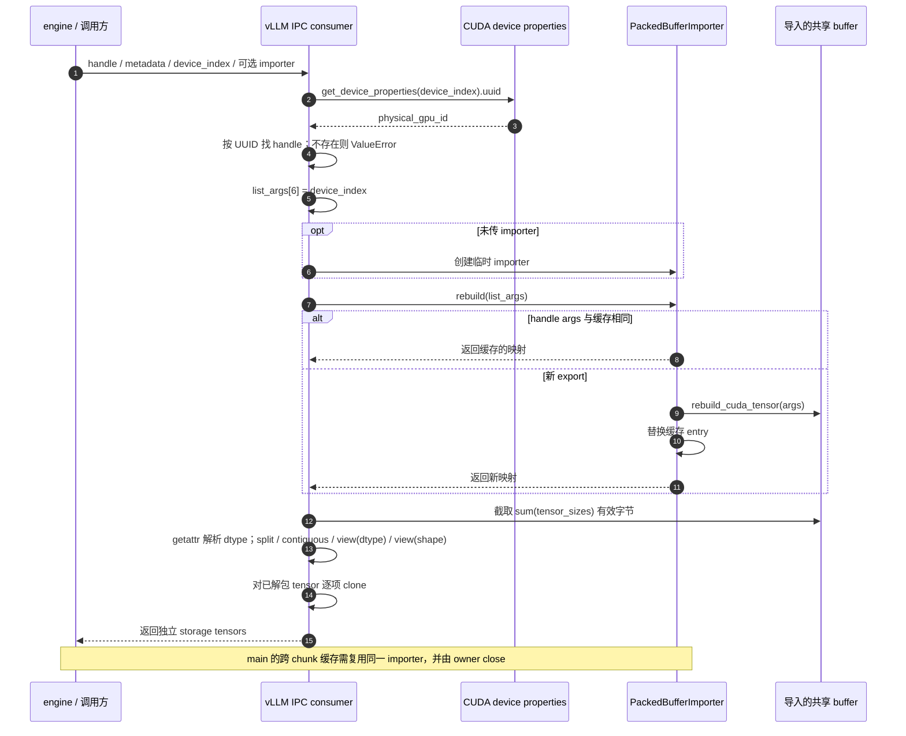
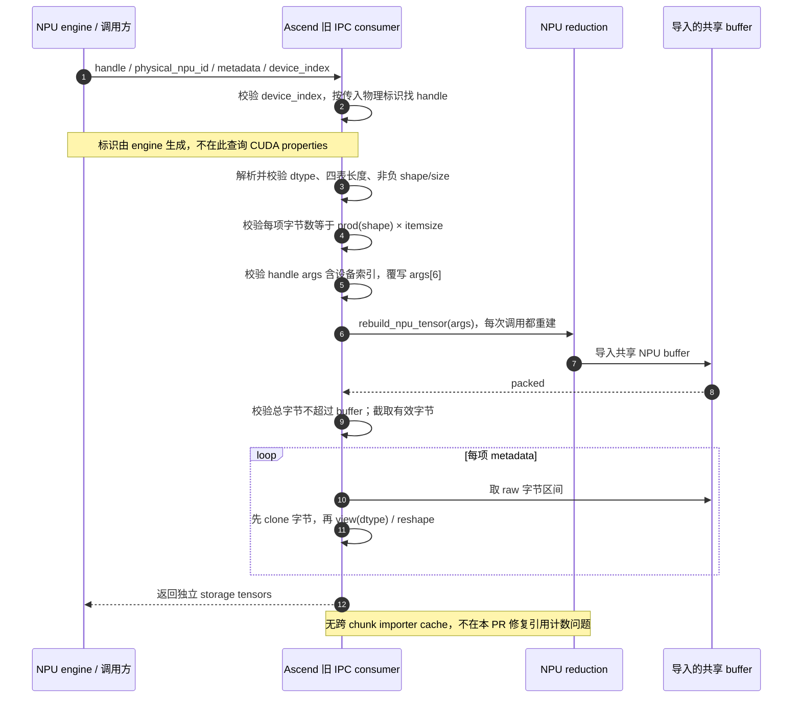

# Packed tensor 上游复用与 NPU 适配设计

> 历史快照 v1.0.23：环境定位信息已检查脱敏；保留当时的设计正文。

## 1. 目标

重构前，Ascend 在本地维护 HCCL packed 发送和接收循环，包含打包、slot 轮转、接收与清理。即使行为与上游相近，上游修改后仍需人工同步，容易产生维护分叉。

本 PR 将 HCCL 主循环委托给 vLLM，只保留 NPU 特异性实现。

本 PR 的范围是复用重构。跨 stream 读序、clone 生命周期和 IPC 导入引用计数等问题分别处理，不随本 PR 引入修复，也不因复用上游而视为解决。

## 2. 整体结构

### 2.1 职责分工

| 能力 | 当前实现 | Ascend 保留的职责 |
| --- | --- | --- |
| HCCL 发送循环 | 委托 `packed_nccl_broadcast_producer` | 参数与回调校验、NPU transport、异常清理 |
| HCCL 接收循环 | 委托 `packed_nccl_broadcast_consumer` | 字节元数据转换、显式 NPU device、clone-first 恢复 dtype/shape |
| 打包与 chunk | 随上游循环复用 `pack_tensors`、`PackedChunk` | 不再维护同一套本地 HCCL 循环 |
| slot stream 缓存 | 复用 `_get_streams` | 使用与上游相同的设备索引和 slot 数作为缓存键 |
| HCCL 解包 | 上游 `unpack_tensor` 只拆分 uint8 views | 本地 `owning()` 创建独立存储，恢复真实类型与形状 |
| NPU IPC 发送/接收 | 保留两个本地函数 | NPU handle、元数据校验、有效字节切片与 clone-first；producer 当前返回 dict，可适配为上游 `PackedIpcChunk` |
| producer 回调校验 | 本地 `_checked_callback` | HCCL 与 IPC 共享 dtype/numel 契约校验 |
| 默认容量与 slot 数 | 引用上游 `DEFAULT_*` 常量 | 避免重复定义 |

改动只落在 `packed_tensor.py`，配套修改其 UT 文件。engine 类继承、group 初始化、RPC、平台 patch 和 V2 utility 文件不在本 PR 的改动范围内。

## 3. HCCL 广播路径

### 3.1 producer：主循环委托

下面两张修改前的图统一使用 producer、slot streams、callback、communicator 四类参与者，按 P1～P6 对齐共同骨架。上游 `pack_tensors` 与旧 Ascend 内联打包在图中都归入 producer 内部，避免函数拆分方式造成视觉上的流程差异。

#### 修改前：vLLM producer



#### 修改前：Ascend producer



**图后对照：共同骨架相同，P4 的保序不能省略解释。**

两侧都是“等待当前 slot → callback 与字节打包 → broadcast → 轮转 slot → 最终 drain”。旧 Ascend 额外在 P4 等待前一次广播所在的其他 stream，避免同一 communicator 上前后两次通信跨 stream 重叠。

上游 P1 等待的是**当前 slot 的上次工作**，不能单凭这一行证明**另一个 slot 的前次广播**已完成；`in_flight` 保留引用也不是跨 stream 完成屏障。因此，不能只删去旧 P4、直接把 native HCCL 对象传给上游，再声称其已经提供相同保序。这里不对原生 NCCL 路径是否需要相同等待作判断，NCCL 与 HCCL 的通信语义不能直接互推。

**差异如何收敛到上游入口：**

| 旧实现差异 | 当前 PR 的处理 | 是否需要复制上游循环 |
| --- | --- | --- |
| 本地 streams 与 CUDA streams | 既有 wrapper 映射 API；适配器和上游共用 `_get_streams` 的相同缓存键 | 不需要 |
| 内联打包与回调校验 | 打包交给 `pack_tensors`，回调外包 `_checked_callback` | 不需要 |
| P4 跨 slot 通信次序与 P5 显式 stream | group 替换为 `_HCCLPackedGroup`；在当前 NPU stream 上执行广播前后同步，后同步完成后主机才进入下一轮 | 不需要，但保序由本地 transport 承担；同步位置与重叠行为改变 |
| 在途 tensor 引用 | 上游 `in_flight` 保留 chunk；适配器另登记 slot 通信 buffer 供失败清理 | 不需要 |
| 无条件本地 finally drain | 上游处理正常 drain，入口 context manager 处理异常 drain/storage 保留 | 不需要 |

#### 修改后：适配器如何承担通信保序

下图是当前 PR `870b61a90` 的调用顺序，不能用它描述上面两份修改前源码。上游 producer 中的 `group.broadcast` 此时实际调用本地 transport，尚未直接调用 native HCCL。



旧版与修改后的保序点分别是：

| 观察点 | 旧 Ascend producer | 当前 PR producer |
| --- | --- | --- |
| chunk B 打包前，A 是否可能仍在通信 | 可能；B 打包后、广播前才等待 A 的 stream | 同一次调用中不可能；A 的后同步先完成，主机才继续 B |
| 保证 A、B 通信不重叠的位置 | B 广播前的 `previous_broadcast_stream.synchronize()` | A 的 transport 返回前，执行当前 stream 的后同步 |
| 打包与 native HCCL 的衔接 | 旧循环显式指定 slot stream | transport 前同步后显式传当前 NPU stream，再后同步 |
| 与上游原循环的关系 | 旧 Ascend 自己维护循环 | 上游维护循环，Ascend transport 补足通信边界 |

因此，当前调用链中的 HCCL 跨 slot 通信保序仍在，但由适配器以更保守的完成等待实现；不能据此认为“上游 producer 自带旧版 P4”。原来 B 打包与 A 通信重叠的机会可能减少，尚无性能收益或回退幅度的测量结论。

该结论限于同一次 producer 调用顺序，不保护其他线程/调用并发共享 communicator；前同步也只等待当前 slot，不补齐任意源 tensor 的 caller-stream 依赖。异常时仍由外层 context manager 执行本地 drain 和失败 storage 保留。

#### 修改后：入口职责

本地入口校验 `buffer_size_bytes` 和 `num_buffers` 为正数，将 `post_iter_func` 包装为 `_checked_callback`，随后调用上游 producer。

| 环节 | 上游负责 | Ascend 适配 |
| --- | --- | --- |
| stream 与 slot | stream 缓存、slot 轮转、在途 chunk 引用 | 以 `torch.accelerator.current_device_index()` 和 `num_buffers` 获取同一组缓存 stream |
| 打包 | `pack_tensors` 和 chunk 生成 | 校验回调返回 Tensor，且 dtype、numel 与源 tensor 一致 |
| 通信 | 调用 `group.broadcast(tensor, src)` | 转发到 HCCL，显式传入当前 NPU stream |
| 完成与清理 | 正常退出时 drain 全部 slot | 异常路径执行本地 drain 与失败 storage 保留 |

回调校验不验证元素顺序；回调必须保持展平后的元素位置与源元数据对应。不能仅凭 dtype、numel 相同就认为转置等重排满足契约。

### 3.2 consumer：字节元数据与独立存储

#### 修改前：vLLM consumer



#### 修改前：Ascend consumer



**差异如何收敛到上游入口：**

| 旧实现差异 | 当前 PR 的处理 | 复用依据与限制 |
| --- | --- | --- |
| stream 创建和 NPU 分配 | wrapper、同一缓存键、显式 `device=npu` 参数 | 上游已有 device 扩展点 |
| metadata 负 shape 校验 | 传入本地 `metadata()` iterator | 上游接收任意满足契约的 iterator |
| 上游直接返回 views；旧 Ascend 要独立 storage | 传入嵌套 `owning()` 作为 `post_unpack_func` | 回调处可 clone，但不能提前让上游用真实 dtype 解包 |
| 混合 dtype 未对齐 | iterator 向上游提供 uint8 shape/dtype，本地另存真实 metadata；回调 clone 后恢复 | 字节数和 chunk 划分不变，避免上游先 `view(dtype)` 就失败 |
| native HCCL 完成等待 | group 适配器在广播前后同步当前 NPU stream | 局部封装 transport，无需重写 receive 循环 |
| slot 等待、ready event、raw buffer tracking | 采用安装的上游实现 | 调度不是旧循环的逐行等价替换，也不自动保护新 clone |
| 异常清理 | 外层 context manager 处理 | 正常 drain 仍由上游执行 |

**结论：**上游 consumer 已有 `iterator`、`group`、`post_unpack_func` 和 `device` 四个适配入口，足以保留当前的 NPU 分配、HCCL transport、未对齐与独立存储契约。故无需保留旧接收循环，可以直接调用上游主循环；但 clone 的跨 stream 读序/生命周期仍单独处理。

#### 修改后：元数据与 owning 回调

接收入口显式传入 `device=f"npu:{...}"`。`metadata()` 增强校验，按真实 shape 和 dtype 计算字节数，向上游提供一维 uint8 元数据，同时保存真实 shape/dtype 队列。

上游负责 chunk 划分、接收、事件与 slot 调度，并通过 `unpack_tensor` 得到 uint8 views。嵌套 `owning()` 随后逐项执行：

```text
uint8 字节 view → clone 独立存储 → view(真实 dtype) → reshape(真实 shape)
```

这同时保留独立存储与未对齐混合 dtype 的兼容性。例如 BF16×3 占 6 字节，后续 INT64 的起始偏移不是 8 的倍数；连续切片的 `contiguous()` 不保证新分配，直接 `view(int64)` 可能失败。先 clone 字节再恢复 dtype 可避开原始偏移限制。 保持`owning` 以用于独立的存储。

## 4. NPU IPC 路径

### 4.2 IPC producer：固定 buffer 与生成器协议

#### 修改前：vLLM IPC producer



#### 修改前：Ascend IPC producer



**图后判定：哪些可适配，哪些缺少入口。**

| 差异 | 是否可从当前上游函数外适配 | 当前决定 |
| --- | --- | --- |
| callback 契约校验 | 可以，外包 `_checked_callback` | 两条 producer 路径共享该 helper |
| accelerator/NPU stream 与 NPU reduction | 有既有 API/reduction 支持，真实 IPC 已验证本地路径 | 不需要把它们笼统判为不可复用 |
| 固定 `device="cuda"` 分配 | 没有 device 参数；CUDA API wrapper 不改写 `torch.empty` 的设备字符串 | 保留本地分配及 producer |
| `PackedIpcChunk` 与 dict | 可以直接 import 上游 dataclass，调整本地 trainer 的字段读取，保持 `_do_send` 参数不变 | 可适配的本地返回类型差异，不是跨进程协议或硬件障碍 |
| 全零元素 chunk 的最后一次 yield | 上游不 yield，单纯转换已有输出无法保留这部分 metadata | 还需要修改生成器语义或引入额外补偿逻辑 |

**结论：**两侧 copy、分包阈值和 yield 前同步高度相似，但 device 分配与零元素判断写在上游函数内部，不能只换 callback/group 参数就保留现有契约。因此当前 PR 保留本地 IPC producer，抽取共享校验；不能据此宣称未来永远无法复用。

#### 可适配项：复用 `PackedIpcChunk`

上游 `PackedIpcChunk` 只是保存 `names`、`shapes`、`dtype_names`、`tensor_sizes` 和 `ipc_handle` 的 dataclass，没有 CUDA 专属操作。NPU producer 可以直接 import 并构造该类型，无需复制定义，也不必须返回 dict。

当前调用链在 trainer 内拆出字段后才发送：

```text
packed_npu_ipc_producer yield dict
→ trainer._send_packed 读取字段、合并 handle
→ _do_send(names, shapes, dtype_names, ipc_handles, tensor_sizes)
→ 现有更新信息和远端接收流程
```

chunk 对象本身没有直接传给远端 consumer。若改为 `PackedIpcChunk`，本地 trainer 将 `chunk["names"]`、`chunk["ipc_handle"]` 等访问改成 `chunk.names`、`chunk.ipc_handle`，并调整相关调用方和测试；只要保持 `_do_send` 的参数契约不变，无需因此更换远端协议。这个结论来自当前 `_send_packed` 调用链，不表示仅修改 yield 一处就能兼容所有依赖 dict 的调用方。

因此，返回容器类型属于**可适配项**，不能作为 IPC producer 无法直接复用的依据。这是后续可实施的适配方向；本文更新没有修改当前 producer 或 trainer 源码。

#### 语义差异：最后一次 `yield` 是什么

IPC producer 是生成器。`yield chunk` 向调用方产出本次的 metadata 和共享 buffer handle，然后暂停；调用方处理后再取下一项，生成器从暂停处继续。它不是结束整个函数的 `return`，也不为每个 chunk 复制一份共享 buffer。消费完成与 buffer 复用的顺序仍需调用方协议保证。

“全零元素”在这里指 **tensor 没有元素，`numel() == 0`**，例如 `torch.empty(0, 4)`；不是 `torch.zeros(4)` 这类有 4 个元素、只是值为 0 的 tensor。后者仍占用数据字节。

以仅包含一个名为 `w` 的 `torch.empty(0, 4)` 的输入为例，EOF 时 `names == ["w"]`、`shapes == [[0, 4]]`，但 `total_bytes == 0`：

| 最后一次发送条件 | 结果 |
| --- | --- |
| 上游 `if total_bytes:` | 条件为假，不产出最后一个 chunk；该零元素 tensor 的 metadata 不随本生成器输出 |
| Ascend `if names:` | 条件为真，仍产出名称、shape、dtype、零字节数及共享 handle |

这与完全空的输入迭代器不同：没有任何 tensor 时 `names` 也为空，Ascend 同样不 yield。只将 dict 换成 `PackedIpcChunk` 不会改变这项判断，返回类型适配与零元素发送语义是两件独立的事。

### 4.3 IPC consumer：标识、导入生命周期与解包

#### 修改前：vLLM IPC consumer



#### 修改前：Ascend IPC consumer



**图后判定：哪些可适配，哪些缺少入口。**

| 差异 | 是否可从当前上游函数外适配 | 当前决定 |
| --- | --- | --- |
| device_index、四表和容量校验 | 部分可在入口预校验；容量依赖重建结果 | 保留已有本地校验契约 |
| CUDA UUID 与传入物理 NPU 标识 | 上游函数内部直接取 UUID，无标识参数 | 当前 wrapper 未覆盖此调用，不能直接传 NPU 标识替代 |
| `rebuild_cuda_tensor` 与 NPU rebuild | main 可传 importer，并覆写其 rebuild；不是绝对障碍 | 当前 PR 不引入 importer/cache，避免把引用计数修复混入重构 |
| 先 view(dtype) 再 clone，与先 clone 字节再 view(dtype) | consumer 没有 unpack callback；返回后再 clone 已晚于可能失败的 dtype view | 保留 clone-first 本地解包；不能只包返回值解决未对齐 |
| importer 缓存与每次重建 | 会改变跨 chunk 映射及释放生命周期 | 单独设计和验证，不因函数复用自动引入 |

**结论：**consumer 与 HCCL 的关键差别是，它没有同样的 metadata iterator / post-unpack callback 组合让我们把真实 dtype 恢复延后。即使通过 importer 解决 NPU 重建，内部 UUID 获取与解包顺序仍不能按当前接口注入。因此本 PR 保留本地 NPU consumer；后续扩大复用需要明确这些扩展点，并兼容 tag/main 差异。

### 4.4 为什么不直接委托上游 IPC

这些差异应区分为缺少设备扩展点、可适配的本地返回类型和发送/解包语义差异，不能统称为“CUDA 导入不可用”。

| 上游行为 | 当前 NPU 需求 | 对直接复用的影响 |
| --- | --- | --- |
| producer 内部 `torch.empty(..., device="cuda")` | 分配 NPU buffer | 当前函数没有 device 参数可注入 |
| consumer 用 `get_device_properties(...).uuid` 查 handle | 使用 engine 生成的物理 NPU 标识 | 需要注入标识查找；现有 wrapper 未重绑定该 API |
| importer 默认调用 `rebuild_cuda_tensor` | 使用 `rebuild_npu_tensor` | main 已提供 importer 参数，重建逻辑可通过覆写 importer 适配；不是不可解的导入障碍 |
| yield `PackedIpcChunk` | 当前本地 trainer 按 dict 读取字段 | 可直接复用 dataclass 并调整本地字段访问；保持 `_do_send` 契约即可，不要求远端协议随之变化 |
| 用 `if total_bytes` 发送最后一个 chunk | 全零元素 chunk 也需发送元数据 | 需保留现有零元素语义 |
| 先按真实 dtype 解包，再 clone | 未对齐时需要 clone-first | 仅替换 device 和 importer 仍不足以保持当前解包契约 |

`torch_npu` 的 reduction 支持已由本次真实多进程 IPC 测试覆盖，但这不等于上游 CUDA IPC 函数可以原样运行。后续若扩大复用，应先明确 device、标识、重建和解包扩展点，再验证 tag/main 差异及零元素、未对齐语义。

### 4.5 engine 类继承与 packed 函数委托的区别

既有 `NPUIPCWeightTransferEngine` 和 trainer engine 通过类继承复用上游 engine，并覆写 NPU 专属部分。其 `npu_generate_uuid` 做逻辑设备到物理设备的映射，`rebuild_npu_tensor` 完成 NPU handle 重建。这些能力解释了 NPU 适配方式，但不代表上游 packed IPC 函数已被复用。

## 5. 正确性边界与独立修复

### 5.1 raw buffer 与 clone 的保护范围

固定 main 中的 `prev_received` 在 `owning()` 前记录，因此只等待它不能证明回调里新提交的 clone 已完成。上游对原始 packed buffer 调用 `record_stream`，也不会自动把新 clone 登记到后续 reader stream。

因此需要分别讨论：

- **读序**：另一个 stream 读取 clone 前，是否等待了 clone 写入完成？
- **生命周期**：Python 引用释放后，allocator 是否知道其他 stream 仍在读取 clone？

`slot_done` 和函数结束时的 drain 不能替代发生在它们之前的跨 stream 读依赖。HCCL 前后同步也不自动覆盖 broadcast 之后新创建的 clone。当前 PR 不增加 callback-completion event 链或 clone reader-stream 跟踪。

既有模拟 collective 的 NPU 延迟探针曾暴露这两类风险；它们属于机制证据，与本次真实 HCCL/IPC E2E 分开理解。常规 E2E 通过不能反证构造性并发场景不存在问题。

### 5.2 相关修复的职责与顺序

下表记录相关方案针对的问题，链接用于追溯技术讨论，不表示各 PR 当前合并状态，也不预设合并冲突只需简单 rebase。

| 参考 | 处理的问题 | 与本 PR 的关系 |
| --- | --- | --- |
| [#19127](https://github.com/vllm-project/vllm-ascend/pull/19127) | 跨 chunk 回调读序与 clone reader 生命周期 | 风险仍需处理；方案须适配当前嵌套 `owning()`，分别验证两类保护 |
| [#12713](https://github.com/vllm-project/vllm-ascend/pull/12713) | 打包前源 tensor 的 caller-stream 依赖 | 委托不自动补齐该依赖；后续补丁应针对新入口或上游扩展点重新设计 |
| [#20740](https://github.com/vllm-project/vllm-ascend/pull/20740) | 多 chunk IPC 一次导出与重复重建/释放的引用计数配对 | 当前 consumer 未引入 importer 缓存；独立修复并验证跨更新与关闭行为 |
| [#18763](https://github.com/vllm-project/vllm-ascend/pull/18763)、[#20614](https://github.com/vllm-project/vllm-ascend/pull/20614) | v0.30.0 release 分支修复 | 不能用本 PR 的配套测试代替 release 分支验证 |

跨 stream 修复已单独保留在 `codex/packed-cross-stream-fix` 分支，按当前安排后续处理。本文和本次配套验证均以纯继承 PR 为准，不包含该分支的生产改动或测试结果。

## 6. 验证结果与后续工作

2026-11-11 已完成固定 Ascend HEAD 与两套 vLLM 的验证：

| 配套 | 受影响 UT | 真实 NPU E2E |
| --- | --- | --- |
| v0.33.0 `4ba787ec` | 186 passed | 5/5 passed |
| main `24420b7a` | 186 passed | 5/5 passed |

每次运行前均核对两侧源码、实际导入路径与文件哈希。Packed 用例通过外部插件移除已有 skip 后实际执行。UT 使用 CPU tensor 和 NPU mock；E2E 使用真实多进程 HCCL/IPC、裁层模型和 `FULL_DECODE_ONLY` 配置。命令、五项用例与验证限制见 [验证说明](../packed-tensor-validation.md)。

这替代了旧文档中“179 项历史 UT、E2E 仅 collection、最终 drain 测试尚未随完整 UT 执行”的状态。正常路径 drain、未对齐与独立存储等用例现已包含在每套 186 项 UT 中。

后续工作包括独立正确性修复、全深度模型、性能和长期运行验证，以及未完成的 CI/pre-commit 检查。当前结果证明所列配置和断言通过，不扩大为任意 stream 调度下的安全性、性能收益或 IPC 无泄漏结论。

## 7. 建议提交给 vLLM 的 IPC 硬件扩展点

本章只提出 IPC 硬件扩展接口：分配设备、handle key 和底层重建函数可由插件传入，默认保持现有 CUDA 行为。零元素发送、未对齐解包等 NPU/GPU 行为差异继续按第 4 章记录，不纳入本章的上游修改建议。

这是基于固定配套源码的待评审方案，尚未提交上游或实施；当前 Ascend 实现和验证结果保持不变。实际提交前应重新核对届时 vLLM main 的接口。三个扩展点可作为一个聚焦的 PR，或按上游评审需要分别提交。

### 7.1 producer 分配设备参数化

给 `packed_ipc_producer` 的现有参数末尾增加 keyword-only 参数，默认值保持 CUDA：

```python
# 接口草案，省略现有参数的类型标注。
def packed_ipc_producer(
    iterator, gpu_uuid, post_iter_func,
    buffer_size_bytes=DEFAULT_PACKED_BUFFER_SIZE_BYTES,
    *, device: torch.device | str = "cuda",
):
    ipc_buffer = torch.empty(buffer_size_bytes, dtype=torch.uint8, device=device)
    # 后续仍走现有 reduction、分包和 yield 流程。
```

这样插件可以传入准确的目标设备，不依赖全局改写 `torch.empty`，也不需要改写传入的设备字符串。是否支持某设备的 IPC reduction 仍由该后端提供，增加 `device` 不等于自动支持全部 accelerator。

先保留 `gpu_uuid` 的参数名，避免无关的关键字调用兼容性变化；它在 producer 中只是 handle 的字典 key，传入 NPU 标识本身不需要 CUDA 专属操作。

### 7.2 consumer 允许显式传入 handle key

给 `packed_ipc_consumer` 增加 `physical_device_id: str | None = None`：

```python
if physical_device_id is None:
    props = torch.cuda.get_device_properties(device_index)
    physical_device_id = str(props.uuid)
# 后续用 physical_device_id 查找 ipc_handle。
```

必须在参数非空时跳过 CUDA properties 查询，而不是先查询再覆盖。默认路径保持当前 CUDA UUID 行为；插件传入与 producer handle key 完全相同的标识。

不建议仅将内部调用替换成 `current_platform.get_device_uuid`：当前 Ascend IPC engine 的标识规则与平台 properties UUID 并不等同，单独更换一端会造成 key 不匹配。显式传参能保留既有标识契约，也更便于 CPU mock 测试。

### 7.3 importer 注入重建函数，保留公共缓存逻辑

当前 consumer 已接收 importer 参数，但 `PackedBufferImporter.rebuild` 仍在方法体内调用 `rebuild_cuda_tensor`。建议给 importer 构造函数增加可选、keyword-only 的 `rebuild_tensor` callable：

```python
# 接口草案：具体 Callable 类型在实现时补齐。
importer = PackedBufferImporter(rebuild_tensor=backend_rebuild_tensor)
```

`rebuild` 内保留相同 handle args 命中缓存、新 export 替换 entry、`close()` 释放 entry 的公共逻辑，只将底层重建调用交给注入函数。未注入时仍懒加载原来的 CUDA rebuild，避免构造 importer 时增加设备后端导入要求。

与让插件覆写整个 `rebuild` 相比，这样不必复制缓存逻辑或访问 `_entry` 私有状态。已有 importer 参数使直接覆写仍是可行备选；因此这个构造参数是减少适配重复代码的扩展点，不是当前 NPU 重建绝对无法实现的证明。

接口本身不能证明 NPU 引用计数已经正确。插件后续仍需验证一次导出、多 chunk 重用、export 切换、finish/shutdown、异常退出及异步读完成后再释放。上游修改只提供注入能力，不将 NPU 生命周期修复宣称为已经完成。

### 7.4 兼容与验证要求

| 范围 | 验证要求 |
| --- | --- |
| device 参数 | 原 CUDA 默认分配不变；显式 device 被正确传给分配函数 |
| 显式 handle key | 未传标识时维持 CUDA UUID 查询；传入标识时完全跳过 CUDA properties 查询，使用与 producer 一致的 key |
| 重建函数注入 | 默认仍懒加载 CUDA rebuild；fake rebuild 验证缓存命中、export 替换、close 与异常路径 |
| 上游 CUDA 集成 | 现有单 chunk、多 chunk、重复更新和 importer 释放行为不回归 |
| 后续 Ascend 接入 | 对支持的 tag/main 分别核对接口，验证 NPU reduction、物理标识匹配、导入生命周期与真实 IPC |

新接口未进入支持的 vLLM tag 时，保留兼容路径或单独 backport。既有 UT/E2E 结果只覆盖当前实现，不是本章方案的测试证据。
